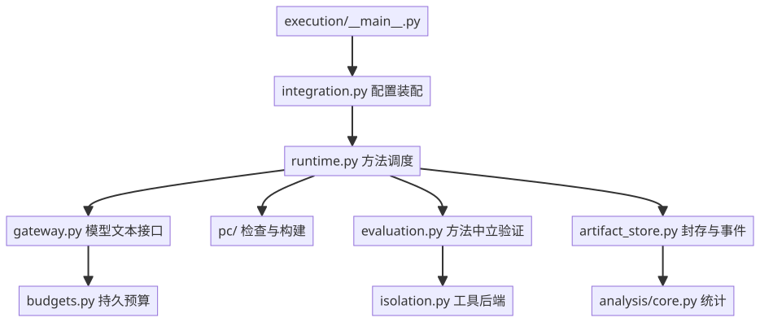
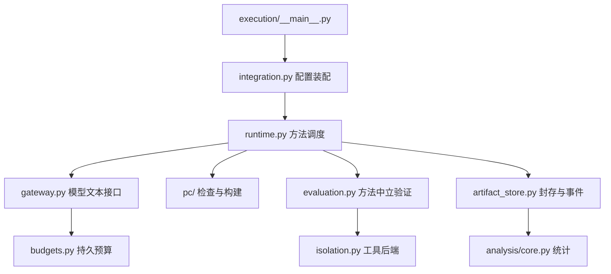

# 02 架构、目录与源码导航

_把一次运行看到的 JSON、RTL、日志和判定映射到具体模块。_

## 🗂️ 仓库按职责分开

| 目录 | 责任 | 推荐入口 | 边界 |
| --- | --- | --- | --- |
| `agent/` | 生成、契约、构建、工具验证、修复、记录和分析 | [README](../../agent/README.md) | 当前主线与 legacy 共存 |
| `contracts/` | 版本化文件格式与注册表 | [manifest.json](../../contracts/manifest.json) | 格式有效不代表功能正确 |
| `training/` | 数据转换、SFT/LoRA、合并和服务 | [README](../../training/README.md) | 不 import Agent；不在 Paper-1 方法中训练模型 |
| `datasets/` | 已发布且版本化的数据 | [manifest.json](../../datasets/manifest.json) | 普通运行不能直接改发布数据 |
| `artifacts/` | 本地运行、候选、日志和诊断 | [README](../../artifacts/README.md) | 默认 Git 忽略，不等于官方证据 |
| `reports/` | 策展后的证据和审计 | [README](../../reports/README.md) | 保留每次结果原有版本与适用范围 |
| `docs/` | 规范、迁移与学习文档 | [索引](../README.md) | 本手册解释实现，不重新定义指标 |
| `app/` | 本地确定性演示 | [README](../../app/README.md) | 不是 PC2.1 六方法实验前端 |
| `references/`, `outputs/` | 参考材料与演示交付物 | [参考索引](../../references/README.md) | 不能用展示材料替代执行证据 |
| `compatibility_tests/` | 跨目录协议与文档兼容性检查 | [文档路径检查](../../compatibility_tests/test_active_documentation_paths.py) | 不验证硬件算术 |

Agent 与 Training 通过注册文件交换数据。`app/` 当前直接复用 Agent 的历史组件，是明确的演示表面；不能据此让 Training 跨项目依赖 Agent。

## 🧭 当前主线的最短阅读路径



<details>
<summary>查看与编辑 Mermaid 源码</summary>



</details>

---

实际调用不只一条直线：构建和评估的工具调用都进入预算钩子；终态评估必须等整个批次的模型生成关闭。图表示职责关系，详细时序见 [04 执行器](04-runtime-methods.md)。

| 想理解的问题 | 源文件与符号 | 读到哪里即可 |
| --- | --- | --- |
| 命令怎样进入系统 | [execution/__main__.py](../../agent/src/sr2fpga_agent/execution/__main__.py)、[integration.py](../../agent/src/sr2fpga_agent/execution/integration.py) 的 `preflight`、`run_development` | 参数、transport选择、生成后才加载终态 suite |
| 公开数据怎样固定 | [pc/context.py](../../agent/src/sr2fpga_agent/pc/context.py) 的 `load_public_task`、`check_task_design` | 公开资产根目录、schema、哈希、投影一致性 |
| 一次方法怎样执行 | [execution/runtime.py](../../agent/src/sr2fpga_agent/execution/runtime.py) 的 `PairedBlockRuntime` | 共享节点、初始阶段、M1/M5 修复、终态 |
| 模型怎样被限制 | [gateway.py](../../agent/src/sr2fpga_agent/execution/gateway.py)、[proposals.py](../../agent/src/sr2fpga_agent/execution/proposals.py) | 公开 JSON、文本响应、文件白名单与父候选绑定 |
| PC 怎样变成 RTL | [pc/checker.py](../../agent/src/sr2fpga_agent/pc/checker.py)、[pc/emitter.py](../../agent/src/sr2fpga_agent/pc/emitter.py) | `check_design` → `build_structure` → `compose_behavior` |
| 结果由谁决定 | [evaluation.py](../../agent/src/sr2fpga_agent/execution/evaluation.py) 的 `Pc21Evaluator` | 候选解析、ABI、独立测试、通用综合 |
| 数据如何避免覆盖 | [artifact_store.py](../../agent/src/sr2fpga_agent/artifact_store.py) 的 `ArtifactStore` | `put_blob`、`read_verified`、seal、事件 |
| 方法优势如何计算 | [analysis/core.py](../../agent/src/sr2fpga_agent/analysis/core.py) | planned slots、层级均值、bootstrap、Holm |

当前源码路径与 [目标架构规范](../specs/2026-09-15-sr2fpga-paper1-code-architecture-development-spec-v2.1.zh.md) 的模块名并不一一相同。目标图不是仓库树；有关差异必须标作 `implementation_protocol_drift` 并按 [迁移记录](../migrations/research-plan-alignment.md) 解释。

## 📄 贯穿一次运行的文件契约

| 对象 | 格式 / 注册位置 | 生产者 → 消费者 | 核心约束 |
| --- | --- | --- | --- |
| 公共需求 | [development-public-context-v2](../../contracts/episode-pack/development-public-context-v2.schema.json) | 任务准备 → 模型投影/PC checker | 固定外部边界、facts、原始资产 |
| 公开目标/能力 | [PC2.1 contracts](../../contracts/pc/2.1/) | 操作者 → checker/工具层 | 能力范围与资源上限不是模型自己决定 |
| 设计提案 | [design-proposal-2.1](../../contracts/pc/2.1/design-proposal-2.1.schema.json) | 模型 → PC 输入层 | 模型只提供 design，不提供控制器 binding |
| 完整 PC | [project-contract-2.1](../../contracts/pc/2.1/project-contract-2.1.schema.json) | 控制器 → checker/builder | 绑定原始 requirements/target/capability 字节 |
| 行为体包 | [behavior-bundle-v1](../../contracts/pc/2.1/behavior-bundle-v1.schema.json) | 模型 → compose | 绑定 build SHA，完整提供所需 unit |
| 自由工程提案 | [project-proposal-v1](../../contracts/execution/pc21-project-proposal-v1.schema.json) | M0/M1/M2/M3 → admission | 文件白名单、FPP 清单、唯一完整工程 |
| 修复提案 | [repair-proposal-v1](../../contracts/execution/pc21-repair-proposal-v1.schema.json) | M1/M5 → 事务接纳 | 修复类型、父候选/构建版本必须匹配 |
| 公共反馈 | [public-feedback-v2](../../contracts/execution/pc21-public-feedback-v2.schema.json) | 公共 evaluator → 下次生成 | 白名单分类与有限提示；审查例外见第09章 |
| 开发配置/结果 | [execution contracts](../../contracts/execution/) | 操作者/控制器 → CLI/读者 | 版本、身份、显式预算、资格状态 |
| 分析输入 | `pc21-analysis-manifest-v1`、`pc21-analysis-results-v1`、`pc21-analysis-policy-v1` | 计划/结果导出 → analyzer | 先有计划槽位，后拼结果；策略显式输入 |

不要用 schema 的文件名猜 version。格式注册由 [ContractRegistry](../../agent/src/sr2fpga_agent/contract_registry.py) 和 manifest 解析。PC2.1 reader 会拒绝旧 PC/System-HIS；历史 reader 继续为原有产物服务。

## 💾 怎样查看运行产物

六方法回放的顶层结构由 [run_development](../../agent/src/sr2fpga_agent/execution/integration.py#L133) 创建：

```text
<runtime>/
  run.json                     # 可先读的运行报告
  control/
    run-store/                 # 配置、输入/回放/源码绑定、结果引用
    b0/                        # 第一个paired block的控制记录与不可变产物
  private/
    b0/                        # 评估器工作目录、原始工具记录
    authority/                 # 终态与私有判定权限记录
    terminal-analysis.json     # 封存后的终态结果
  analysis/                    # 有终态时导出的注册分析视图
```

按顺序检查：`run.json` → 各方法 `public_accepted` 与 terminal candidate → 对应公共/终态工具记录 → 分析输入。`terminal_evaluation: completed` 说明流程已关闭，不说明六个方法都成功。

`ArtifactStore` 以内容 SHA256 储存 blob，再以不可变逻辑 key 引用。相同 key 再写不同内容会冲突；读取会复核大小与哈希。它检测哈希绑定不一致，并拒绝经 API 覆盖已绑定逻辑 key，**不自动建立操作系统访问隔离**。不同目录也不等于互相不可读。

## 🔒 三种权限主体

| 主体 | 可以看到 | 可以修改/决定 |
| --- | --- | --- |
| 候选模型 | 允许公开的任务、资产、schema、自己的候选和批准反馈 | 白名单内的候选文件、设计或行为体 |
| 控制器 | 配置、预算、公开任务、候选、构建记录 | 选择阶段、校验绑定、记账、冻结候选 |
| 可信评估器 | 必需候选与自身测试/数学参考 | 编译、运行测试、计算结果；不接受候选修改 oracle |

开发者能阅读整个仓库，不代表候选能获得这些权限。`ModelGateway` 的 text-only transport 和受控工具 worker 是实际约束的一部分；给一个共享工作区的 coding agent 完整工具权限不能替代它们。

## 📖 阅读旧代码时怎么定位

`cli.py`、`runner.py`、`generator.py`、`project_generator.py`、`generation/`、`system_his_v12_checker.py`、`repair.py` 等保留了大量历史生成/评估逻辑。当前执行器会复用其中通用模型、存储、provider 等能力，但不能据文件数量判断哪条链路是当前方法主线。先看入口的实际 imports 和拒绝守卫，再看 [07 外围与历史链路](07-legacy-training-demo.md)。
