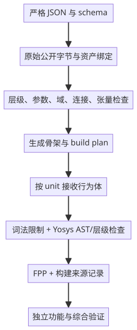
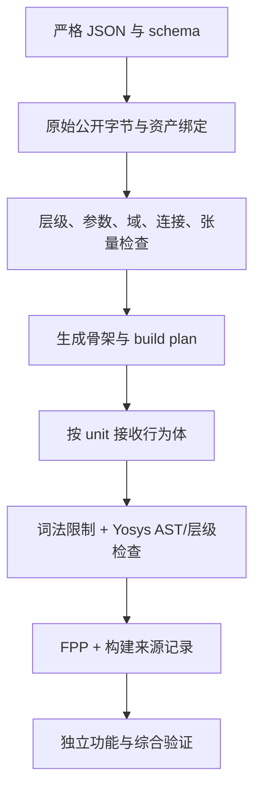

# 03 PC 2.1 如何把设计变成工程

_核心思想：把可机械检查的结构交给契约和构建器，把真正的计算行为留给 RTL 与独立执行验证。_

## 💡 为什么要有 PC

多文件 RTL 常见的问题不只有算法写错，还包括模块不存在、参数漏传、位宽不一致、张量排列相反、reset 域不匹配、背压线接反。若全部交给模型自由写文件，这些问题直到编译或仿真时才暴露。

PC 将**外部要求、内部设计和实现代码**分开。要求指定外部接口和公开数学事实；模型声明内部模块与连接；静态 checker 在生成行为代码前检查声明；构建器把通过检查的结构确定性地变成文件。模型仍须实现 MAC、cache、LUT 查询和控制状态机。

研究方案区分结构一致性、声明语义一致性、实际行为正确性。前两项能被 PC 部分检查，第三项必须执行独立测试。权威语义见 [PC2.1 设计](../specs/PC-2.1-AI-stream-contract-design.zh.md)和 [研究方案 §3–5](../specs/2026-09-15-sr2fpga-paper1-research-plan-v2.2.zh.md)。

## 📥 两类输入不要混淆

模型设计提案是 `design` 本身，不是带版本和 binding 的完整 PC。最小结构示例来自 [输入 smoke fixture](../../agent/tests/fixtures/pc21_input_smoke/design.json)：

```json
{
  "entry": "Top",
  "modules": {
    "Top": {
      "signature": {"source": "requirement_boundary"},
      "implementation": {"kind": "structural", "instances": {}, "nets": {}}
    }
  },
  "requirement_map": []
}
```

这个例子仅说明设计提案的根结构，**不是可执行的 LLM 算子实现**。顶层签名来自公开 requirement boundary；内部模块声明自己的签名。控制器再将提案、格式版本与三类公开源的 ID/SHA256 组装成完整 PC。

原始字节 binding 有一个容易忽略的后果：只改 JSON 空格，也会改变源文件哈希。这是有意的来源绑定，不应该通过修改旧 manifest 绕过。见 [inputs.py](../../agent/src/sr2fpga_agent/pc/inputs.py) 与 [原始字节变更测试](../../agent/tests/test_sr2fpga_pc21_inputs.py#L447)。

## 🔍 五个命令分别做什么

| 命令 | 输入 | 输出/作用 | 能否证明硬件正确 |
| --- | --- | --- | --- |
| `assemble` | design + 三类原始源 | 控制器绑定的 PC；基础层级检查 | 不能 |
| `check` | 完整 PC + 同样原始源 | schema、binding、基础结构复核 | 不能 |
| `validate` | 完整 PC + 类型化公开 context + 资产 | 配置级静态语义报告 | 不能 |
| `build` | 同上 | 确定性结构和待填 behavior unit | 尚无完整行为 |
| `compose` | 同上 + 完整 behavior bundle | parser 检查后的 FPP | 仍须独立仿真与后续工具验证 |

`assemble/check` 允许其输入阶段的 opaque source bytes，不应解释为完成所有任务语义。`validate/build/compose` 使用 `development-public-context-v2`、development target/capability 的真实类型并校验公开资产。入口：[pc/__main__.py](../../agent/src/sr2fpga_agent/pc/__main__.py)，类型化加载：[context.py](../../agent/src/sr2fpga_agent/pc/context.py#L37)。

## 🧱 静态检查的实际内容



<details>
<summary>查看与编辑 Mermaid 源码</summary>



</details>

---

| 检查层 | 能拒绝的典型错误 | 核心文件 |
| --- | --- | --- |
| 输入与来源 | 重复 JSON key、浮点/非有限数、无效 Unicode、过大/过深 JSON、候选自己填 binding、旧格式 | [inputs.py](../../agent/src/sr2fpga_agent/pc/inputs.py) |
| 模块层级 | entry 不存在、未知实例、递归实例化、不可达模块、参数未完整绑定 | [inputs.py](../../agent/src/sr2fpga_agent/pc/inputs.py)、[checker.py](../../agent/src/sr2fpga_agent/pc/checker.py) |
| 参数与类型 | 有界表达式非法、越界、packed 类型不一致 | [expressions.py](../../agent/src/sr2fpga_agent/pc/expressions.py)、[semantics.py](../../agent/src/sr2fpga_agent/pc/semantics.py) |
| 时钟复位与连线 | 未声明域、reset 不兼容、方向错误、多驱动、非法 stream fanout | [checker.py](../../agent/src/sr2fpga_agent/pc/checker.py) |
| 张量和量化 | shape/order/lane/tail 不一致、per-axis 元数据问题、dense/partial-sum 关系不满足 | [tensors.py](../../agent/src/sr2fpga_agent/pc/tensors.py) |
| 公开义务 | fact 引用和角色不一致、缺少必要 trace coverage、资产字节不匹配 | [context.py](../../agent/src/sr2fpga_agent/pc/context.py)、[checker.py](../../agent/src/sr2fpga_agent/pc/checker.py) |

`requirement_map` 检查的是引用与覆盖关系，不是“代码逻辑蕴含需求”的形式化证明。`compute` 声明也不证明任意算法。checker 保留 `verification_obligations`，把真正需要执行的数值、交易、reset、活性和时序问题交给后续阶段。

## 🔌 从逻辑 stream 到物理端口

PC 的 tensor stream 既包含元素类型，还包含 shape、轴顺序、lane 数与 tail 规则。`abi.py` 负责物理映射；ready 信号沿数据流反向传播；构建器不能随意改变公开端口名或位宽。

当前三例使用两个 int8 lane，加两个 mask bit：

```text
位索引   17     16      15 ........ 8     7 ......... 0
含义    mask1  mask0       lane1             lane0
长度3的一行： [a,b] mask=11 → [c,0] mask=01
```

因此同一总元素数不代表同一传输序列。`[head=4, dim=3]` 每个 head 单独补尾，共 8 拍；把 12 元素整体连续打包成 6 拍会违反公开 ABI。细节和手算例见 [05 LLM 案例](05-llm-cases.md)。

## ⚙️ 构建器究竟生成什么

[build_structure](../../agent/src/sr2fpga_agent/pc/emitter.py#L136) 根据检查结果进行参数特化、稳定命名、端口声明、实例和连线生成，并计算 `build_plan_sha256`。行为模块对应独立 unit，其接口和依赖由构建计划决定。

[compose_behavior](../../agent/src/sr2fpga_agent/pc/emitter.py#L425) 要求：

1. bundle 绑定当前 build SHA，全部 unit 恰好提供一次。
2. 模型只提供模块内部 body；模块声明和结束由构建器补齐。
3. 词法检查拒绝不允许的外部访问、宏等语言结构。
4. 真实 Yosys AST 检查签名、实例、输入写入、层级访问等问题。
5. 完整工程还要进行层级展开检查，然后才能写出 FPP。

`construction-origin-map.json` 区分确定性构建与模型/人工行为来源。它解释某段结构由谁产生，不能代替正确性证据。失败的 parser 源码和日志也被保存。

## 🛠️ 修改 PC 时应改哪里

| 修改目标 | 修改面 | 必需验证 |
| --- | --- | --- |
| 新增声明语义 | schema + checker + 相关规范/迁移记录 | 合法例与针对边界的拒绝例 |
| 改物理 packing | ABI + emitter + 公开边界契约 | 位级 golden、方向、mask 和真实接口检查 |
| 改结构生成 | emitter | 相同输入稳定产物、来源映射、真实 parser/展开 |
| 新增算子 | `tasks/<family>/` | 公开任务、独立 oracle、参考实现与交易 harness |
| 改算法行为 | 候选/参考 behavior | 数学 golden、仿真、背压与 reset，不把算法塞入通用 emitter |

PC 不应按 family ID 偷偷补上正确算法。模型能力与确定性构建作用必须可分辨；这正是 M3/M4 共享 PC 对比的原因。
