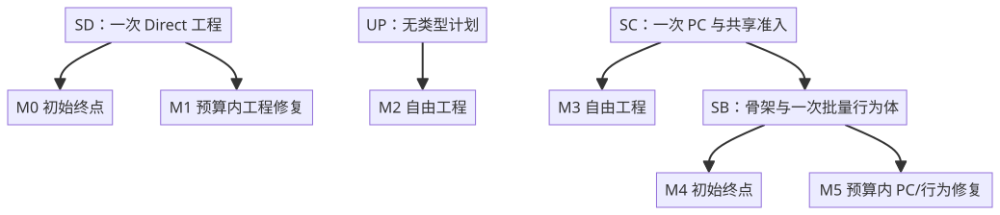
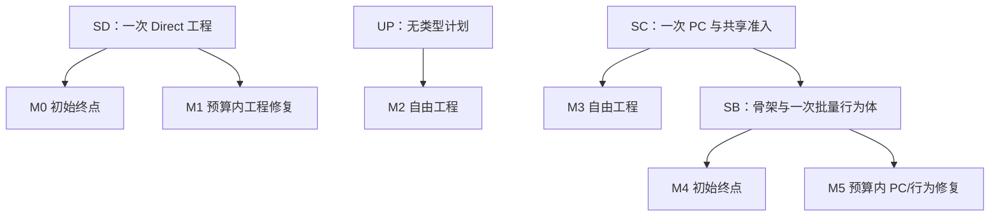
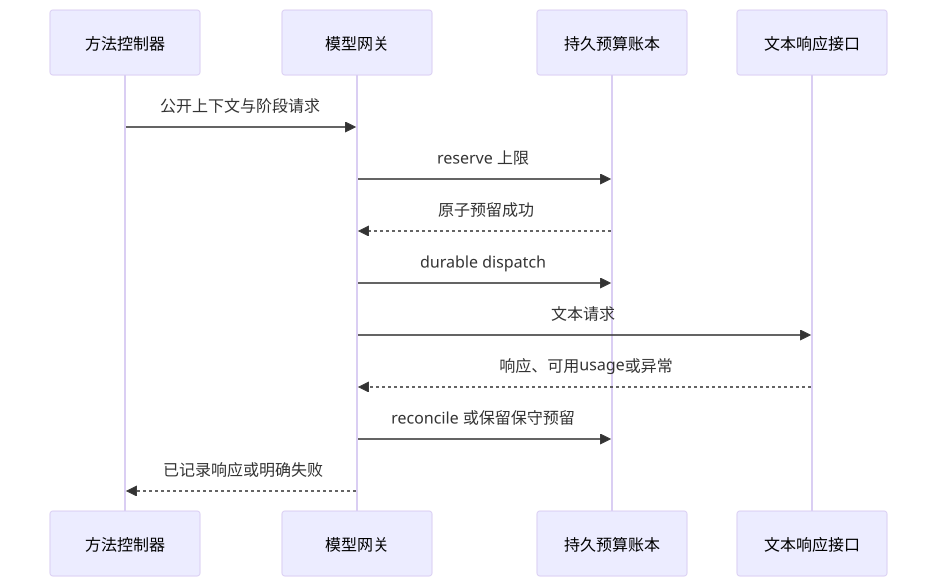
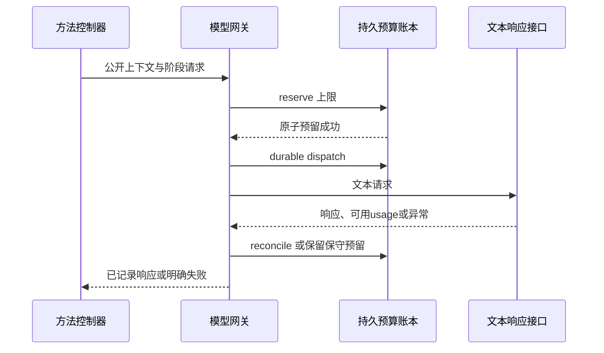

# 04 六种方法、预算与修复机制

_从“模型如何写一次代码”到“怎样公平比较完整生成过程”。_

## 🎯 M0–M5 分别控制什么

方法定义来自 [v2.2 基础方案 §9.2](../specs/2026-09-15-sr2fpga-paper1-research-plan-v2.2.zh.md)；当前案例由 v2.3 修订替换。执行实现主要在 [PairedBlockRuntime](../../agent/src/sr2fpga_agent/execution/runtime.py#L87)。可直接搜索规范中的 `M0` 定位方法表。

| 条件 | 初始生成过程 | 是否用确定性骨架 | 允许修复 | 分析终点 |
| --- | --- | --- | --- | --- |
| M0 Direct | 需求 → 完整工程 | 否 | 无 | `initial` |
| M1 Direct-Repair | 与 M0 共享同一初始工程或失败 | 否 | 完整工程/文件事务 | `B4` |
| M2 Structured-Direct | 无类型计划 → 完整工程 | 否 | 无 | `initial` |
| M3 PC-Free | 共享 PC 与准入 → 自由完整工程 | 否 | 无 | `initial` |
| M4 PC-Skeleton | 共享 PC → 骨架 → 批量行为体 | 是 | 无 | `initial` |
| M5 PC-Online | 与 M4 共享初始构建/行为体或失败 | 是 | design 或行为单元 | `B4` |

M2 的计划是纯文本；M3/M4 的 PC 是类型化可检查设计。M3 仍自行输出完整工程，不能把 M4 构建器生成的文件塞给它。M1/M5 只有在允许的公共反馈和剩余预算范围内修复。

两项主要比较有不同解释：

- **M5−M1@B4**：在匹配总预算下比较整套表示、生成、构建、诊断及编辑策略的系统价值。
- **M4−M3@initial**：在共享生成 PC 的条件下比较确定性构建与相应编辑边界的联合效果。

后者不是只改变“是否多一段骨架文本”，前者也不是单独测“修复算法更聪明”。

## 🔗 共享初始 DAG

查看与编辑 Mermaid 源码

---

控制器在依赖允许的顺序中用 schedule seed 平衡初始安排。共享**成功和失败 checkpoint**；不能让某个条件在共享失败后免费再抽样。M3 的 PC 准入完成后独立分支，不以 M4 emitter 成功为前提。M1/M5 的后续修复不倒灌给 M0/M4。

源码入口：[generate](../../agent/src/sr2fpga_agent/execution/runtime.py#L507)，相关测试：[runtime_methods](../../agent/tests/test_sr2fpga_pc21_runtime_methods.py)。

## 💰 B4 是总调用预算

| 方法 | 初始逻辑调用上限 | 总逻辑调用上限 | 完整公共检查周期上限 |
| --- | ---: | ---: | ---: |
| M0 | 1 | 1 | 1 |
| M1 | 1 | 4 | 4 |
| M2 | 2 | 2 | 1 |
| M3 | 2 | 2 | 1 |
| M4 | 2 | 2 | 1 |
| M5 | 2 | 4 | 4 |

一次“批量提供全部行为体”是一次逻辑调用。M1 常见分配是 `1+3`，M5 是 `2+2`；因此按相同修复次数比较会破坏总调用公平性。非法 JSON、空响应、重复提案同样消耗调用。

在全部初始节点实际执行的正常路径中，实际共享执行 6 次，按六方法分别归属为 10 次；耗尽 B4 的逻辑上界为实际 11 次、独立归属 15 次。早期失败可使实际使用更少。这些数不是自然模型 HTTP 请求数，也不是 benchmark 样本数。

调用次数之外，运行配置还必须明确输入/输出/context token、单次输出、工具调用、active time、EDA time、CPU、内存等轴。fixture 中的大上限是开发测试分配，不是已冻结的科学预算。见 [budgets.py](../../agent/src/sr2fpga_agent/execution/budgets.py) 和 [runtime config schema](../../contracts/execution/pc21-runtime-config-v1.schema.json)。

## 🧾 先预留，再派发，再结算

查看与编辑 Mermaid 源码

---

`BudgetLedger` 使用线程锁和 OS 进程锁保护预算检查与写入。重开目录不重置额度；远端是否已接收请求不确定时，不自动重发。共享操作的实际视图只记一次，每个消费者的 standalone 视图都承担完整费用。

`observed` 表示实测消耗；`used` 可以包含尚未结算的保守预留。服务未提供 token usage 时不是“用了零 token”。容量上界 transport 的 `tokenizer_id="unavailable"` 也不能解释为准确计数。代码：[gateway.py](../../agent/src/sr2fpga_agent/execution/gateway.py)、[BudgetLedger](../../agent/src/sr2fpga_agent/execution/budgets.py#L284)。

## 🔧 两类修复事务

**M1** 可以替换整个工程，或对模型拥有的 RTL 和 manifest 执行 replace/add/remove。文件补丁绑定准确的父候选 SHA；所有改动通过统一准入后一起形成新候选。候选只可提交 `manifest.json`、`rtl/*.v|sv` 和可选 `README.md`，不允许提供构建脚本或可信 testbench。

**M5** 可以替换 design，或替换当前 build plan 中已知的行为单元。修改 design 会使原先所有行为体失效；新的行为体需要另一次收费调用。不能在新结构下悄悄复用旧 body，也不能把补行为当成免费的修复子步骤。

无效、空或重复提案没有形成有效 repair transition，但仍消耗调用。后续分支没有形成完整工程时保留之前的完整候选；有一个通过公开检查的候选即按既定停止规则终止。预算用尽时保留最后完整候选，或形成带理由的 terminal-null。源码：[proposals.py](../../agent/src/sr2fpga_agent/execution/proposals.py)、[_repair](../../agent/src/sr2fpga_agent/execution/runtime.py#L402)。

## 🔒 反馈与隔离

正常 evaluator 反馈使用 `pc21-public-feedback-v2`：固定阶段 verdict、诊断类别、有限提示；候选源码解析错误可提供白名单内候选相对文件与合法行号。功能反馈只提供允许的类别和公开 stream，不带测试向量、期望/实际值、cycle 或 seed。

本次审查发现**构建阶段的异常诊断尚未全部走这条投影**，见 [R1 复现报告](09-deep-review.md)。因此应理解为有明确投影实现，但不能宣称所有错误路径都已覆盖。

| 后端 | 已实现的控制 | 当前可作何种声明 |
| --- | --- | --- |
| `LocalDevelopmentBackend` | 最小环境、固定工具调用、开发日志 | `isolation_qualified=false`；无硬 CPU/内存 confinement |
| `DockerBackend` | 本地 Linux engine、digest 固定的已有镜像、无网络、非 root、只读根、资源限制、独立 work mount | 必须真实执行资格测试；配置存在不等于已验证 |

网关向模型只传递分离并序列化的公开值。共享工作区的 coding agent 不是合格候选 transport。实现位置：[isolation.py](../../agent/src/sr2fpga_agent/execution/isolation.py)、[public_feedback.py](../../agent/src/sr2fpga_agent/execution/public_feedback.py)。

## 🏁 终态屏障保证什么

整个批次的所有方法先停止生成，再导入终态 suite factory；随后 `finalize_batch` 封存全部候选或 terminal-null，关闭屏障，再执行私有评测。该函数不接收模型网关。私有结果无法触发新修复或改变候选选择。

槽位身份不含候选 hash，换个候选不能获得第二次评分。重复调用读取已经验证的 receipt；未知派发不自动重放。只有明确界定的基础设施重试可以在相同冻结上下文中进行。已知公开失败可以直接关闭私有槽位并保留分母，不需要重复运行已知不合格候选。

终态工具有单独预算，不能增加模型机会。分析导出会重读候选 seal、最终公开记录和私有 commitment，不接受调用者随手填写的汇总分数。见 [finalize_batch](../../agent/src/sr2fpga_agent/execution/runtime.py#L580)、[export_analysis_views](../../agent/src/sr2fpga_agent/execution/integration.py#L215)。
