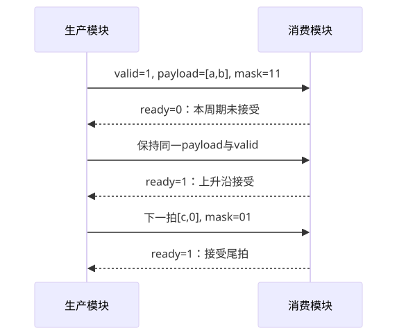
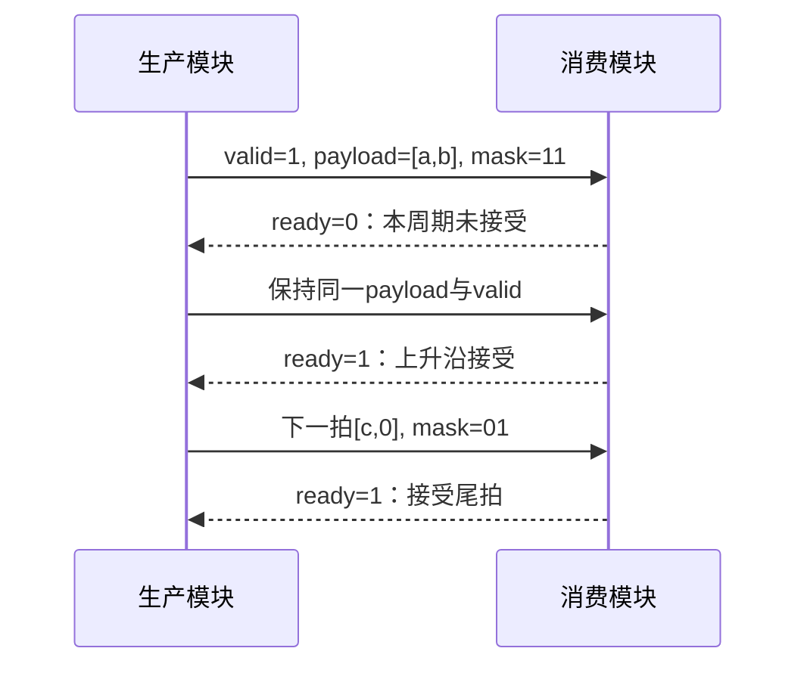
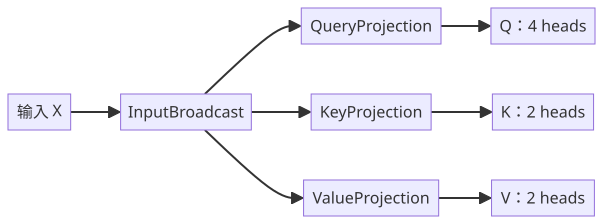
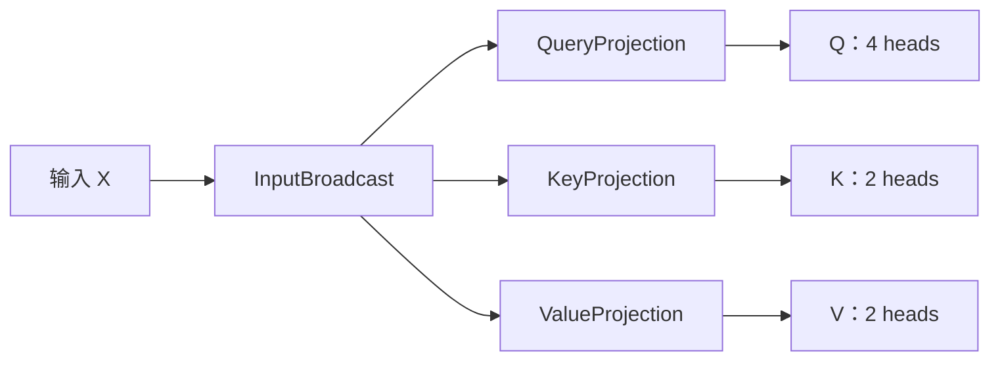
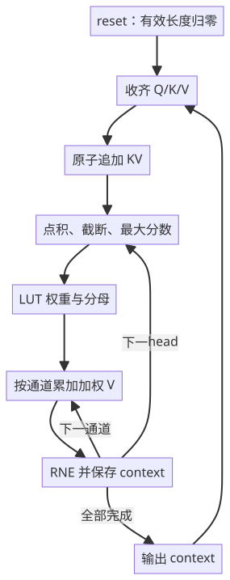
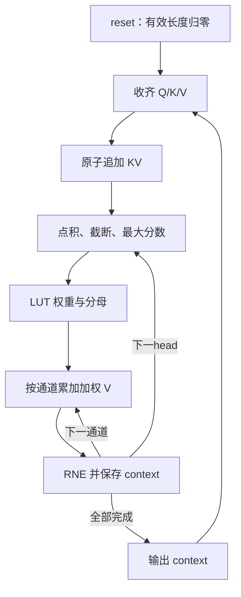
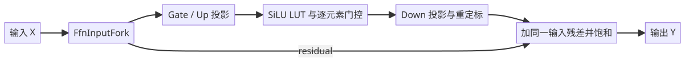
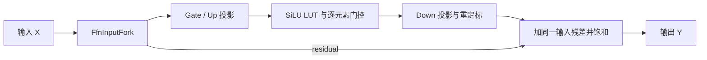

# 05 三个 LLM 子系统的具体算法

_本章公式描述仓库固定开发任务的精确整数语义，不把它们推广为真实模型 checkpoint。_

## 🧩 共同结构与验证角色

| 文件 | 回答的问题 | 是否属于模型可见任务输入 |
| --- | --- | --- |
| `task.py` | 实现什么：形状、接口、数值规则、公开权重/LUT、期限 | 通过投影输出的公开事实和资产可见 |
| `reference.py` | 人怎样实现一份开发对照 | 不作为候选答案输入 |
| `oracle.py` | 实际接受的输入应得到什么输出 | 评估方拥有 |
| `harness.py` | 怎样驱动输入、背压、reset，并核对逐拍行为 | 评估方拥有 |

三例均使用整数和有理数 oracle；RTL 是另一套状态机/定点实现，测试还有手算 golden、不同遍历方式和高精度查表核对。共享公开常量不意味着二者共享内部算法实现，但这也不能替代尚待完成的正式 oracle mutation qualification。

定义 `sat8(x)=min(127,max(-128,x))`；`RNE` 是带符号的最近偶数舍入，例如 `RNE(1/2)=0`、`RNE(3/2)=2`、`RNE(-3/2)=-2`。不能用 Python 向零截断或只加半再右移替代所有带符号 ties 情况。

## 🔌 先理解逐拍传输

三个案例使用两 lane int8 的 ready/valid stream。上升沿 `valid && ready` 才接受一拍；`valid && !ready` 时保持 valid 和完整 payload。payload 为 18 bit：低 8 bit 为 lane0，接着为 lane1，最高两位为 lane mask。

一行 `(-128,127,-1)` 的物理 golden 是 `0x37F80`、`0x100FF`。第二拍的无效 lane raw bits 必须为 0；这与某个量化格式的“实数零”未必相同。每个 head/feature 行独立补尾，不能把下一行的首值填进上一行尾部。

查看与编辑 Mermaid 源码

---

harness 检查的不只是最后打印一个 PASS：它按实际接受输入重建期望，检查 valid 提供的输出、被阻塞 payload 的稳定性、拍数、顺序、reset 取消和最后一拍完成期限。具体 deadline 及驱动限制由各 task 的公开环境事实给出；固定测试 schedule 不等于穷尽所有合法时序。

## ⚙️ QKV：一次输入的三路投影

公开配置为 `T=2, Din=5, Hq=4, Hkv=2, Dhead=3, lanes=2`。每个 token 的 Q 有 12 个元素，K/V 各 6 个；两 token 的 Q/K/V 分别输出 16/8/8 拍。

查看与编辑 Mermaid 源码

---

输入 scale 为 `1/4`、zero-point 为 `-2`；权重 scale 为 `1/2`、zero-point 为 `0`。每个分支 $b\in\{q,k,v\}$ 计算：

$$
A_b[o]=\mathrm{bias}_b[o]+\sum_{c=0}^{4}(x[c]+2)W_b[o,c],\qquad
y_b[o]=\operatorname{sat8}\left(\operatorname{RNE}(A_b[o]/d_b)+z_b\right).
$$

| 分支 | 除数 `d` | 输出零点 `z` | 输出 scale |
| --- | ---: | ---: | ---: |
| Q | 2 | 1 | 1/4 |
| K | 4 | -1 | 1/2 |
| V | 2 | 3 | 1/4 |

中心化累加器 scale 为 `1/8`，因此三个除数来自目标编码比例。输入全部 raw=-2 时，实数输入为零，但 bias 和输出零点仍存在；Q 前六项为 `(-1,1,3,1,3,-1)`，并非全零。

参考广播用一拍数据加三路接收状态确保每路恰好收到一次。投影 reference 支持缓存 1 或 2 个 token 的实现；默认 body 使用两 token。公开要求和监测器允许完整第一 token 接受后提前输出，不强迫候选采用同一缓存策略。

源码导航：[task.py](../../agent/src/sr2fpga_agent/tasks/llm_qkv/task.py#L70)、[oracle.evaluate_token](../../agent/src/sr2fpga_agent/tasks/llm_qkv/oracle.py#L11)、[参考广播/投影](../../agent/src/sr2fpga_agent/tasks/llm_qkv/reference.py#L34)、[harness](../../agent/src/sr2fpga_agent/tasks/llm_qkv/harness.py#L30)。回归：[QKV tests](../../agent/tests/test_sr2fpga_llm_qkv.py) 包含偏移/impulse golden、舍入饱和、head-local tail、token streaming、deadline 与真实 HDL。

## 💾 Attention：cache 状态与分组查询

配置为 `Hq=4, Hkv=2, D=3, capacity=4, lanes=2`。一次调用接收 Q 8 拍、K 4 拍、V 4 拍；三路可以不同步到达。收齐后才将本次 K/V 原子加入 cache，然后对包含当前 token 的全部有效 cache 计算 context，输出 8 拍。

第 $h$ 个 query head 使用 KV 组 $g(h)=\lfloor h/2\rfloor$。对于历史 token $t$：

$$
s_t=\operatorname{clip}_{[-8,8]}\left(\operatorname{RNE}\left(
\frac{37\sum_{d=0}^{2}Q[h,d]K[t,g(h),d]}{1024}\right)\right),
$$
$$
w_t=\mathrm{EXP\_LUT}[\max_t s_t-s_t],\qquad
c[h,d]=\operatorname{sat8}\left(\operatorname{RNE}\left(
\frac{\sum_t w_tV[t,g(h),d]}{\sum_t w_t}\right)\right).
$$

Q/K scale 为 `1/8`，V/context scale 为 `1/4`，零点均为 0。`37/64` 是公开规定的 `1/sqrt(3)` 近似，score 格点为 `1/4`，组合后 raw dot 系数就是 `37/1024`。

公开 EXP_LUT 为 `(256,199,155,121,94,73,57,44,35,27,21,16,13,10,8,6,5)`。减去最大分数后索引范围 0–16，至少一个权重为 256，分母不会为零。这里不先量化每个概率，而是最后对加权和统一做一次除法和 RNE。

查看与编辑 Mermaid 源码

---

图将内部 token 循环折叠为计算阶段；同一 head 的下一通道复用权重，下一 head 重新计算 scores/weights，详见 [reference.py](../../agent/src/sr2fpga_agent/tasks/llm_attention/reference.py)。所有状态都响应 reset。旧 cache memory 不必逐字清零，只要有效长度归零就不会参与计算。第四次调用完成后 cache 满，ready 保持低，下一次调用前必须 reset。

手算例：Q 全零时两个历史 token 权重相同。一个 KV 组的 V 从 `(10,-10,5)` 加入 `(20,6,-3)` 后，context 为 `(15,-2,1)`；两个映射到该组的 query heads 得到相同结果。这同时检验历史数据参与、GQA 映射和 RNE。

源码：[公开义务](../../agent/src/sr2fpga_agent/tasks/llm_attention/task.py#L42)、[持久 oracle](../../agent/src/sr2fpga_agent/tasks/llm_attention/oracle.py#L37)、[trace checker](../../agent/src/sr2fpga_agent/tasks/llm_attention/harness.py#L47)。[Attention tests](../../agent/tests/test_sr2fpga_llm_attention.py) 覆盖 cache/reset、分组差异、score clipping、尾拍期限与分母1024的正负极值。

## 🔀 Gated FFN：配对、查表与残差

配置为 `T=2, Din=5, Dff=7, lanes=2`。此任务是 `FFN(x)+x`；RMSNorm 不在边界内。activation 和 weight 的 scale 均为 `1/4`、zero-point 均为 0。

查看与编辑 Mermaid 源码

---

每个 token 计算：

$$
g_j=\operatorname{sat8}(\operatorname{RNE}((b^g_j+\sum_i x_iW^g_{ji})/4)),\quad
u_j=\operatorname{sat8}(\operatorname{RNE}((b^u_j+\sum_i x_iW^u_{ji})/4)),
$$
$$
a_j=\mathrm{SILU\_LUT}[g_j+128],\quad
z_j=\operatorname{sat8}(\operatorname{RNE}(a_ju_j/4)),
$$
$$
y_i=\operatorname{sat8}\left(\operatorname{RNE}((b^d_i+\sum_j z_jW^d_{ij})/4)+x_i\right).
$$

gate/up 各自先重定标和饱和，再使用 gate 查 256 项 LUT。down 分支在重定标后加残差，最后饱和，不能先把 down 饱和后再加残差。LUT 是任务精确常量；构造含义近似 `4*SiLU(code/4)`，oracle 运行时不计算浮点指数。

手算例：`x=0` 时门控乘积为零，但 down bias 得到 `(1,0,1,-1,0)`；输入 `(4,0,0,0,0)` 得到 `(5,0,1,-2,0)`。两 token 必须各自配对，不能错用前一 token 的 residual。

参考结构把后半段融合在 `FfnFuseDownResidual` 模块内，图中展开了其中数学阶段。参考实现先收两 token 再计算；公开语义允许 token 级流水与输入输出重叠。源码：[task.py](../../agent/src/sr2fpga_agent/tasks/llm_ffn/task.py#L65)、[oracle.py](../../agent/src/sr2fpga_agent/tasks/llm_ffn/oracle.py#L21)、[reference.py](../../agent/src/sr2fpga_agent/tasks/llm_ffn/reference.py#L35)、[harness.py](../../agent/src/sr2fpga_agent/tasks/llm_ffn/harness.py#L30)。[FFN tests](../../agent/tests/test_sr2fpga_llm_ffn.py) 以 Decimal 高精度核对全部 LUT，并覆盖舍入、残差、独立列式累加、tail、同一调用内输入输出重叠，以及跨调用提前输入的拒绝。

## 🚧 这些例子证明不了什么

三个 fixed profiles 的公共量化和调用边界不同：QKV 输出与 attention 输入的 scale/zero-point 不一致，QKV 两 token 调用与 attention 单步 cache append 也不同。直接连线不会构成正确 decoder，必须新增公开转换与整体调用契约。

任务 catalog 的三族均为 `implementation_status=partial`、`qualification_status=not_ready`；mutation、正式 split 和独立设计簇总体尚未完成。QKV 的 RoPE、FFN 的 RMSNorm、真实 checkpoint 兼容性和完整模型生成能力都不在这些固定控制的已验证范围。generic synthesis 不给出 LUT/BRAM 映射、布局布线、Fmax 或模型端到端吞吐。
