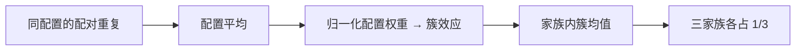

# 06 验证、结果状态与统计分析

_读懂“通过”的对象、阶段和分母，才能正确解释任何结果。_

## 🔬 从工程到结果的证据链

[Pc21Evaluator.evaluate](../../agent/src/sr2fpga_agent/execution/evaluation.py#L296) 对所有方法使用同一套外部接口和任务工具验证；PC 条件额外的 H 类检查不是 Direct 方法的共同准入门槛。

| 检查 | 当前主线的具体动作 | 结果不能外推到 |
| --- | --- | --- |
| PC 静态准入 | 严格 schema、binding、层级和配置级语义 | 任意行为正确、所有参数组合正确 |
| FPP/L0 | 白名单源码、规范 manifest、工程一致性、公开顶层/端口声明 | RTL 实际端口或功能正确 |
| L1 | 候选独立 Yosys frontend、层级展开、实际物理 ABI | 有限仿真和数值语义 |
| public L2 | 可信 TB 编译、vvp、独立数学及完整交易轨迹检查 | 未执行的终态 suite 或全部合法环境 |
| 当前 L3 | `Yosys synth -top ...; stat` 通用综合 | FPGA LUT/BRAM 映射、布局布线、Fmax |
| 终态独立检查 | 批次屏障关闭后，对同一封存候选进行一次评估 | 用终态结果再选择/修复候选 |
| L4 | 规范要求的指定目标物理研究，当前这条开发演示未完成 | 上板运行、通用 PPA 结论 |

编译可信 TB 前先对候选独立解析，可以避免候选依赖 TB 内部模块/符号才能通过。实际端口从 Yosys 输出读取，并和公开任务独立推导的 ABI 比较；不只相信模型写在 manifest 的位宽。每次工具调用前后还会检查候选文件未被更改。

## 🏁 VPP-L3 与开发通过的区别

规范的 VPP-L3 要求**同一个终止候选**在共同 FPP/外部接口、L0、指定 L1、public L2、一次独立 hidden L2、指定 L3 上通过，并满足相应来源、边界和预算条件。正式任务、suite、工具目标和预算资格必须成立。

当前回放使用手写 synthetic responses，本地后端隔离和资源计量未获资格，终态输入也是开发 synthetic suite。即使所有实际工具都通过，也不能把它记为正式 VPP-L3 成功率。参考入口的 `status=passed` 在没有加 `--synthesize` 时甚至允许综合阶段 `not_run`，必须逐字段阅读。

依据：[研究方案 §11](../specs/2026-09-15-sr2fpga-paper1-research-plan-v2.2.zh.md)、[终态归约](../../agent/src/sr2fpga_agent/execution/runtime.py)、[评估器](../../agent/src/sr2fpga_agent/execution/evaluation.py)。

## 🏷️ 状态不是一个布尔值

| 维度 | 常见值 | 解释 |
| --- | --- | --- |
| 阶段状态 | `pass/fail/not_run` | 该阶段做了什么；工具原始记录可能用 `passed/failed` |
| `semantic_status` | `pass/fail/null` | 是否得到可评分的语义结果 |
| `execution_status` | `completed/infrastructure_error/integrity_error` | 执行闭合、基础设施不可评分或完整性问题 |
| `budget_status` | `compliant/exceeded/unverifiable` | 预算合规、超额或无法验证 |
| `integrity_status` | `intact/violation/unverifiable` | 来源/边界完整性资格 |
| terminal-null | 带理由的无候选终态 | 仍保留计划槽位，不从分母移除 |
| `not_applicable` | 不适用 | 与设计失败、未知分开；不适用共同主终点会阻止主判定 |

正常设计失败记 0；基础设施不可评分保留 null。资格问题不应偷偷重写已观测语义值，而是限制可作出的比较。未知不是零，通过也不是已合规。`not_run` 是未运行；历史和当前子模块的字段枚举不同，导出时必须使用注册的 reducer，不能直接把字符串拼在一起算成功率。

## 📋 先计划槽位，再匹配观测

分析需要三个注册输入：

1. **Manifest**：提前计划每个 family/cluster/configuration/replicate/method/endpoint 槽位，绑定 task 和 suite。
2. **Results**：只填计划内槽位，重复 task/suite hash，成功值需要封存候选 hash；未出现的行保留为未知。
3. **Policy**：显式提供效应边界、计划效应、bootstrap 数与 seed、缺失门槛、簇数/分歧要求等。

代码在 [validate_dataset](../../agent/src/sr2fpga_agent/analysis/core.py#L187) 拒绝未计划行、重复身份、跨方法改 task bytes、把完全相同的任务 hash 重标成独立簇等情况。每个 paired block 要计划六方法；M0/M2/M3/M4 对应 `initial`，M1/M5 对应 `B4`。

analyzer 校验一致性，不替任意外部调用者证明输入“真实发生过”。应优先使用执行器从封存和评估原件重建的 [export_analysis_views](../../agent/src/sr2fpga_agent/execution/integration.py#L215)。完整联合分析需要三家族和足够独立簇，单一 QKV fixture 不能用来证明方法优势。

## 📊 为什么要按设计簇统计

同一个设计的不同配置、seed 或输入向量通常共享结构难点，不能当作新的独立需求。令对比 X−Y 的配对差为 $d_{fckr}=Y_X-Y_Y$，当前实现按以下层级计算：

$$
\widehat\Delta=\frac13\sum_{f=1}^{3}\frac1{C_f}\sum_{c=1}^{C_f}
\sum_k\widetilde w_{fck}\frac1{R_{fck}}\sum_r d_{fckr}.
$$

其中 $f$ 是家族、$c$ 是设计簇、$k$ 是配置、$r$ 是重复；配置权重在簇内归一化。


<details>
<summary>查看与编辑 Mermaid 源码</summary>



</details>

---

例如一个簇有十个配置、另一个只有一个配置，不能因此让前者在家族总结果中获得十倍权重。增加同簇重复主要改善簇内估计，不把独立样本数从一变成十。实现：[core.py 聚合与估计](../../agent/src/sr2fpga_agent/analysis/core.py#L441)。

## 🧮 Bootstrap、Holm 与缺失值

两项主比较使用同一批家族内设计簇 bootstrap 抽样，保留它们的协方差。每次抽一个簇时，簇里的配置、重复、六方法一起保留。bootstrap-t 使用中心化统计量 `(Delta* - Delta_hat)/SE*`，和针对显式边界 delta 的 `(Delta_hat-delta)/SE` 比较；有限次数的 p 值使用加一修正，不能返回假装精确的零。

两个单侧假设属于同一 Holm family，注册 CLI 策略固定 alpha=0.05。某一项 p 无法计算，也不能从 family 中删除。两侧 95% 区间是**边际区间**，不是同时多重比较调整区间。相关实现：[bootstrap](../../agent/src/sr2fpga_agent/analysis/core.py#L528)、[Holm](../../agent/src/sr2fpga_agent/analysis/core.py#L422)。

对 X−Y，主分析副本把未知 X 赋0、未知 Y赋1，给出保守差值；同时报告反向界限和完整簇敏感性分析。原始 null 保持不变，失败也不会被删掉。不能只拿“有结果的样本”作主分母。

簇太少、配对分歧稀疏、标准误为零或 bootstrap 退化过多时，返回 `degenerate` 和空 p/区间。跨多个 design cluster 的依赖组目前直接拒绝，尚未实现依赖组协调重采样。不同 bytes 也可能语义近复制，这需要源任务和义务审计，哈希不负责证明真正独立。

## 🛠️ 怎样运行分析

已有注册输入时，从仓库根目录运行，文件名替换为实际路径：

```powershell
$env:PYTHONPATH = (Resolve-Path agent/src).Path
python -B -m sr2fpga_agent.analysis validate --manifest MANIFEST.json --results RESULTS.json
python -B -m sr2fpga_agent.analysis analyze --manifest MANIFEST.json --results RESULTS.json --policy POLICY.json --output artifacts/analysis/fresh-report.json
```

输出必须为新文件。这里的占位名不是仓库自带数据；可运行的数值机制例子在 [test_sr2fpga_cluster_analysis.py](../../agent/tests/test_sr2fpga_cluster_analysis.py)，使用手算权重、已知 Holm 值和明确的 synthetic 数据。

`simulate` 只产生受控 Bernoulli 合成数据，可测试缺失、相关性和边界零假设。它不提供真实 LLM 的统计功效保证。当前报告始终保留 `official=false`、`claim_authorized=false`；数值拒绝不能替代研究设计和实验授权。
