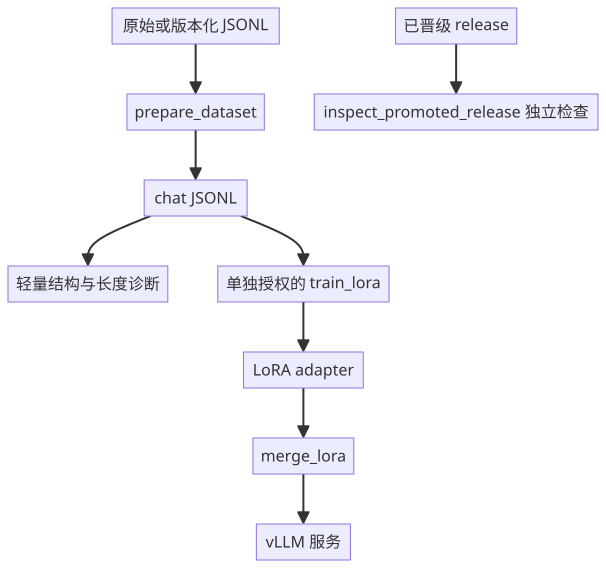
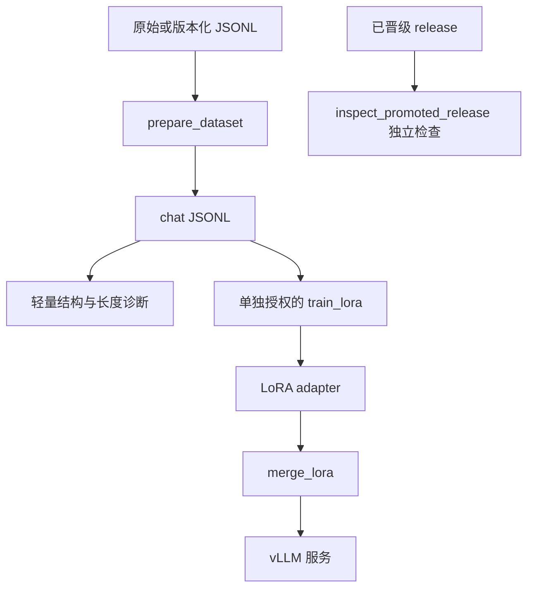

# 07 历史运行器、Training 与演示页面

_这些模块仍有使用价值，但入口、数据和验证范围与当前 PC2.1 主线不同。_

## 🧭 历史 Agent 入口

安装后的 `sr2fpga-agent` 指向 [cli:main](../../agent/src/sr2fpga_agent/cli.py)，`sr2fpga-runner` 指向 [runner:main](../../agent/src/sr2fpga_agent/runner.py)。它们是保留的 System-HIS/旧开发链。当前主线用 `python -m sr2fpga_agent.execution`。

旧 CLI 在 [cli.py:92](../../agent/src/sr2fpga_agent/cli.py#L92)，旧批次配置在 [runner.py:537](../../agent/src/sr2fpga_agent/runner.py#L537) 显式拒绝当前研究/PC 标记。这是防误用守卫；删除标记不能使旧运行自动成为 Paper-1 当前实验。

| 模块 | 实际责任 |
| --- | --- |
| [runner.py](../../agent/src/sr2fpga_agent/runner.py) | YAML 配置、预检、批次任务、续跑、预算与记录编排 |
| [agent.py / DataGenerationAgent](../../agent/src/sr2fpga_agent/agent.py#L127) | 单样本生成→检查→修复→终态选择 |
| [project_generator.py](../../agent/src/sr2fpga_agent/project_generator.py#L607) | 基于旧任务家族的确定性模板 |
| [generation/direct_project.py](../../agent/src/sr2fpga_agent/generation/direct_project.py) | 需求直接生成工程 |
| [generation/two_stage.py](../../agent/src/sr2fpga_agent/generation/two_stage.py) | REQ2HIS→契约检查→HIS2PROJECT |
| [generation/skeleton_fill.py](../../agent/src/sr2fpga_agent/generation/skeleton_fill.py) | oracle System-HIS + 模型生成，不等于当前模型生成 PC |
| [repair.py](../../agent/src/sr2fpga_agent/repair.py) | HIS 或工程修复及契约保持 |
| [public_evaluator.py](../../agent/src/sr2fpga_agent/public_evaluator.py) | 旧开发 L0–L3；缺 trusted harness 时保留 needs_oracle/not_run |
| [recorder.py](../../agent/src/sr2fpga_agent/recorder.py) | attempts、final、标签、轨迹、成本与训练派生视图 |

历史生成链是“配置→需求边界→生成器→适用 H 检查→共同 FPP/工具验证→预算内修复→封存→记录”。不要因为旧字段名字里有 H0–H3，就把旧格式的各阶段结果直接解释成 PC2.1 静态语义。

## 📂 历史产物结构与预检

```text
<sample>/
  requirement.txt
  platform_profile.json
  metadata.json
  attempts/attempt_000/
    generated_project/
    eval/<stage>.log, <stage>.json
    diagnosis.json, patch.diff, patch.json
  final/generated_project/
  eval/
    labels.json, measured_qor.json, tool_versions.json
    training_view_eligibility.json, trajectory.json
```

此结构来自 [DatasetRecorder](../../agent/src/sr2fpga_agent/recorder.py#L35)，不是新 runtime 的 `control/private/analysis` 目录。

```powershell
python -B -m sr2fpga_agent.runner --config agent/configs/current/sr2fpga_deterministic_curriculum_smoke.example.yaml --run-id legacy-guide-preview --preflight
```

这条旧 smoke 预检不生成样本。去掉 `--preflight` 会运行工具并写产物。对于配置了模型服务的 source，加 `--validate-provider` 会发最小服务认证请求；本例 deterministic source 不请求模型。当前 smoke 配置的 `max_samples=24` 是该配置的上限，不是新 LLM 总体。历史命令的成本和权限不能从 `smoke` 名称猜测。

## 📚 Training 数据准备

Training 是独立包，不 import Agent。基础依赖为 jsonschema、PyYAML；`[train]` 才引入训练框架，`[serve]` 才引入 vLLM。只做数据准备使用轻量环境即可。

```powershell
python -m pip install -e "training[dev]"
$env:PYTHONPATH = (Resolve-Path training/src).Path
$trainGuide = "artifacts/training/prepared-data/guide-" + (Get-Date -Format "yyyyMMdd-HHmmss")
python -B -m sr2fpga_training.prepare_dataset --input training/tests/fixtures/smoke_verilog_raw.jsonl --output "$trainGuide/chat.jsonl"
python -B -m sr2fpga_training.training_dry_run --input "$trainGuide/chat.jsonl" --max-seq-length 2048 --fail-on-truncation
```

当前 converter 可能覆盖已有目标，务必选新输出目录。上例用同一 smoke fixture 在本次验证中转换了 6 行；不是一次训练。

[prepare_dataset.convert_jsonl](../../training/src/sr2fpga_training/prepare_dataset.py#L30) 接受 chat messages、instruction/input/output、prompt/completion，以及历史 HIS/FPP/file/patch 等格式。先解析全部输入再写输出；canonical v2 在过滤前校验 schema/hash/row_id，不能靠过滤掩盖坏数据。

[release_reader](../../training/src/sr2fpga_training/release_reader.py) 将审计 envelope 与候选可见 payload 分开，校验 row hash、去重及泄漏规则。最终训练文本只渲染允许的 payload。单文件派生样本保留 source episode 与非独立评估身份，不能获得整工程通过信用。

`training_dry_run` 检查 messages 形状与粗略长度，用正则估算 token，**没有加载真实 tokenizer**。只有 `--fail-on-truncation` 才让估计超长导致非零退出；空文件当前仍报告 fits=true，见 [R2](09-deep-review.md)。

## 🧠 手动训练、合并与服务



<details>
<summary>查看与编辑 Mermaid 源码</summary>



</details>

---

LoRA 的基本形式是 $W_{eff}=W+(\alpha/r)BA$：保留基座权重，训练低秩增量。仓库 [train_lora.py](../../training/src/sr2fpga_training/train_lora.py) 从 YAML 读取模型、dataset、rank/alpha/dropout/target modules 与优化参数，使用 tokenizer 的 chat template，调用 PEFT 和 SFTTrainer。QLoRA 路径使用 NF4 4bit、bfloat16 compute、double quant，训练结束保存 adapter/tokenizer。

[merge_lora.py](../../training/src/sr2fpga_training/merge_lora.py) 加载基座和 adapter，`merge_and_unload` 后保存 safetensors。当前训练与合并加载器使用 `trust_remote_code=True`；实际执行需明确选择可信模型代码及资源，本文没有执行这些操作。

[release_bundle.inspect_promoted_release](../../training/src/sr2fpga_training/release_bundle.py#L73) 检查 promoted、training_authorized、授权 hash、inventory、sidecar、certificate、字节长度和哈希，但**没有接入 train_lora 的强制调用链**。不能把独立 inspector 宣传为已经实现的自动授权训练闭环。

服务脚本在 [training/scripts](../../training/scripts/README.md)，需要 Bash/Linux或相应 WSL/GPU 环境。它们默认使用独立 Training 环境，可通过脚本支持的变量指定模型与环境。Python 轻量安装成功不意味着 GPU 训练或服务已经可用。训练、merge、服务属于 Paper-1 之外的独立任务，本手册不自动触发它们。

## 🖥️ 本地演示页面

运行方式是标准库 HTTP 服务，不需要前端构建：

```powershell
python app/server.py
```

默认访问 `http://127.0.0.1:8000`。服务默认输出到 `artifacts/agent/ui-demo/`。它复用 legacy `DataGenerationAgent` 和确定性 `ProjectGenerator`，不是在线模型调用；生成操作仍可能运行本地工具。源码：[generate_demo](../../app/server.py#L450)。

| 接口 | 用途 |
| --- | --- |
| `GET /api/health` | 服务状态、确定性模式和任务数量 |
| `GET /api/tasks` | 支持的任务与模板工程上下文 |
| `POST /api/audit-requirement` | ready / needs_clarification / capability_gap |
| `POST /api/generate` | 审核后运行单个确定性样本，返回文件、阶段和产物位置 |

建议先使用 `/api/tasks` 提供的模板上下文，不自行假设某个接口受支持。输入与模板不符会要求澄清或报告 capability gap；这不是一次候选生成失败。

工程名、需求长度、width 和 POST 大小有验证；生成请求通过锁串行执行。页面展示来自记录的 `eval/labels.json` 和最终工程文件。UI 的动画或“完成”展示不能替代工具证据，更不能迁移为当前 LLM 任务的正式成绩。API 与资源路由详见 [server.py](../../app/server.py#L596)。
