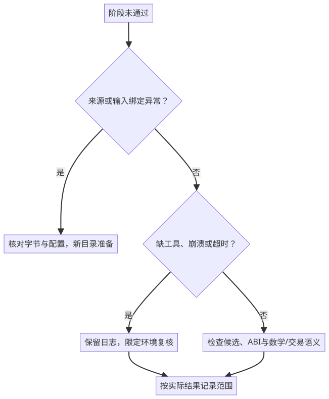
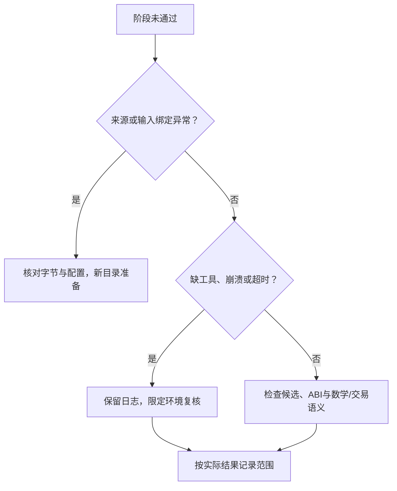

# 08 开发、扩展与排错

_从要改变的行为出发，找到最小修改面和能检验它的证据。_

## 🧭 开始修改前

先读 [WORKTREE.md](../../WORKTREE.md)，确认当前路线，再检查分支与既有修改：

```powershell
git branch --show-current
git rev-parse HEAD
git status --short
git diff --stat
git diff --cached --stat
```

本仓库的当前 PC2.1 实现有大量未提交文件，不能仅凭 HEAD 判断代码状态。保留原有暂存/未暂存内容，普通任务不需要 reset、clean 或 stash。实际运行会把有关源码字节写入既有 ArtifactStore；复现优先核对这些字节与配置。

## 🛠️ 按需求找修改点

| 你想做的事 | 主要修改面 | 必须保持的约定 |
| --- | --- | --- |
| 改生成提示 | `execution/gateway.py`、`prompt_guidance.py` | 同条件同公开事实，不能放入 oracle/hidden 内容 |
| 改方法/共享调度 | `execution/runtime.py` | 共享失败也共享，initial 不被 repair 回写 |
| 改修复能力 | `execution/proposals.py`、runtime | 事务原子、父 hash、候选文件白名单 |
| 改预算 | `execution/budgets.py`、gateway hooks | 先预留后派发；缺失usage保留；重开不重置 |
| 增强诊断 | `execution/public_feedback.py` 与异常调用点 | 固定公共类别/有限提示；原始日志仅供评估器 |
| 改 PC 语义/ABI | `pc/` + 对应 registered schemas | 破坏兼容时版本迁移，不能只放宽断言 |
| 新增任务 family | `tasks/`、catalog、契约、可信 suite | 实现与资格分开，数据发布与实验授权分开 |
| 改统计 | `analysis/core.py` + policy/schema/规范 | 保留 planned denominator、配对和独立簇 |
| 改 UI | `app/` | 读取实际后端结果，不在前端复制研究评分 |
| 改训练数据 | `training/`、训练视图契约 | Agent/Training 不跨项目 import，禁止隐藏信息进入payload |

涉及 trusted oracle、评分、split 或研究语义时，先明确变更范围、版本与受影响证据。普通 RTL 修复不包含修改 oracle 的授权。

## 🧩 怎样新增一个任务

1. 明确公开边界：输入输出、数值公式、shape/order/lane/tail、reset/state、完成期限与环境假设。
2. 在 `task.py` 输出公开事实、资产、target/capability；资产保留原始字节和哈希。
3. 独立编写整数 oracle，先用手算 golden/不同实现交叉检查。
4. 写一个明确标记的人工 reference，经 PC 构建器走完整路径，避免只验证手工独立 RTL。
5. 写 harness，覆盖数值、拍数顺序、mask、背压、reset 取消和最后一拍期限。
6. 注册开发入口、catalog 身份和契约，增加对应负例及边界测试。
7. 正式族资格另外完成：源任务独立性、mutation、split、簇设计、预算、工具和封存政策。

不能把“有 task.py”直接标记为 family qualified；也不能把参考拓扑变成候选的额外隐藏要求。当前 `Pc21Evaluator` 支持的是固定开发 case，不会因为换一份 public JSON 就自动得到新的 oracle 资格。

## 🧪 按修改风险选择测试

以下路径均相对仓库根。使用新的 `--basetemp=artifacts/...`，不要复用既有临时目录。

| 修改内容 | 优先测试文件 |
| --- | --- |
| PC 输入与版本 | `test_sr2fpga_pc21_inputs.py`、`test_sr2fpga_pc21_cli.py` |
| 类型化上下文/静态语义 | `test_sr2fpga_pc21_context.py`、`test_sr2fpga_pc21_semantic_checker.py` |
| 构建/行为保护 | `test_sr2fpga_pc21_emitter.py`、`test_sr2fpga_pc21_development_tools.py` |
| 六方法/修复/恢复 | `test_sr2fpga_pc21_runtime_methods.py` |
| 预算/模型网关 | `test_sr2fpga_pc21_runtime_budgets.py`、`test_sr2fpga_pc21_runtime_gateway.py` |
| 隔离/公共反馈 | `test_sr2fpga_pc21_runtime_isolation.py`、`test_sr2fpga_pc21_public_feedback.py` |
| 评估/终态/导出 | `test_sr2fpga_pc21_runtime_evaluation.py`、`test_sr2fpga_pc21_runtime_integration.py` |
| LLM 算法/流协议 | `test_sr2fpga_llm_qkv.py`、`test_sr2fpga_llm_attention.py`、`test_sr2fpga_llm_ffn.py`、`test_sr2fpga_llm_suite.py` |
| 统计 | `test_sr2fpga_cluster_analysis.py` |
| 数据转换与隔离 | `training/tests/`、`contracts/tests/test_project_dependency_boundaries.py` |
| 文档 | `compatibility_tests/test_active_documentation_paths.py`、`test_project_terminology.py` |
| UI | `app/test_server.py`，含路由和真实生成的测试需要对应运行环境 |

上述 `test_sr2fpga_*` 文件位于 [agent/tests](../../agent/tests/)。部分测试会运行真实 Yosys/Icarus，不能因为命名为 test 就把成本当作零。全仓库常用命令为：

```powershell
python -B -m pytest contracts/tests agent/tests training/tests compatibility_tests -q -p no:cacheprovider --basetemp=artifacts/regression/fresh-run
```

这条命令没有包含 `app/test_server.py`。本次没有运行全量回归或发现可据以声称“CI 自动通过”的流水线，实际执行列表见 [10 验证记录](10-validation.md)。

## 🔍 失败定位顺序



<details>
<summary>查看与编辑 Mermaid 源码</summary>



</details>

---

先读首个失败阶段与原始退出码，而不是后续连锁失败。工具崩溃、超时和普通编译拒绝含义不同；但当前某些崩溃分类仍有缺口，见审查报告。相同输入、相同工具和不同执行环境的对照可以帮助定位，不能用一次主机通过抹掉原失败记录。

若 repeated attempt 不再产生信息，应更换诊断方法。不要通过跳过 assertion、吞异常、增大未授权预算或修改隐藏 suite 来获得绿色结果。

## 📝 文档维护与复现习惯

手册链接到源码符号、注册契约与测试；行号是本次快照的导航辅助。更新时以源码和新运行证据为准：命令改变更新上手章，协议改变更新规范/迁移记录，真实缺陷修复后在审查报告中链接新的验证范围。不要重写历史运行的结果或把旧族证据迁移给新族。

每次报告至少说清：哪个源码状态、哪些输入、什么工具/配置、输出在哪里、哪些检查实际执行、失败与未运行如何处理。本地测试通过不等于研究假设成立，提交文档也不意味着实验已授权。
