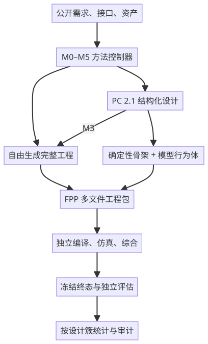
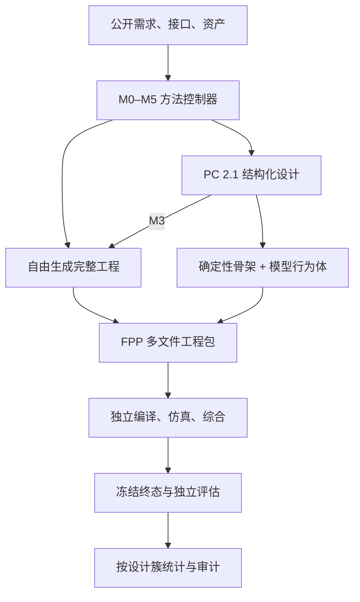

# SR2FPGA 代码手册与方法实现审查

_中文学习入口 · 路线 A · 2026-10-29 工作区快照_

SR2FPGA 研究的是：怎样把硬件需求交给大模型，生成接口一致、能够编译和验证的**多文件 FPGA 工程**。目前最值得从头学习的链路是 **PC 2.1 + 六方法开发执行器 + 三个固定 LLM 推理子系统**。

这套手册从操作、机制和源码三个角度解释当前仓库。它是代码的学习说明和审查记录；研究定义仍由 [v2.3 案例修订](../specs/2026-10-28-sr2fpga-paper1-llm-case-amendment-v2.3.zh.md)及 [v2.2 基础方案](../specs/2026-09-15-sr2fpga-paper1-research-plan-v2.2.zh.md)决定。

## 🧭 按目标选择阅读路线

| 你的目标 | 推荐顺序 | 阅读后的具体能力 |
| --- | --- | --- |
| 第一次接触，只想运行起来 | 本页 → [01 上手](01-quickstart.md) | 准备公开任务，运行零模型回放，找到实际结果 |
| 接手开发 | [02 架构](02-architecture.md) → [03 PC](03-project-contract.md) → [04 执行器](04-runtime-methods.md) → [08 开发](08-development.md) | 定位修改点，识别契约与评测边界，选择回归测试 |
| 理解论文方法 | [03 PC](03-project-contract.md) → [04 方法对照](04-runtime-methods.md) → [05 算子](05-llm-cases.md) → [06 评估与统计](06-evaluation-analysis.md) | 理解契约为什么有用、比较控制了什么、结果如何计算 |
| 维护旧实验、训练或演示 | [07 历史链路与外围](07-legacy-training-demo.md) | 使用正确入口，避免把旧格式或演示结果当成当前实验 |
| 判断实现是否可靠 | [09 深度审查](09-deep-review.md) → [10 本次验证](10-validation.md) | 区分已复现问题、已知限制、尚未执行的验证 |

建议先完成 QKV 示例，再回头阅读机制。第一次阅读无需通读历史研究材料、训练代码或几千行的旧 `runner.py`。

后续开发可查 [LLM 案例覆盖与下一增量](llm-case-coverage.zh.md)，逐项定位现有检测与待补强项。
PC 声明的三个命名空间、主关系覆盖和 FIFO 支持形式可先运行
[通用公开正反例](../../agent/tests/fixtures/pc21_public_rules/README.md)；这些例子不提供案例算法或参考行为。

## 🗺️ 一张图理解系统

查看与编辑 Mermaid 源码

---

图中模型负责提出设计或 RTL；控制器负责权限、预算、装配和记录；评估器负责测试和判定。三者的权限不同。固定开发示例可以用手写响应回放代替模型，从而验证整条工程链路。

## 📚 先掌握这十二个术语

| 术语 | 直观解释 | 对应代码或文件 |
| --- | --- | --- |
| RTL | 描述寄存器、组合逻辑和时钟行为的 Verilog/SystemVerilog 源码 | FPP 中的 `rtl/` |
| FPP | 一个可交付工程包：源码、顶层入口、清单及构建声明 | `project-package-v1` |
| PC | 一次具体设计的结构化工程契约，约束模块、连接、张量与定点语义 | `sr2fpga-pc-2.1` |
| DP / DSC | DP 是一个设计点；DSC 是设计空间的约束。它们不是当前自动搜索已经完成的证明 | [术语表](../specs/2026-09-08-sr2fpga-terminology.md) |
| ABI | 外部看得见的硬件接口，包括端口名称、方向、位宽及握手映射 | `pc/abi.py` |
| behavior body | 模型填入模块内部的行为代码；模块头尾由构建器拥有 | `pc/emitter.py` |
| oracle | 由评估方控制、独立计算期望值的数学实现 | 各任务 `oracle.py` |
| harness | 输入驱动、时钟复位、背压和交易轨迹检查设施 | 各任务 `harness.py` |
| reference | 人工编写、供开发验证的参考设计与 RTL | 各任务 `reference.py` |
| replay fixture | 显式记录的合成模型响应，用于测试执行器 | `pc21_runtime/prepare_fixture.py` |
| terminal | 生成和修复停止后冻结的最终候选；也可以是带理由的空终态 | `execution/runtime.py` |
| design cluster | 统计上的独立设计簇；同簇多个配置和重复运行不能冒充多个独立样本 | `analysis/core.py` |

## 🔎 当前能做什么

| 能力 | 当前判断 | 阅读时的边界 |
| --- | --- | --- |
| PC 2.1 严格输入、静态语义、结构生成和行为拼装 | 已实现；有针对性测试与真实工具路径 | 静态通过不保证算法和时序正确 |
| M0–M5、共享初始生成、预算、修复、终态屏障 | 已实现开发执行器 | 回放响应通过不能证明自然模型的能力 |
| QKV、KV-cache decode attention、gated FFN | 各有一个固定合成开发配置 | 三者不是可直接串联的完整 decoder |
| 离线设计簇分析 | 已实现统计流程及合成数据检查 | 当前每族一个固定例子不足以支持正式推断 |
| 真实模型接入 | 有 transport 与 provider 接口 | 本手册验证没有进行模型请求 |
| 正式实验、完整族资格、物理实现 | 尚未由这些开发结果建立 | `--formal` 预检拒绝是预期边界 |
| Training 与浏览器 demo | 保留的独立功能 | 不属于 Paper-1 主实验或当前 PC2.1 UI |

“已实现”指存在可检查的代码；“本次验证”仅指 [10 验证记录](10-validation.md) 中实际执行的内容。历史报告中的测试数量不重复作为本次结果。

## 🧩 入口选择表

| 任务 | 使用入口 | 不应混用的入口 |
| --- | --- | --- |
| 生成固定任务公开输入 | `python -m sr2fpga_agent.tasks.llm prepare` | 旧 catalog runner 的同名或相似任务 |
| 检查手工参考工程 | `python -m sr2fpga_agent.tasks.llm check-reference` | UI 中的绿色阶段展示 |
| 单独理解 PC 检查/构建 | `python -m sr2fpga_agent.pc` | legacy `HISChecker` |
| 运行 M0–M5 开发回放 | `python -m sr2fpga_agent.execution` | `sr2fpga-runner` |
| 统计计划槽位和最终结果 | `python -m sr2fpga_agent.analysis` | 直接汇总终端上的成功行 |
| 旧格式回归、数据生成 | `sr2fpga-agent` / `sr2fpga-runner` | 当作当前 LLM campaign 入口 |
| 训练数据准备 | `sr2fpga-prepare-dataset` | 从 Training 跨项目 import Agent |

## 📝 这份文档对应哪个版本

- 分支：`codex/paper1-ai`；起始 HEAD：`e20dfd2ce46c5690767e30cb629fb5c58aff073a`。
- 审查对象：该 HEAD **加上 2026-10-29 开始任务时已有的暂存、未暂存及未跟踪实现**。只检出 HEAD 无法复现本文的 PC2.1 runtime。
- 本次增加手册与导航，不修改候选生成逻辑、trusted oracle、评分、研究定义或历史结果。
- 函数和行号对应审查时文件；后续改动请按符号名再次定位。实际运行的源码字节由既有 ArtifactStore 路径保存，见 [验证记录](10-validation.md)。

12张图均提供可直接显示的 SVG，Mermaid 源码保留在图下的折叠区，便于修改和版本比较；每张图附近均有文字说明。文档更新时，应先检查对应源码和测试，再更新本手册；不要通过改写手册让未实现功能显得已经完成。
