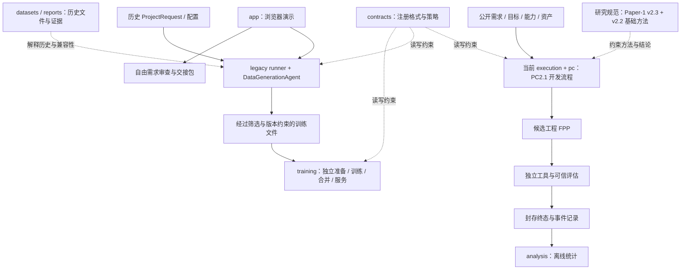
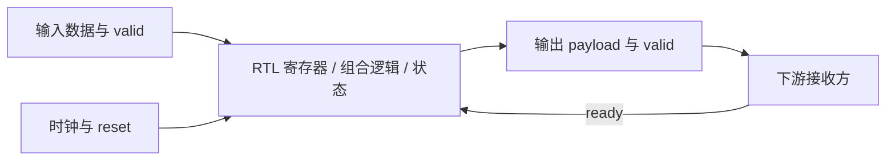

# 从需求到 FPGA 工程：系统地图与阅读方法

本章先解释系统为什么这样分层，再指出实际调用位置。完整的函数参数、源码行和直接调用表达式见[全量索引](indexes/README.md)；算法与契约细节见[契约和硬件](03-contracts-hardware.md)。

## 1. 系统交付的东西是什么

SR2FPGA 接收硬件需求，生成一个多文件 FPGA 工程，并用工具执行与受信检查记录工程是否满足要求。它不是只输出一段 Verilog 的聊天机器人。

用盖房子作比喻：需求是业主要求，PC 是可以由机器检查的结构图，RTL 是具体施工实现，FPP 是交付的整套工程文件，评估器是独立验收机构。图纸检查、施工可进行、功能正确、实际场地可落地，是不同层次的结论。

| 名词 | 小白可以这样理解 | 在仓库里的准确含义 |
| --- | --- | --- |
| PC / Project Contract | 结构化工程图纸 | 当前 `sr2fpga-pc-2.1` 的设计和受信来源绑定；不是最终 RTL |
| FPP / FPGA Project Package | 完整交付文件夹 | 有清单、顶层和源码的工程包；旧系统还有更丰富的脚本/约束产物 |
| ABI | 外接插头的规格 | 端口名、方向、位宽、时钟复位与握手信号映射 |
| checker | 图纸检查员 | 检查 JSON、参数、连接、类型、域、张量声明等明确规则 |
| emitter | 按图生成结构的工具 | 生成模块接口、实例和连线，再装入单独提交的行为代码 |
| provider / transport | 模型通信适配器 | 发送消息、收取文本与用量；replay 则从合成响应中回放 |
| evaluator | 验收程序 | 负责候选准入、工具执行与受信测试；其结果才是执行证据 |
| oracle | 计算标准答案的独立程序 | 由评估方拥有，不由待测模型修改 |
| harness | 驱动和检查电路的测试设施 | 产生合法输入时序，制造停顿/复位，收集并核对交易轨迹 |
| reference | 手写参考实现 | 用来验证开发链路；不代表模型生成能力 |
| artifact | 可追溯的运行产物 | 候选、日志、哈希、事件、工具结果和成本记录 |
| terminal | 本轮最终封存状态 | 停止生成/修复后的候选，或有原因的无候选终态 |

`schema` 验证的是“表格填得合不合格式”，`checker` 验证的是可静态表达的设计关系，仿真验证的是选定输入上的行为。任何一层都不能自动替代下一层。

## 2. 仓库不是一条流水线，而是几条有边界的链路

虚线表示规则或读取关系，实线表示主要处理/数据方向。图不表示当前 PC2.1 自动发布训练数据，也不表示 app 已连接当前六方法执行器。详细的真实调用见[执行器说明](02-agent-runtime.md)和[外围说明](04-training-demo-tooling.md)。

| 目录 | 真正负责什么 | 不应混淆的事情 |
| --- | --- | --- |
| `agent/src/sr2fpga_agent/pc/` | PC2.1 输入、静态检查、结构构造与行为装配 | 不内置三个案例算法来替模型答题 |
| `agent/src/sr2fpga_agent/execution/` | 当前六方法、预算、候选、公共评估、封存和终态评估 | 是开发执行器；存在入口不代表正式研究已获授权 |
| `agent/src/sr2fpga_agent/tasks/` | 三个 LLM 固定案例、旧 DW→PW 开发案例 | 开发参考正确性不等于完整族资格 |
| `agent/src/sr2fpga_agent/analysis/` | 按预定槽位、设计簇与缺失规则分析结果 | 不生成或修复候选，也不补造缺失结果 |
| Agent 顶层及 `generation/` | legacy 调度、历史任务生成与共享基础设施 | 顶层文件不全是废弃代码；新路径仍导入其中一部分 |
| `task_families/`、`oracles/` | 旧任务生成与旧独立语义检查 | 历史任务不能改名当作当前三类 LLM 任务 |
| `contracts/` | 84 个注册格式/策略条目、兼容测试及维护工具 | JSON 文件不都是 JSON Schema；PC2.0 草案没有注册 |
| `training/` | 文件到训练样本、LoRA 训练/合并和模型服务 | 不 import Agent；不属于 Paper-1 当前主实验 |
| `app/` | 前端展示、旧演示后端和自由需求交接 | PC 这个显示名称不证明采用 PC2.1 序列化 |
| `datasets/`、`reports/` | 版本化数据与留存证据 | 其中大量 RTL 是被测代码，不是控制器模块 |
| `outputs/` 与研究插图脚本 | 幻灯片、说明书和图形生成 | 不决定研究定义或评测判定 |
| `artifacts/` | 被忽略的本地执行输出 | 本次不把所有历史运行缓存算作当前源代码 |

## 3. 跟一次当前请求读源码

建议先顺着一条链看，不要从 5,669 行的旧 runner 开始。

1. 从 [`tasks/llm.py`](../../../agent/src/sr2fpga_agent/tasks/llm.py) 的 `main()` 找到 `prepare`，理解公开输入如何准备。权重/LUT 可以是公开输入，oracle、参考行为与评估刺激属于另一侧。
2. 从 [`execution/__main__.py`](../../../agent/src/sr2fpga_agent/execution/__main__.py) 进入 `integration.preflight()` 和 `integration.run_development()`。这层确认配置、来源、预算和实际入口。
3. 阅读 [`runtime.py`](../../../agent/src/sr2fpga_agent/execution/runtime.py) 的 `PairedBlockRuntime.generate()` / `_generate_locked()`。它决定六个方法何时共享初始结果、何时允许修复和何时停止。
4. 需要模型文本时，进入 [`gateway.py`](../../../agent/src/sr2fpga_agent/execution/gateway.py) 的 `ModelGateway.call()`；需要预算时，进入 [`budgets.py`](../../../agent/src/sr2fpga_agent/execution/budgets.py) 的 `BudgetLedger`。调用模型前预留，完成后对账，未知用量不能当作零。
5. PC 路径进入 `assemble_project_contract()` → `check_task_design()` → `build_structure()` → `compose_behavior()`。自由工程路径进入 proposal parser 和 `admit_project()`。两条路径最后都要接受候选准入和评估。
6. 阅读 [`evaluation.py`](../../../agent/src/sr2fpga_agent/execution/evaluation.py) 的 `Pc21Evaluator.evaluate()`：当前路径使用 Yosys parser、Icarus/vvp 仿真及通用 Yosys 综合。具体条件与失败归类不能从旧 Verilator 路径类推。
7. 修复只消费允许的公共反馈。所有生成关闭后才能进入终态评估屏障；私有结果不能倒流为“再试一次”的提示。
8. 最后看 [`analysis/core.py`](../../../agent/src/sr2fpga_agent/analysis/core.py) 的 `validate_dataset()` 和 `analyze()`：先按计划槽位对齐结果和身份，再计算统计，而非数日志里出现了几次 PASS。

这里列的是阅读主线。某个方法会跳过不适用的步骤；函数实际控制分支和异常处理见下一章与符号索引。

## 4. 六个方法到底改变了什么

| 方法 | 模型先输出什么 | 工程结构由谁落实 | 后续修复 |
| --- | --- | --- | --- |
| M0 | 完整工程 | 模型 | 无 |
| M1 | 与 M0 相同的初始完整工程 | 模型 | 有预算的工程修复 |
| M2 | 非类型化计划，再输出完整工程 | 模型 | 无 |
| M3 | PC，再输出完整工程 | 模型依据 PC 自由生成 | 无 |
| M4 | PC，再输出行为单元 | 确定性构建器落实骨架 | 无 |
| M5 | 与 M4 相同的初始工程/失败 | 确定性构建器落实骨架 | 有预算的设计/行为修复 |

代码尽量共享相同初始结果，目的是让对比能够解释：例如 M5 与 M1 比的是整个契约方法链的作用；M4 与 M3 在初始结果上比的是结构构造的作用。共享一次调用的物理费用只发生一次，但独立运行一个方法时仍然需要那份准备成本。因此仓库会同时保存实际去重成本和各方法独立归属成本。

上述是当前方案及实现组织，不是本次评估出来的性能优势。

## 5. 软件函数与硬件模块不是同一种“调用”

Python 函数调用是运行控制程序时先后执行一段代码。RTL 的模块实例是同一时刻存在的电路，不是 Python 函数那样“调用后返回”。硬件数据可以流水流动，某一路停顿时其他支路是否允许推进取决于握手和状态设计。

例如 QKV 三路输出：Python 的 `reference.py` 可以在生成文本时顺序构造三段 RTL，但实际电路必须正确处理 Q、K、V 各自的 `ready`。某一路被阻塞时，不能因为另一路已经接收而提前覆盖其输出数据。函数索引只能告诉你“谁生成这段代码”，不能证明这些时序义务已满足。

在上升沿 `valid && ready` 才算一拍被接收；阻塞时必须保持完整 payload 与 valid。复位、尾拍 mask、head/feature 顺序、饱和与舍入是功能的一部分，不是“之后再优化”的细节。

## 6. 全量覆盖如何计算

此次库存以 `git ls-files --cached --others --exclude-standard` 的现存路径为底稿，既包含已提交文件，也包含当前未跟踪实现。被工作区删除的旧文件不计为现存；忽略的私有配置、运行缓存、虚拟环境、模型权重与另一 worktree 不纳入本次源代码库存。

| 根目录 | 代码文件数 | 本次处理方式 |
| --- | ---: | --- |
| agent | 288 | 159 个包内 Python 文件、126 个测试/fixture 支持文件、3 个脚本；全部建立源码索引，主链路与历史职责人工追踪 |
| app | 5 | Python 后端/测试、JavaScript、HTML、CSS；人工核对演示与交接路径 |
| contracts | 47 | 41 个测试、6 个维护工具；契约 JSON 另列 84 项注册表 |
| training | 24 | 8 个包内 Python 文件、7 个脚本、9 个测试文件 |
| compatibility_tests | 4 | 项目边界、目录、术语和兼容性检查 |
| outputs | 71 | 展示材料生成代码；逐文件库存、按生成模板族说明 |
| docs | 1 | 研究方法图绘制脚本 |
| datasets | 2,751 | 已存数据样本中的代码，逐路径列入历史代码库存 |
| reports | 619 | 已留存候选/工具证据中的代码，逐路径列入历史代码库存 |
| **合计** | **3,810** | 440 个实现/测试/展示代码文件 + 3,370 个历史数据/候选代码文件 |

统计扩展名包括 Python、JS/MJS/TS、HTML/CSS、Shell/PowerShell、Verilog/SystemVerilog、Tcl/XDC 等；本快照实际出现的扩展名及完整路径见 JSON 索引。JSON/YAML/TOML/INI 是数据、契约或配置，不混进源码数量，但其机制和入口同样纳入说明。

**“全量库存”不等于“逐行证明所有代码正确”。** 本次对 363 个 Python 文件完成 AST 解析，对 5,958 个命名类/函数/嵌套定义建立索引，记录 47,860 个语法调用位置；人工审查聚焦主要执行链、版本交界、权限边界与可疑重复。历史候选 RTL 仅做库存，不重新打开全部隐藏材料或重跑研究实验。测试通过范围见[验证记录](06-validation.md)。

## 7. 实际维护时应从哪里改

| 变化目标 | 首选定位 | 必须核对的关联 |
| --- | --- | --- |
| 改公开任务或某个硬件案例 | `tasks/<family>/task.py` | 公开资产、boundary、数值规则、harness 和独立 oracle；修改可信评测需要明确授权 |
| 改 PC 字段/表达能力 | 注册 schema + `pc/inputs.py` / `checker.py` | 版本兼容、公开投影、ABI、emitter、正反例；不能仅改 JSON 示例 |
| 改生成/修复策略 | `execution/runtime.py` | 共享初始结果、预算记账、公共反馈、封存与信息边界 |
| 接入模型服务 | `execution/gateway.py` + provider adapter | token 用量、失败/未知结果、单次请求限制、真实模型调用授权 |
| 改执行器/工具后端 | `execution/isolation.py` / `evaluation.py` | 工具退出分类、资源限额、候选写权限、日志投影和复现证据 |
| 改统计 | `analysis/core.py` | 预定槽位、设计簇、缺失、方法比较、策略版本与研究定义授权 |
| 修旧实验或旧导出 | 顶层 legacy / `generation/` | 原契约版本与原证据身份，不能让旧数据无声迁移成当前结果 |
| 改训练或 UI | `training/` / `app/` | 不跨 runtime import 连接 Training；不要让 UI 复制评测逻辑 |

应先读目标函数及它的调用方，再读对应契约和测试。不要因为模块名称相近而合并，也不要因为索引中没有静态调用方就删除入口：console script、`python -m`、插件工厂、CLI 指定 callable、测试发现和 shell 调用都会形成静态索引之外的入口。
