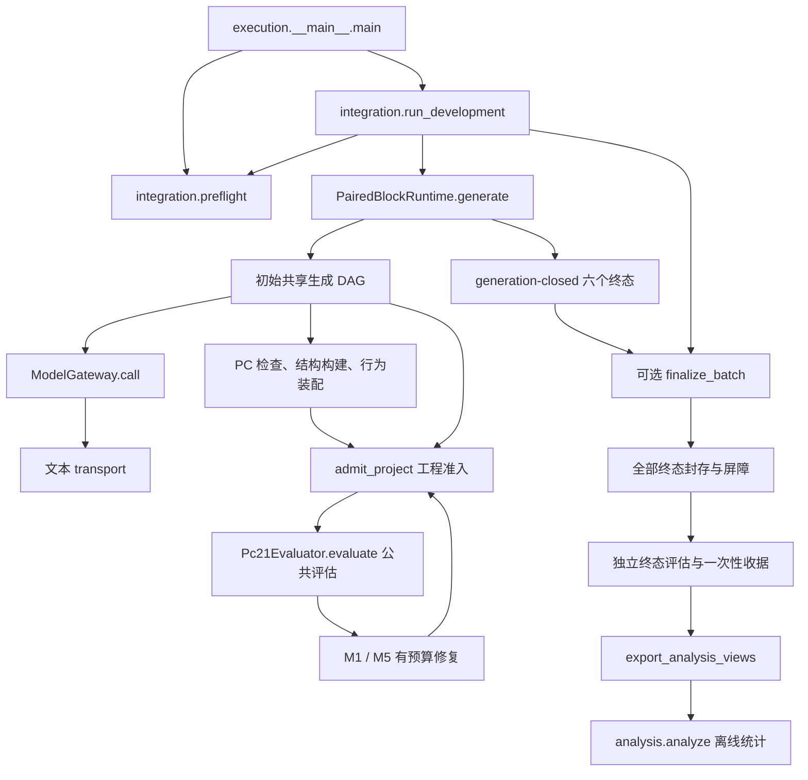

# Agent 的两代执行流程、函数调用与审查发现

审查快照：2026-11-09，路线 A，当前工作区（含未提交实现）。本章依据实际 Python 源码追踪调用；它不把研究计划中的目标架构当成已完成的运行系统。文中 `模块:行号` 是本次定位，后续应优先按函数名查找。

## 1. 先理解三个角色

可以把系统理解为“设计者、项目经理、验收员”。模型是设计者，提出 PC 设计、RTL 文件或修补方案；运行控制器是项目经理，决定可以做什么、还能花多少预算、保存哪次产物；评估器是验收员，持有工具与可信测试设施，检查候选工程。模型不能自己宣布测试通过，也不能修改验收员的试卷。

仓库目前有两代控制器：

| 问题 | 当前 PC 2.1 路线 | 保留的 legacy 路线 |
| --- | --- | --- |
| 从哪里启动 | `python -m sr2fpga_agent.execution` | `sr2fpga-agent`、`sr2fpga-runner` |
| 调度核心 | `execution/runtime.py::PairedBlockRuntime` | `runner.py::run_batch` + `agent.py::DataGenerationAgent` |
| 输入事实 | `pc.context.PublicTask`，绑定三份公开源文件及资产 | `ProjectRequest`、`RequirementEnvelope`、`FrozenRequirementContext` |
| 结构表示 | PC 2.1 的 `bindings + design` | 主要是 System-HIS 及历史方法适配器 |
| 主要任务 | 三个固定 LLM 子系统的开发入口 | 历史小型 RTL 任务、旧六方法开发、轨迹/训练导出 |
| 候选工具流程 | 当前受限 FPP、Yosys parser、可信 Icarus 仿真、通用 Yosys 综合 | 旧 FPP/HIS、Verilator、候选烟测/独立评估分支、综合及可选 L4 |
| 能否据此开始正式研究实验 | 否；只有开发执行入口，`--formal` 只报告缺少的前提 | 否；显式拒绝当前研究/PC 格式绑定 |

两者不是“同一个函数改了个名字”。当前执行器复用部分底层设施，但没有调用旧 `DataGenerationAgent.run_one()` 来实现 M0–M5。反过来，旧命令也不会自动切入新执行器。`cli.py:100` 附近与 `runner.py:537` 的拒绝逻辑就是为了避免这种误用。

## 2. 当前执行器的完整调用链



图中箭头表示控制调用或产物传递，不表示所有步骤在每种方法中都会执行。尤其 M0/M1/M2 不经过 PC 结构生成，私有终态结果也没有返回修复循环的箭头。

当前执行子包逐文件分工如下，方便从问题反查文件：

| 文件 | 负责的工作 | 常用定位点 |
| --- | --- | --- |
| `execution/__main__.py` | 命令行参数与退出码 | `main` |
| `execution/__init__.py` | 对外导出当前执行 API | 导出列表 |
| `execution/integration.py` | 配置预检、组装一批运行、重读证据后导出分析 | `preflight`、`run_development`、`export_analysis_views` |
| `execution/runtime.py` | 共享初始 DAG、方法状态、修复、终态屏障协调 | `PairedBlockRuntime`、`finalize_batch` |
| `execution/gateway.py` | 公开消息序列化、replay/live transport、计费派发与恢复 | `ModelGateway.call`、`ClientTransport` |
| `execution/budgets.py` | 方法限额、多轴资源预留/结算、共享成本 | `BudgetLimits`、`BudgetLedger` |
| `execution/locking.py` | 本地进程级互斥，防止同一状态并发写 | `file_lock` |
| `execution/proposals.py` | 模型提案 schema 与工程文件补丁准入 | `parse_proposal`、`admit_project`、`apply_project_patch` |
| `execution/isolation.py` | 公开投影、候选允许范围、主机/容器执行后端 | `public_task_projection`、`validate_candidate_sources`、`DockerBackend` |
| `execution/evaluation.py` | 可信工具执行、结果结构、终态一次性评估权威 | `Pc21Evaluator`、`TerminalEvaluationAuthority` |
| `execution/public_feedback.py` | 有界白名单公共诊断，剥离任意工具日志 | `source_diagnostics`、`functional_diagnostics` |
| `execution/public_interfaces.py` | 从公开 boundary 派生逻辑端口/tensor/物理 ABI 名称索引 | `public_interface_index`、`indexed_public_payload` |
| `execution/prompt_guidance.py` | 各方法共用的版本化 HDL/PC 公开说明常量 | `MODEL_GUIDANCE_VERSION`、`COMMON_MODEL_GUIDANCE` |
| `execution/development.py` | 构造不同于公共输入的合成开发终态 suite | `terminal_suites`；不是正式 held-out 套件 |

### 2.1 入口和准备

入口 [execution/__main__.py](../../../agent/src/sr2fpga_agent/execution/__main__.py) 的 `main()` 只解析 `preflight` 和 `run-development` 两个命令。

[integration.py](../../../agent/src/sr2fpga_agent/execution/integration.py) 执行以下动作：

1. `load_json()` 拒绝重复 JSON 键、非有限数值和超过 64 MB 的本地输入。
2. `preflight()`（第 81 行）用 `ContractRegistry` 检查配置，加载公开输入，核对固定任务支持范围、预算、工具和后端条件。它不导入 live transport 工厂、不读取凭证、不请求模型。Docker 的可用性检查仍会调用本地 Docker 查询命令。
3. `load_public_directory()` 读取 `requirements.json`、`target-profile.json`、`capability-profile.json`，交给 `load_public_task()`。真正输入权限与字节绑定由 `pc/` 执行。
4. `run_development()`（第 133 行）限制输出在仓库 `artifacts/` 内，记录配置、源代码/契约哈希、公开输入与 replay 绑定，再创建各个 `PairedBlockRuntime`。
5. 所有块完成 `generate()` 后，才可能导入操作者选择的 `terminal_suite_factory`。没有该参数，报告会保留 `terminal_evaluation=not_run`。

`--allow-model-calls` 是代码层面的开关，不会替代项目层面对模型、范围和资源预算的授权。默认 replay 是显式合成响应，不能把 replay 的成功写成自然模型的成功率。

### 2.2 六方法为什么没有各写一套循环

[runtime.py:511](../../../agent/src/sr2fpga_agent/execution/runtime.py#L511) 的 `_generate_locked()` 用共享初始节点组织六个条件：

| 方法 | 实际初始调用 | 共用的内容 | 是否修复 |
| --- | --- | --- | --- |
| M0 Direct | `_project_node("initial-SD", "direct_project", ...)` | 与 M1 共用完整初始工程或失败 | 否 |
| M1 Direct-Repair | 读取相同 SD 初始状态 | 不重新抽一份更好的初始答案 | 是，允许整包替换或文件补丁 |
| M2 Structured-Direct | `_call("initial-UP", "untyped_plan", ...)` → `_project_node(..."project_from_plan"...)` | 独立的非类型化文字计划 | 否 |
| M3 PC-Free | 共享 `initial-SC` → `_project_node(..."project_from_pc"...)` | 与 M4/M5 共用同一初始 PC 和准入结果 | 否 |
| M4 PC-Skeleton | 共享 `initial-SC` → `_body_node("initial-SB", ...)` | 与 M5 共用完整骨架+行为工程或失败 | 否 |
| M5 PC-Online | 读取相同 SB 初始状态 | 初始失败同样共享，后续修复独立 | 是，允许改设计或已知行为单元 |

SD/SC/UP 的执行顺序由本地 `schedule_seed` 打乱；SC 后的 M3 和 SB 分支也打乱，依赖顺序保持不变。这里的 seed 是调度 seed，不能自动当作模型解码 seed 或统计抽样 seed。

举例：共享 PC 结构不合法时，M3/M4/M5 的初始状态都要反映同一次 PC 失败。只有 M5 还能在自己的剩余预算内更正，M4 不会偷偷获得一次内部重试。

### 2.3 一次模型输出怎样变成工程

自由工程路线：

```text
_project_node()
  → _call() → ModelGateway.call() → transport.generate()
  → parse_proposal(..., "pc21_project_proposal")
  → _admit() → admit_project()
  → 候选哈希 + 不可变 candidate-records 记录
```

PC 骨架路线：

```text
_check_pc()
  → assemble_project_contract()         控制器补入可信 bindings
  → check_task_design()                 检查当前公开配置下的静态语义
_body_node()
  → _build() → build_structure()        生成控制器拥有的结构和行为单元接口
  → _call(stage="behavior")            模型只返回各单元的 body
  → _compose() → compose_behavior()    真实 parser 检查结构保护
  → _admit()                           入库完整候选
```

没有行为单元时，代码显式记录 `behavior_not_applicable`，而不是为凑固定调用次数而再请求一次模型。结构构造不等于推导算法；矩阵乘、缓存读写或激活运算的正确性需要行为代码和独立验证。

[proposals.py](../../../agent/src/sr2fpga_agent/execution/proposals.py) 与 [isolation.py:107](../../../agent/src/sr2fpga_agent/execution/isolation.py#L107) 一起限制候选文件：`manifest.json`、`rtl/` 内的 `.v/.sv` 和可选 `README.md`。候选不能带可执行构建脚本或可信测试台。受限 HDL 检查拒绝宏、字符串、越界系统调用、层次访问等，之后仍需要真实 parser；词法检查不是完整 Verilog 语义证明。

### 2.4 修复时修改的是谁

[runtime.py:402](../../../agent/src/sr2fpga_agent/execution/runtime.py#L402) 的 `_repair()` 只用于 M1/M5：

- M1 有候选后可 `replace_project` 或 `replace_project_files`。文件补丁通过 `apply_project_patch()` 绑定父候选哈希、应用修改、重新进行完整准入；错误补丁不会覆盖原候选。
- M5 可 `replace_design` 或 `replace_behavior_units`。改设计必须重新检查 PC、重建结构，并清空旧行为 bundle；填新行为需要再付出一次有预算的模型调用。
- 行为补丁必须同时匹配父候选哈希与 `build_plan_sha256`，不能借“修复一个行为”更换受保护的结构。
- 空修改、重复修改、错误 schema 仍可能消耗已发生的模型调用，但不会凭空形成成功修复转移。
- 一旦已有公开接受的候选立即停止。未成功时保留最后一个完整候选；后面一条不完整支路不会抹掉已有可评估工程。

`state["pc"]` 等字段可以表示正在修复的新支路；`last_candidate` 保存最近完整工程。这是两个不同的状态，阅读时不能以为新 PC 一出现就已经替换了最终候选。

### 2.5 预算是持久状态，不只是一个计数器

[budgets.py](../../../agent/src/sr2fpga_agent/execution/budgets.py) 的 `BudgetLedger` 使用以下状态顺序：

```text
reserve（先占预算）→ dispatch（持久化“已发出”）→ reconcile（结算实测）
          └ 未发出且可取消 → cancel
```

`ModelGateway.call()` 在网络调用之前写请求并将 reservation 标记为 dispatch。若进程在请求发出后丢失响应，恢复代码不会自动重发一遍得到额外样本；它返回未解决的派发状态。模型调用、token、公开检查轮数、子工具、服务时间和资源分配是不同的预算轴。

M0/M1 共用一次生成，在 `actual` 视角只发生一次；在独立运行归因 `standalone` 视角，两种方法都承担完整初始成本。共享不是免费。`used` 可包含尚未结算的保守预留，`observed` 才是实际记录的消耗；未知 token 不能变成 0。

[gateway.py](../../../agent/src/sr2fpga_agent/execution/gateway.py) 还区分两种 live token 方案：`ClientTransport` 需要操作者提供精确 tokenizer；`ProviderCapacityTransport` 预留明确的服务容量上界，记录 `tokenizer_id="unavailable"`，不会把上界声称为实测输入 token。当前 transport 复用 [providers.py](../../../agent/src/sr2fpga_agent/providers.py) 客户端，但强制单次 transport attempt（`gateway.py:128`），不继承旧客户端的多次自动传输重试策略。

`_source_guard()` 与 `_cached()` 对源码、契约、操作记录进行绑定。`ArtifactStore.put_blob()` 的同 key 不同字节冲突是防止改历史的机制。恢复不是“重新执行后覆盖旧文件”。

### 2.6 实际评估调用，按源码而不是旧 README 猜测

[evaluation.py:296](../../../agent/src/sr2fpga_agent/execution/evaluation.py#L296) 的 `Pc21Evaluator.evaluate()` 顺序如下：

| 阶段 | 实际调用 | 通过后能说明什么 |
| --- | --- | --- |
| L0 | `validate_candidate_sources()` → `resolve_project_manifest()` → `check_project_package_l0()`，核对公开 ABI | 工程包和候选边界符合共同格式；尚未执行算法 |
| L1 | `yosys read_verilog -sv -noautowire; hierarchy -check; proc; check -assert; write_json` | 实际 HDL 可解析，顶层物理端口名称、方向和位宽匹配需求 |
| L2 | 评估器写可信 TB → `iverilog` → `vvp` → `suite.check(stdout)` | 当前可信套件下的交易轨迹、算术与协议检查通过；不是候选输出一句 PASS 就接受 |
| L3 | `yosys ... synth -top ...; stat` | 当前通用综合流程通过；不等于 FPGA 映射、BRAM 推断或布局布线 |

当前 L1 是 Yosys parser，不是旧 `_run_pipeline()` 的 Verilator。不同执行路径中相同 L 编号需连同工具策略一起读，不能把历史 Verilator 结果替换为当前 parser 结果。

工具运行前后 `_run()` 都检查候选文件字节是否被修改；task、suite 和 tool policy 也核对绑定。公共评估返回的是 `public_feedback()` 的结构化投影，原始日志与可信测试内容留在评估产物。

`EvaluationResult` 分开记录 `execution_status`（工具执行有没有正常完成）和 `semantic_status`（完成后设计过没过）。`terminal_value()` 再把完整终态与公开/私有证据归约成 1、0 或未知 null。设计失败保留 0；基础设施缺失不假装失败，也不假装成功；完整性错误中断归约。

### 2.7 终态为什么必须有“全批次屏障”

[runtime.py:580](../../../agent/src/sr2fpga_agent/execution/runtime.py#L580) 的 `finalize_batch()` 不接收模型 gateway。它先让所有已计划槽位都拥有候选封印，或带原因的无候选终态，再调用 `TerminalEvaluationAuthority.close_barrier()`。

槽位由 campaign/population/instance/replicate/condition 标识，不包含候选哈希；因此更换候选不能换一个“新槽位”再次评分。`evaluate_once()` 读取已有收据或执行一次承诺，同一结果恢复读取不算新评分。已知公共失败可以关闭私有槽位而不运行它，失败仍保留在分母里。

`integration.export_analysis_views()` 不是把调用者传来的分数直接转 CSV。它重新读取封印、收据、候选字节、最终公共检查和预算记录，重算分析行。另一方面，离线 `analysis` 只负责输入一致性及统计数学，不能证明任意外部伪造输入是真的；真实性要靠上游受控导出。

## 3. 离线统计的函数关系

入口是 [analysis/__main__.py](../../../agent/src/sr2fpga_agent/analysis/__main__.py) 的 `validate`、`analyze`、`simulate`。它没有模型、HDL、hidden 或物理评估功能。

```text
main()
  → 严格 JSON 与注册 schema 检查
  → validate_dataset()                  对齐计划槽位、结果和身份
  → analyze()
      → _aggregate(lower/upper/complete)
      → _estimate()
      → _bootstrap()                    两个对比共用设计簇抽样
      → holm_adjust()                   同一族两个假设的多重检验调整
      → _qualification() / _rates()     资格、缺失与分母
  → 不覆盖已有输出的 _write()
```

[core.py:441](../../../agent/src/sr2fpga_agent/analysis/core.py#L441) 的聚合顺序是“同配置的重复先平均 → 配置在设计簇内按权重合并 → 家族内设计簇平均 → 三家族等权”。同一个设计重复跑很多次，不会冒充很多个独立设计。

主要对比固定为 M5−M1@B4 和 M4−M3@initial。`_bootstrap()`（第 528 行）把整个设计簇作为重采样单位，两个对比保留联合关系。样本簇过少、标准误为零或重采样退化时保留 `degenerate` 和 null，不硬凑显著性。

未知结果保留在原始数据中。保守上下界只在分析副本中赋值，完整簇分析是敏感性视角，不是偷偷删掉失败后的主分母。跨多个设计簇的共同 dependency group 当前被拒绝；协调依赖组重采样尚未实现。

[simulation.py](../../../agent/src/sr2fpga_agent/analysis/simulation.py) 的 `synthetic_dataset()` 和 `simulate()` 产生合成 Bernoulli 数据检验统计机制，不能替代实际模型功效分析。报告显式写 `official=false`、`claim_authorized=false`、`model_calls=0`。

## 4. Legacy 流程：保留了哪些工作

### 4.1 单样本、批量和生成适配器

```text
cli.main() / runner.main()
  → requirement_boundary / frozen_context
  → 选择 deterministic / direct / two-stage / frozen-context generator
  → DataGenerationAgent.run_one()
      → _run_one_impl()
      → generator.generate()
      → HIS/FPP 检查、_run_pipeline()、公共评估分支
      → diagnosis → repairer.repair() → 再检查
      → terminal_selection / evaluator_dispatch / episode_outcome
      → DatasetRecorder.write_attempt() / write_final()
  → runner 汇总、measurement / cost views、可选训练视图导出
```

`runner.py::run_batch()`（第 799 行）负责计划任务、paired block、共享准备、断点恢复、工具环境、冻结记录和批量状态；`agent.py::run_one()`（第 310 行）负责一次样本生命周期。它们分别是 5669 行与 3740 行的大模块，说明旧逻辑积累较多，不等于都可以删除。

`EpisodeExecutor.emit_candidate()` 的范围只到“形成完整候选”。它把 `method_adapters` 中的方法 facade、规划结果、H 阶段验证、可修复的前置失败转成明确状态转移。公共评估、终态选择与后续 hidden 是其他阶段，不应把这个类名理解成包办全部流程。

| 生成模块 | 主要函数/类 | 负责的转换 |
| --- | --- | --- |
| `project_generator.py` | `ProjectGenerator.generate` | 历史小任务的确定性参考工程；不是当前 PC2.1 行为生成器 |
| `generation/direct_project.py` | `DirectProjectGenerator.generate` | 自然需求 → 自由工程 |
| `generation/req2his.py` | `SystemHisGenerator.generate` | 需求检查 → HIS 提案，含其历史输出重试处理 |
| `generation/his2project.py` | `HisProjectGenerator.generate` | HIS → 工程 |
| `generation/two_stage.py` | `TwoStageProjectGenerator.generate` | 组织上面两阶段 |
| `generation/skeleton_fill.py` | `OracleHisProjectGenerator.generate` | 历史 oracle-HIS/骨架实验入口；不是当前自然模型 PC 生成 |
| `generation/context_direct.py` | `FrozenContextDirectProjectFacade`、`FrozenContextProjectRepairFacade` | 同一冻结事实下的直接生成和修复 |
| `generation/context_plan.py` | `FrozenContextUntypedPlanFacade` | 冻结事实 → 文字计划 → 工程 |
| `generation/context_his.py` | `FrozenContextSystemHisFacade`、`FrozenContextHisGeneratorBridge`、validation/correction facade | 把历史 HIS 实现接到方法适配器和候选前状态机 |
| `generation/__init__.py` | 导出上述 API | 兼容导入表面，无独立运行流程 |
| `prompts.py`、`providers.py`、`model_budget.py`、`repair.py` | prompt 构造、客户端、`BudgetedModelClient`、`SystemHisRepairer`/`ProjectRepairer` | 历史模型调用和修复服务；其中 provider 仍被当前 gateway 复用 |

### 4.2 历史的测试通过不能照搬到当前研究

`agent.py::_run_pipeline()`（第 1863 行）先做轻量标识符检查，后做 Verilator lint；候选提供的 TB 仅写到 `candidate_sim_*`，正式 L2 字段在缺可信通道时是 `not_run(needs_oracle)`。后续还可调用 Yosys 和可选 OpenXC7。可信公共评估在 `public_evaluator.py` 另一条受控分支实现。

这解释了“同一个样本明明仿真运行了，却没有正式 L2 credit”的现象：运行的是候选自带烟测，不满足独立验收的证据要求。不能为了表面一致把 `not_run` 改成通过。

### 4.3 顶层模块按职责归组

以下表格覆盖顶层辅助实现的职责，逐函数签名另见本次索引。分组依据当前调用角色；“旧”不意味着可删除。

| 职责 | 文件 | 进入流程的位置及保留理由 |
| --- | --- | --- |
| 通用数据与存储 | `models.py`、`artifact_store.py`、`contract_registry.py`、`repository_paths.py` | 新旧执行器共用；模型对象、规范 JSON、不可变产物和 schema/仓库定位 |
| 工程准入与编辑边界 | `parsers.py`、`path_safety.py`、`project_contract.py` | 解析响应/manifest、L0、路径、patch、工程 envelope；部分新路径仍直接或间接使用 |
| 主机工具基础 | `local_tools.py`、`tool_runner.py`、`tool_environment.py`、`log_parser.py` | 可执行文件查找、旧工具执行、版本快照及日志分类；当前后端有自己的隔离执行层 |
| 需求进入系统 | `requirement_envelope.py`、`requirement_boundary.py`、`frozen_context.py`、`public_boundary.py` | 旧需求事实、歧义/能力分流、冻结上下文、公开接口检查 |
| 任务与证据索引 | `task_catalog.py`、`task_evidence.py`、`family_recipe.py` | 目录身份、实际证据、可选家族提示决策；目录声明不是执行验证 |
| 旧契约验证/构造 | `his_validation.py`、`system_his_schema.py`、`system_his_checker.py`、`system_his_v12_checker.py`、`system_his_fidelity.py`、`system_his_capabilities.py`、`system_his_compatibility.py`、`contract_skeleton.py`、`pc_assembly.py` | 旧 HIS 的 schema、结构、忠实度、能力/兼容封套、骨架和显式 decision 装配；不代替 `pc/` |
| 轻量 RTL/TB 检查 | `rtl_identifier_checker.py`、`rtl_introspect.py`、`testbench_checker.py`、`semantic_trace.py` | 旧静态问题定位、信号/端口提取、TB 竞态/观测能力、valid-ready 轨迹；不是通用 HDL 编译器 |
| 旧方法控制 | `method_contract.py`、`method_adapters.py`、`episode_executor.py`、`budget_allocation.py` | 方法词表、facade、候选前状态机和历史 B4 分配 |
| 旧成对执行准备 | `paired_block.py`、`block_preparation.py`、`measurement_freeze.py` | 配对身份、共享节点准备/恢复、固定测量配置 |
| 旧成本与测量 | `cost_accounting.py`、`block_cost_accounting.py`、`paired_cost_views.py`、`paired_measurement.py` | 尝试/准备成本、实际/独立/增量视角和 paired 测量；对应不同契约，不能随意混合 |
| 旧公共/终态评估 | `public_evaluator.py`、`public_l2_harness.py`、`terminal_selection.py`、`evaluator_dispatch.py`、`hidden_execution_state.py`、`episode_outcome.py` | 可信公共工具、终态选择与一次性 hidden、两轴状态和结果归约；与新 `execution/evaluation.py` 分属不同格式 |
| 旧停止与纠正结果 | `checkpoint_stop_outcome.py`、`pre_candidate_outcome.py`、`his_correction_outcome.py` | 明确没有候选的原因、H 阶段停止与 HIS 纠正结果，不能用“无文件”替代这些状态 |
| 旧开发验收 | `full_pack_smoke.py`、`g3_acceptance.py`、`g3_test_evidence.py` | 旧 G3/全包开发证据重建与 pytest 记录，不能证明当前研究总体已合格 |
| 独立语义与故障注入 | `oracle_runner.py`、`failure_injector.py`、`oracles/`、`task_families/` | 历史任务 oracle、mutant、合成缺陷和任务实现；当前 LLM task 另有独立实现 |
| 扩展歧义审计 | `requirement_audit.py`、`ambiguity_audit_runner.py`、`ambiguity_events.py`、`ambiguity_witness.py`、`ambiguity_outcome.py` | 独立需求歧义用例、事件拦截、见证和结果归约；不是当前核心生成的必经步骤 |
| Provider 资格 | `provider_seed_capability.py`、`provider_seed_probe.py`、`model_gateway_provenance.py` | seed 可重复性探测、能力记录、旧 gateway 追踪；probe 可能实际收费，不可当普通静态检查运行 |
| L4 与目标扩展 | `l4_tool_environment.py`、`openxc7_report.py`、`vivado_report.py`、`target_profile_pairs.py` | 工具版本、物理报告、可选 Vivado 参考与目标配对；这些文件存在不证明当前 PC2.1 已接通 L4 |
| 旧样本与报告 | `recorder.py`、`baseline_report.py`、`req2file_eval.py` | 逐尝试落盘、历史汇总、REQ2FILE 数据/预测装配与评分 |
| Agent 侧训练交换 | `training_view_exporter.py`、`training_eligibility.py`、`training_pool.py`、`training_release.py` | canonical 训练行、资格证书、候选池和 release 完整性；与 Training 通过文件交换，位于 Paper-1 核心之外 |
| 包装入口 | `__init__.py`、`cli.py`、`runner.py` | 包 API 与旧单样本/批量调度；不要从文件所在顶层推断“这是当前主线” |

## 5. 哪些重叠值得整理，哪些应该保留

| 表面重复 | 实际关系 | 审查判断与整理方向 |
| --- | --- | --- |
| `contract_skeleton.py` 与 `pc/emitter.py` | 都生成结构，但前者消费 HIS v1.2，后者消费类型化 PC2.1 checked design 并校验真实 AST | 两套格式迁移期共存，不应直接合并或删除；先明确输入/行为/来源映射差异 |
| `model_budget.py` / `artifact_store.EpisodeBudgetLedger` / `execution.BudgetLedger` | 历史逻辑调用预算、旧事件账本与当前多轴持久共享预算 | 概念重叠、状态/契约不同；可先统一术语/比较测试，再评估抽共用基础设施 |
| `public_evaluator.py` / `evaluator_dispatch.py` 与 `execution/evaluation.py` | 都做评估权威，但接收不同上下文和证据契约 | 明确 legacy/current 名称有收益；搬代码前需保护旧收据、one-shot 和 reducer 语义 |
| `terminal_selection.py` 与 `runtime._repair()` / `finalize_batch()` | 都涉及最终候选；旧者独立重建选择，新者在状态机中停止并封存 | 不是仅函数名重复；需要先比较“最后完整候选、公开通过、无候选”的精确规则 |
| `cost_accounting.py` / `paired_cost_views.py` 与 `execution/budgets.py` | 一个侧重旧已发生事件归约，另一个还承担发出前预算控制 | 不能用成本汇总替换执行预算；也不能用预留值冒充实测 |
| 多处 `_sha`、JSON 读写、`_hdl_tokens` | 较小的工具性重复，部分 strictness/大小上限/允许语法刻意不同 | 可作为局部重构候选；先把差异写进参数和测试，再抽取，不能凭相似代码直接统一 |
| `generation/skeleton_fill.py` 与 `generation/two_stage.py` 的 `_run_stage` / `_emit_stage_event` | 本次全局 AST 比较确认去除位置后的语法树相同；分别位于 50/73 行与 73/96 行 | 是可明确定位的内部实现复制；可抽为 generation 内部辅助层，保留调用阶段名与事件语义。这是小范围重构候选，不说明两个生成类整体冗余 |
| 巨型 `runner.py`、`agent.py`、`prompts.py` | 历史功能叠加，调度、报告、配置或 prompt 细节共存 | 是可维护性债务；按明确职责拆分，同时保留公共入口和历史记录格式 |

当前 execution 对旧顶层底层设施仍有直接依赖，尤其 `ArtifactStore`、`ContractRegistry`、`models`、`parsers`、`path_safety`、`local_tools`、`providers`。因此把顶层 Python 文件全部搬进 `legacy/` 会破坏当前链路。

本章没有把“静态查不到调用”认定为死代码：命令入口、测试、工厂字符串、用户 API 和保留的历史读取器都可能不形成普通 AST 调用边。真正删除前应证明相关契约无消费者、历史产物仍可读、公开入口兼容，并单独进行回归。

## 6. 可定位的审查发现

这里的优先级表示修复顺序：P2 为有明确触发条件的可靠性或边界缺陷；限制单列，不为凑数量而报错。本次未修改执行器、可信评估器或评分语义。

### A1 · P2 · Docker 运行中断后，同目录恢复会卡在资格目录

**新发现，合成本地复现。** [integration.py:179](../../../agent/src/sr2fpga_agent/execution/integration.py#L179) 每次未读到最终 `report` 的恢复都创建新 DockerBackend，并使用固定 `private/qualification-{index}` 调用 `qualify()`；[isolation.py:253](../../../agent/src/sr2fpga_agent/execution/isolation.py#L253) 直接 `mkdir(parents=True, exist_ok=False)`。

触发条件是第一次运行已创建资格目录，但在最终 report 提交前中断。第二次相同配置/输出恢复会因目录已存在抛 `FileExistsError`，尚未进入候选恢复。已完成且保存最终 report 的重开会提前返回，不受这条路径影响。

本次把 Docker 可用性和探测进程替换为合成返回值，首次 `qualify=True`，第二个 backend 对同一路径得到 `FileExistsError`；实际 Docker、EDA、模型调用均为 0。结果见 probe-result.json（本地 `artifacts/documentation/full-review-20261109/docker-resume-64e703c0/probe-result.json`）。这验证的是目录恢复缺陷，不是实际容器隔离资格。首轮系统临时目录受 Windows sandbox 权限阻断，改用新建的 `artifacts/` 专用目录后完成验证；前者是验证环境问题。

建议为每次重新资格检查分配不可变新探测目录，或明确验证/重用已有资格记录，并保持镜像/后端身份绑定。不能简单删除旧目录来“恢复”，因为它含先前探测证据。

### A2 · P2 · 行为装配错误仍能绕过结构化反馈投影

**旧发现的当前源码复核。** [pc/emitter.py:386](../../../agent/src/sr2fpga_agent/pc/emitter.py#L386) 把 parser 的 `stderr[-3000:]` 加入 `PcBuildError`；[runtime.py:296](../../../agent/src/sr2fpga_agent/execution/runtime.py#L296) 的 `_diagnostic()` 仅替换两个根路径、截断文本。`_body_node()` 的失败信息再经 `_repair()` 进入后续 `public_feedback`。

正常评估错误走 `public_feedback.py` 的注册白名单投影，composition 错误没有一致经过该投影。影响是任意候选 parser 错误文本可能进入模型上下文，覆盖强度与声明的统一反馈策略不一致。本次没有使用隐藏用例，也不能由此推断 hidden 内容已经泄露。

10 月 29 日手册已有合成 canary 复现；本次只确认相关实现仍存在，未冒充重新执行该复现。建议统一 composition 公共错误分类，保留合法候选相对路径/行号，原始日志只入评估产物。见 [原审查 R1](../09-deep-review.md)。

### A3 · P2 · 工具异常退出与普通设计拒绝的分类仍不充分

**旧发现的当前源码复核。** [evaluation.py:430](../../../agent/src/sr2fpga_agent/execution/evaluation.py#L430) 的 `_require_tool()` 除 `missing_tool` 外只将三个固定退出码识别为 crash，其余异常落入候选边界失败。例如旧手册记录的 Yosys `std::bad_alloc`/exit 3 会走 `parser_rejected`。

这种分类会影响 `terminal_value()` 的 0/null 解释。但不能只根据一个异常单词就断言宿主机 OOM，或把所有超时改成基础设施缺失；需要工具异常、资源限额及宿主状态的可验证证据。本次未重跑 HDL、未重分类历史数据。修复会触及结果语义，应单独版本化和验证。见 [原审查 R3](../09-deep-review.md)。

### A4 · 实现限制，不是本次新增缺陷

| 已确认限制 | 源码位置 | 对读者的实际意义 |
| --- | --- | --- |
| 本地主机后端没有 CPU/内存强制隔离资格 | `isolation.py::LocalDevelopmentBackend`，第 179 行 | 配置里写了资源上限，不等于操作系统实际执行了它 |
| 日志长度在进程结束后检查 | `isolation.py::_run_process`，第 141–176 行 | `max_output_bytes` 限制读回/结果，不是运行时磁盘硬配额 |
| L3 是 generic Yosys synthesis | `evaluation.py::Pc21Evaluator.evaluate` | 不提供 FPGA LUT/BRAM mapping、布线、时序或 L4 结论 |
| 当前 CLI 不执行正式协议 | `integration.py::preflight` 的 formal 分支 | 返回不就绪是明确边界，不能通过删除检查来“完成研究” |
| 跨簇 dependency group 未实现联合重采样 | `analysis/core.py::validate_dataset` | 当前拒绝这类输入，用户需保留真实依赖，而不能改标签绕过 |

## 7. 阅读覆盖与验证边界

本章逐段追踪了 `execution/runtime.py` 的准备、共享生成、修复、终态与 finalization，以及 `integration.py`、`gateway.py`、`isolation.py`、`proposals.py` 和 `evaluation.py` 的关键控制路径；核对了 `budgets.py` 的公开状态接口、`public_feedback/public_interfaces/prompt_guidance` 的职责和入口关系；读取 `analysis/core.py` 的聚合、bootstrap、Holm、资格与输出逻辑及 CLI。

对 legacy，检查了 `cli`/`runner` 的配置拒绝与批处理入口、`DataGenerationAgent` 主生命周期/实际工具流水线、`EpisodeExecutor` 和 generation facade；顶层辅助模块通过定义/导入/入口静态目录核对后按职责归组。逐函数索引不代表每个历史函数都完成逐行正确性证明。

本次新执行的专项检查只有 A1 的合成目录恢复探测。A2/A3 是源码复核与明确标注的历史证据引用。项目的统一轻量测试结果由本次总报告记录；本章没有请求自然模型、运行实际 Docker/HDL/物理工具、读取正式 held-out 内容或晋级研究证据。
