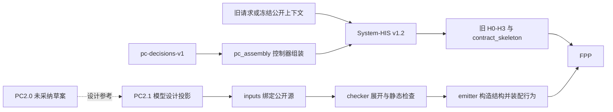

# 契约版本、硬件语义与构建链路

本章按 2026-11-09 当前工作区源码审查。它解释格式和实现，不授予实验执行或证据晋级权限；实际执行结果统一见本次审查的验证记录。

## 1. 先分清四种“版本”

项目里看起来相似的版本号，实际回答不同问题。**研究计划规定做什么比较；PC 规定怎样表达一个硬件设计；FPP 规定怎样交付源码；记录契约规定怎样保存一次执行。** 因而 `paper1-v2.3`、`sr2fpga-pc-2.1`、`project-package-v1`、`pc21-runtime-report-v1` 同时出现是合理的，不能按数字大小相互替代。

| 层次 | 当前或保留的身份 | 谁使用 | 容易误解的地方 |
| --- | --- | --- | --- |
| 研究定义 | `paper1-v2.3` 案例修订 + v2.2 基础方法 | 开发者、实验调度和分析设计 | v2.3 换了主案例总体，未自动冻结正式预算或批准实验 |
| 目标代码架构 | `sr2fpga-paper1-code-dev-v2.1` | 开发者 | 这是目标分工；不能把文档中的类名当成现有 Python 类 |
| PC 序列化 | `sr2fpga-pc-2.1` | `pc/inputs.py`、checker、emitter、当前执行器 | 它不是“研究计划 v2.1” |
| 模型设计投影 | `urn:sr2fpga:pc-design:2.1` | 模型响应接收端 | 根就是设计内容；模型不能提交完整 PC 的受信绑定 |
| FPP 清单 | `project-package-v1` | 新旧生成器、公共工程检查、封存 | 文件清单与接口格式可以共用，生成方法和评测版本仍须分别保存 |
| 执行、成本、轨迹、分析 | 各自的 `*-v1/v2/v3` | 对应 writer/reader/reducer | 某一种记录升版，不意味着其他记录或算法同时升版 |
| 契约注册表 | `contract_registry_version: 1.0` | `ContractRegistry` 和专用加载器 | 这是目录格式版本，不是所有契约共同的版本 |
| 任务目录 | 文件格式 v0.2，内容 `catalog_version: 0.4.0` | `task_catalog.py` | “收录这个家族”不代表已有实现、工具验证或正式资格 |

研究依据见 [v2.3 修订](../../specs/2026-10-28-sr2fpga-paper1-llm-case-amendment-v2.3.zh.md)；实现职责见 [架构规范 §6–8、§18](../../specs/2026-09-15-sr2fpga-paper1-code-architecture-development-spec-v2.1.zh.md)。本章把规范要求与源码观察分别说明。

## 2. HIS 到 PC 2.1：演化了什么，什么没有自动迁移

| 格式/接口 | 仓库中的实际状态 | 主要入口 | 与下一代的关系 |
| --- | --- | --- | --- |
| `system-his-v1.1` | 老格式仍有兼容识别；兼容策略将其标为 `legacy_quarantine`，注册 H-stage 拒绝，不能导出正向 System-HIS 训练视图 | `system_his_checker.py`、`system_his_compatibility.py` | 不是 PC2.1 的宽松输入分支 |
| `system-his-v1.2` | schema、W1–W10 一致性规则、后端能力及旧运行代码继续存在 | `his_validation.py`、`system_his_v12_checker.py`、`contract_skeleton.py` | 旧记录保持原身份；当前 `pc/inputs.py` 不将它转换成 PC2.1 |
| `pc-decisions-v1` | 注册的旧权限分离接口；模型给决策，控制器补冻结字段和来源 | `pc_assembly.assemble_pc()` | 最终组装的仍是 `system-his-v1.2`；不能称作已经存在的“PC 1.0”格式 |
| `sr2fpga-pc-2.0` | 两份 schema 草案保留在 `contracts/pc/2.0/`；未采纳、未注册；在当前 Agent 源码中未找到运行消费引用 | 无当前运行入口 | 是 PC2.1 的设计底稿；不是必须经过的中间转换站 |
| `sr2fpga-pc-2.1` | 注册；严格输入、类型化公开任务、静态检查、确定性结构、行为装配、开发执行器均有代码 | `python -m sr2fpga_agent.pc` 和 `execution` | 当前主线；旧结果不能仅改版本字段后重用 |

可直接核实的关键位置：

- [旧兼容策略](../../../contracts/system-his/system-his-compatibility-v1.json)及 [兼容加载器](../../../agent/src/sr2fpga_agent/system_his_compatibility.py)定义 v1.1 隔离，而非静默升级。
- [pc_assembly.py](../../../agent/src/sr2fpga_agent/pc_assembly.py) 的 `_assemble()` 第 190 行显式写入 `schema_version = system-his-v1.2`；`assemble_pc()` 第 251 行调用旧 H-stage 验证。
- [inputs.py](../../../agent/src/sr2fpga_agent/pc/inputs.py) 的 `assemble_project_contract()` 第 193 行只组装 `sr2fpga-pc-2.1`，`parse_project_contract()` 第 209 行按该注册 schema 和三个原始源重新验证。
- [manifest.json](../../../contracts/manifest.json)没有 PC2.0 注册项；[PC2.0 README](../../../contracts/pc/2.0/README.md)保留了“未采纳、未注册”的历史说明。当前审查没有执行其历史报告中声称的测试。



图中两条实线是并存的执行体系。共同输出 FPP 便于复用部分检查基础设施，但不代表两条体系的 H-stage、模型输入、受保护区域和结果含义完全相同。

## 3. 注册表包含哪些契约

本次按当前 `contracts/manifest.json` 逐项读取，得到 **84 个注册项：80 份 JSON Schema 定义、4 份数据/策略文档**。四份数据/策略是 task catalog、System-HIS backend capabilities、well-formedness matrix、compatibility policy。task catalog 自身也有 `$schema` 字段，但它是数据实例，不能因此计为一份 JSON Schema 定义。

| 文件组 | 交换的对象 | 主要生产/消费代码 | 版本阅读方式 |
| --- | --- | --- | --- |
| `pc/2.1/` | 完整 PC、设计投影、行为 bundle、目标/能力 profile | `pc/inputs.py`、`context.py`、`emitter.py`、`execution/runtime.py` | design 与完整 PC 共用定义；不是一宽一严两套设计标准 |
| `pc/` 根部 | 旧决策、调用源、装配回执 | `pc_assembly.py` | 保留旧 HIS 权限拆分，未替换为 PC2.1 |
| `system-his/` | 旧 HIS、未解析输出包装、能力和兼容策略 | `system_his_*`、`his_validation.py`、旧 generation | `canonical` 是旧 HIS 子体系内的身份，不把旧序列化升为当前 PC |
| `project-package/`、`project-envelope/` | 源码清单、受信文件所有权和完整性封套 | `parsers.py`、`project_contract.py`、生成和评测代码 | FPP 说明“有哪些文件”；envelope 说明“哪些字节由谁拥有、绑定哪次候选” |
| `public-evaluation-candidate/` | 每次公开评测的候选提交 | `artifact_store.py` 的 seal/read public candidate 方法 | v1/v2 并存，v2 进一步保存 envelope 状态与原因；不能任意挑最新版本解释旧文件 |
| `terminal-candidate/` | 生成/修复结束后的最终候选 | `artifact_store.py` 的 `seal_candidate()/read_sealed_project()`、`terminal_selection.py` | terminal 不等于通过，只表示该条生成链不再改候选 |
| `execution/` | PC2.1 运行配置/报告、工程/修复提案、公开反馈 v2、合成回放、分析清单/结果/策略/报告 | `execution/`、`analysis/` | 当前开发主线；回放的合成来源与正式运行资格分开 |
| `episode-pack/` | 冻结公开上下文、配对组、共享检查点、公开 boundary/context | `frozen_context.py`、`paired_block.py`、`block_preparation.py`、`pc/context.py` | `development-public-context-v2` 不等于旧 EpisodePack 中任意同名字段 |
| `accounting/` | 尝试事件、成本汇总、共享准备成本、provider 来源与 seed 能力 | `cost_accounting.py`、`block_cost_accounting.py`、`model_gateway_provenance.py` 等 | 逻辑调用、底层请求、token、工具时间是不同轴；未知不能当零 |
| `evaluation/` | 公开/终态/独立评测回执、工具环境、L4 来源、停止原因、对账、资格与旧 G3 回执 | 对应 `*_outcome.py`、`public_evaluator.py`、`pre_candidate_outcome.py`、`g3_*.py` 等 | `development_*` 保留开发范围；`g3_*` 的名称不恢复旧研究 gate |
| `requirement-audit/` | 需求歧义 case、澄清回放、事件、witness、结果 | `requirement_audit.py`、`ambiguity_audit_runner.py`、`ambiguity_events.py`、`ambiguity_outcome.py`、`ambiguity_witness.py` | 是单独的可选需求审计链路，不自动属于当前六方法主流程 |
| `trajectory/` | 轨迹 v1、含终态/谱系信息的轨迹 v2 | `recorder.py`、`cost_accounting.py`、`episode_outcome.py` | 消费者必须检查实际版本；旧记录不会因 reader 更新而补全缺失谱系 |
| `training-release/`、`training-views/` | 训练资格、样本 sidecar、池与发布清单、训练视图 v1/v2 | Agent 导出和独立 Training 消费代码 | 保留跨项目文件边界；不属于 Paper-1 当前实验 |
| `task-catalog/` | 任务身份、别名、当前总体与历史角色 | `task_catalog.py`、`family_recipe.py` | catalog 提供意图和路由；实际能力须看实现及证据 |

`evaluation/` 中特别容易混淆的多版本组有 `development-pre-candidate-stop-outcome-v1/v2/v3`、`development-his-correction-outcome-v1/v2`、`full-pack-runner-reconciliation-v1/v2`、`full-pack-outcome-reconciliation-v1/v2`。它们记录的是逐步扩展的谱系、平台、H-stage、自然模型来源和成本等事实，不能以“都是结果 JSON”为由合并。逐文件清单应与本次全量索引一起阅读。

[ContractRegistry.load_schema()](../../../agent/src/sr2fpga_agent/contract_registry.py) 第 61 行执行“注册 key → 路径约束 → schema 版本常量 → 本地依赖 → validator”。`_SCHEMA_DEPENDENCIES` 明确列出 boundary/context、repair 和分析策略依赖；未知外部 `$ref` 没有网络回退。这是格式加载器，不是任意注册 JSON 的统一解释器：三份 System-HIS policy 和 task catalog 有自己的加载规则。

## 4. 一份 PC2.1 从输入到硬件文件的函数调用

把这条链想成工程审图与施工：模型交设计图，控制器核对委托书，checker 审查结构，emitter 画出确定的接口和连线，模型再填内部计算，最后编译器检查拼装结果。

| 顺序 | 函数和位置 | 输入 → 输出 | 这一层实际证明什么 |
| --- | --- | --- | --- |
| 1 | `inputs._parse()`，108 行 | UTF-8 bytes + 显式上限 → dict | 拒绝重复 key、浮点/NaN、非法 Unicode、超大小/深度；还没有理解硬件 |
| 2 | `parse_design_proposal()`，176 行 | 模型设计根 → 合格的设计形状 | 模型不能混入 `bindings` 或完整 PC 包装 |
| 3 | `assemble_project_contract()`，193 行 | 设计 + `TrustedContext` → 完整 PC | 控制器绑定 requirements/target/capability 的原始字节 hash，并做基础引用检查 |
| 4 | `context.load_public_task()`，37 行 | 三份受信源 + 操作者选择的资产根 → `PublicTask` | 三份公开源格式合法；资产路径、大小、hash 相符 |
| 5 | `context.check_task_design()`，80 行 | 设计 + `PublicTask` → `CheckedDesign` | 先防止内存投影偏离绑定源，再调用完整静态 checker |
| 6 | `checker.check_design()`，147 行 | 设计/公开边界/能力/事实 → 展开的实例图 | 参数、类型、域、连接、tensor 关系及声明覆盖自洽；行为仍待验证 |
| 7 | `emitter.build_structure()`，136 行 | `CheckedDesign` + 三源绑定 → `StructureBuild` | 确定模块名、文件、顶层 ABI、实例连线和待填行为单元 |
| 8 | `emitter.compose_behavior()`，425 行 | build + 绑定同一 build hash 的 bundle → `ComposedProject` | 全部行为单元恰好覆盖；受保护结构不变；真实 parser/展开检查通过 |
| 9 | `emitter.write_project()`，496 行 | 完整工程 → 新目录 | 安全相对路径、独占新文件写入；并非重新证明功能正确 |

`check` 和 `validate` 的名字必须分清：CLI 的 `assemble/check` 只做严格输入、绑定及一组基础语义规则，并输出 `semantic_validation: partial`；`validate/build/compose` 才加载类型化公开任务并进入完整静态 checker。`build` 生成骨架和行为接口，不代表已经有完整可运行算法。源码入口见 [pc/__main__.py](../../../agent/src/sr2fpga_agent/pc/__main__.py) 第 47、57、70、81 行分支。

### 静态 checker 内部怎样走

`check_design()` 先验证 design schema 和公共 boundary；随后检查模块引用、递归、可达性、顶层签名所有权。内部 `elaborate()` 从 `self` 开始递归展开：

1. `bind_parameters()` 精确覆盖参数名，解释受限表达式，检查当前取值范围。
2. `resolve_tensor()` 展开 shape、量化、lane、mask、sequence；`resolve_type()` 计算实际打包类型。
3. structural 模块递归展开子实例，再由 `_check_nets()` 检查方向、驱动、消费、域和完整类型。
4. behavioral 模块检查状态、numeric/timing 声明，调用 `check_tensor_rules()`；产生初态为 `not_evaluated` 的验证义务。
5. `_check_requirement_map()` 检查公开事实与模块/端口/状态/net 的合法映射和覆盖。

表达式来自有限 AST（`add/sub/mul/ceil_div/min/max/clog2`），不是 Python `eval` 或自由 HDL 字符串。比如 `clog2(1)=0` 可以是合法表达式结果，但拿它当端口宽度会被零宽检查拒绝。当前配置合法也不证明整个参数范围都合法。

### H0–H3 和 L0–L4 是两套坐标

按目标规范，H0 是 PC 形状；H1 是引用、类型、结构和 tensor 自洽；H2 是所选后端能力及展开支持域；H3 是公开 requirement binding/角色/覆盖。当前 PC2.1 的实现函数把若干检查合在 `check_design()` 中，不应伪造四个与函数一一对应的独立 checker。

L0 处理所有方法共同的工程/接口边界，后续 L1/L2/L3/L4 依赖指定编译、功能仿真、综合、物理流程。**H 通过不能替代 L2，L2 通过不能替代器件映射或 L4。** `CheckedDesign.deferred_checks`（`checker.py` 第 69 行附近）明确保留算法、真实打包/算术、reset/背压、状态实现、组合环、死锁、时序资源等未证明事项。

## 5. 硬件工程师最关心的五个边界

### 5.1 同位宽不代表同一种数据

tensor 连接比较的是 shape、element、quantization、layout、sequence 的展开内容，而不是只比较总线位宽。两个都是 18 bit 的总线，可能有不同 scale、zero point、head 排列和调用顺序，直接接线仍然错误。`checker._check_nets()` 第 350 行附近对完整解析类型做相等比较，`tensors.check_tensor_rules()` 再处理显式 repack/requantize 等关系。

### 5.2 ready 的方向与数据相反

ready/valid 的一次传输发生在时钟上升沿 `valid && ready`。生产者阻塞时须保持 valid 和整个 payload。结构 emitter 对 payload/valid 正向连线，对 ready 反向连线（`emitter.py` 第 230 行附近）。checker 只允许 stream 点对点；广播要有显式行为模块逐支记录接受状态，不能简单把三个 ready 当成一根线。

### 5.3 两个 INT8 lane 加 mask 组成 18 bit

当前固定案例每拍两路 8 bit 数，加两位 mask：lane0 在最低八位，lane1 紧接其后，mask 在高位。feature/head 长度为奇数时最后一拍只有第一 lane 有效；无效 lane 必须 raw0/mask0。有效的数值零与“没有数据的 lane”是两种状态。

`abi.type_layout()` 给出物理位区间；`tensor_beats()` 给出逻辑坐标；`pack_tensor_beat()` 只负责按规则打包。它们不自动插入量化换算、FIFO 或计算算法。tensor 中的逻辑 shape 也不等于一拍的物理宽度。

### 5.4 声明状态并不会自动得到正确状态机

PC 可以声明 register/memory/FIFO、容量、域、reset、numeric/timing 责任；checker 能验证名称、范围和关联。真实 RTL 中是否存了正确数据、是否在正确周期更新、复位是否取消半帧，仍由行为体和实际验证决定。FIFO 深度为正也不能证明不会死锁。

### 5.5 确定性构建只拥有结构

`build_structure()` 依据整体 design、边界、能力、源绑定、checker/emitter/ABI 代码 hash 和 toolchain 构造依赖身份。模块参数和域相同的实例可以共享一个专门化模块定义，但硬件实例仍各自存在。行为 bundle 必须匹配该 build hash，设计变化后不能直接套用旧 bundle。

`compose_behavior()` 依次做词法限制、Yosys AST 检查、端口/实例检查以及整工程展开；限制包含额外 module、输入写入、分层引用、外部访问、宏、延时和不支持系统调用。词法检查不是最终证明，真实 parser 才是后续防线。这里的源码限制也不能替代独立的操作系统隔离；候选 RTL 仍须作为不可信输入交给受控工具环境。

## 6. 三个 LLM 案例实际计算什么

三者是 decoder 计算位置对应的**独立固定开发任务**，不是已经接好的完整模型。

| 案例 | 当前固定配置 | 数据路径 | 主要硬件风险 |
| --- | --- | --- | --- |
| QKV | 两个 token，输入维 5；Q 4 heads，K/V 2 heads，head 维 3；lane 2 | 输入广播 → 三路独立 centered MAC/bias → 明确重定标/饱和 → 独立输出流 | Q/KV 维度差异、head 内尾拍、三支不同背压、重复/丢失 token |
| KV-cache decode attention | Q 4 heads，KV 2 heads，D 3，cache 容量 4 | 收齐 Q/K/V → 原子追加 K/V → 分组 QK → max subtraction + 公开 exp LUT → 归一化加权 V | 跨调用 cache 保留、GQA 组索引、满缓存背压、reset 逻辑失效 |
| gated FFN | 两个 token，输入维 5，中间维 7；lane 2 | 同输入分叉 → gate/up → 公开 SiLU LUT → 逐元素门控 → down projection → 同输入残差 | gate/up 配对、舍入和饱和次序、残差只加一次、尾拍与背压 |

QKV 的输入是 6 拍，Q 输出 16 拍，K/V 各 8 拍。Attention 每次输入 Q 8 拍、K/V 各 4 拍，输出 context 8 拍，cache 跨 decode 保留；满四次后需要 reset。FFN 输入和输出均为 6 拍。以上是代码与公开任务规格的静态事实，不是本次运行测得的吞吐。

三族使用整数/有理数、nearest-even 舍入和显式 INT8 饱和。Attention 是固定整数 softmax 近似，FFN 是固定整数 SiLU 表；不能宣称等价于任意浮点实现或某个 checkpoint 的模型质量。QKV 输出与 attention 输入的 scale/zero point 不一致，所以即使端口宽度相同也不能直接串接。

## 7. 每个案例为什么都有 task、oracle、reference、harness

| 文件 | 对新手的解释 | 关键函数 | 所有权和用途 |
| --- | --- | --- | --- |
| `task.py` | 题面：要求输入输出什么、按什么精确规则计算 | `build_development_task()`、`signature/signatures()`、`reference_design()` | 公开 facts/资产可进模型；同文件中的手写 `reference_design()` 不是模型可见输入 |
| `oracle.py` | 阅卷答案计算器 | QKV/FFN 的 `evaluate_token()/evaluate()`；attention 的 `DecodeOracle.decode()/reset()` | 评测侧从实际接受输入独立算答案，不 import RTL reference |
| `reference.py` | 开发者手写的控制设计 | `reference_behavior_bodies()`、`render_reference_project()` | 用来检验工具/构建/harness；不能统计成模型生成成功 |
| `harness.py` | 驱动器和监考器 | `render_testbench()`、`check_trace()` | 发 stimulus、记录每拍 handshake、检查输出/背压/复位/结束；不因 DUT 打印 PASS 就通过 |
| `__init__.py` | 包的公共出口 | 导出 task builder 与手写 design | 当前三个 LLM 包没有在出口导出 oracle；旧 DW/PW 包额外导出 oracle 辅助函数 |

源码分别位于 [llm_qkv](../../../agent/src/sr2fpga_agent/tasks/llm_qkv/)、[llm_attention](../../../agent/src/sr2fpga_agent/tasks/llm_attention/)、[llm_ffn](../../../agent/src/sr2fpga_agent/tasks/llm_ffn/)。入口 [tasks/llm.py](../../../agent/src/sr2fpga_agent/tasks/llm.py) 统一调度。

`prepare_case()` 第 61 行只将公开 requirements、target、capability 和原始资产写入 `public/`；另外在 ArtifactStore 留来源快照。`_load_prepared()` 第 123 行核对源代码、公开源、资产是否仍与快照一致。**快照不是文件访问沙箱**，不能让有整个仓库权限的候选 agent 自行读取后仍称其只接触公开输入。

`check_reference()` 第 147 行实际调用链为：

```text
prepare_case → _load_prepared → reference_design
  → assemble_project_contract → check_task_design → build_structure
  → reference_behavior_bodies → compose_behavior → write_project
  → harness.render_testbench → run_recorded(iverilog) → run_recorded(vvp)
  → harness.check_trace → 可选 run_recorded(yosys synth)
  → result.json + ArtifactStore event
```

代码分别记录 static、composition、compile、simulation、semantic、synthesis，避免一个 `passed` 混淆所有层。`--synthesize` 才增加通用综合；即使通用综合通过，也没有自动得到 FPGA LUT/BRAM、布线时序或上板结果。

手写 reference 有两种封装：一套手写 wrapper 直接包 behavior；另一套由 PC emitter 生成 wrapper 再装配同一 reference behavior。前者帮助检查后者的结构构造，但两者共享行为体，不能冒称两套完全独立算法。真正的数学交叉检查来自不同实现的 oracle，以及测试中的显式黄金值/故障注入。

`harness.check_trace()` 从每拍实际接受的输入构建期望队列，再检查提供/接受的输出。QKV/FFN 支持逐 token 完成而不强迫候选照搬 reference 的整帧缓存；attention 额外维护 cache 历史和有效长度。它们仍然只是各自开发 schedule 的监控器，本次审查没有因此推导无限时域的协议证明或整个家族资格。

## 8. 旧硬件链路的地位

| 源码 | 当前职责 | 为什么还不能直接删除 |
| --- | --- | --- |
| `system_his_schema.py` | 注册旧 v1.2 schema 的专用校验 | 旧 H-stage、回放、训练来源解释仍依赖它 |
| `system_his_v12_checker.py` | HIS 字段/引用、W1–W10、RTL 交叉核对 | 旧格式有 components/instances/control_flow/artifacts 等概念，不能由 PC2.1 checker 原样替换 |
| `system_his_checker.py` | common L0 与 HIS-to-project 兼容入口，包含 v1.1/v1.2 分流 | `check_project_l0()` 明确仍组合 common package 检查与旧 HIS 一致性 |
| `system_his_capabilities.py`、`system_his_compatibility.py` | 旧后端能力、可接受表示与隔离政策 | 它们负责保留历史语义，不应因当前主线换 PC 就改写旧结果 |
| `system_his_fidelity.py` | 旧需求与 HIS 的匹配/冻结事实核对 | H3 的旧表示与当前 PC 公开事实映射并非同一个接口 |
| `his_validation.py` | 旧 H0→H1/W-rules→H2 lowering→H3 顺序与报告 | `validate_frozen_system_his_payload_h_stages()` 仍被旧装配和 frozen generation 调用 |
| `contract_skeleton.py` | 从 HIS v1.2 确定性地产出老 manifest、模块骨架、TB/约束等附属项 | 旧生成器仍调用；输出内容和编辑边界不同于 `pc/emitter.py` |
| `generation/req2his.py`、`his2project.py`、`two_stage.py`、`skeleton_fill.py` | 旧需求→HIS→工程、oracle-HIS 对照等入口 | 尚有旧 CLI/runner 与回归测试消费；不是当前 LLM 执行器的隐含步骤 |
| `generation/context_his.py` | 冻结公开上下文上的旧 HIS 生成/构建/纠错及 canonical FPP 装配 | 它显式桥接旧接口；不能简单与非 frozen 生成器合并掉身份核验 |
| `tasks/ai_dw_pw/` 四职责文件及 `__init__.py` | 历史量化 DW→PW 固定开发任务 | v2.3 明确保留历史/回归身份，原始结果不转成 LLM 结果 |
| `pc/development.py` | 旧 DW/PW 外部模型开发 session、调用预留、响应保存、构建与公开评测 | 独立于新 `execution`；不是当前六方法 budget/terminal 状态机的替代品 |
| `task_catalog.py`、`family_recipe.py` | catalog 身份/别名解析，旧需求路由与显式拒绝策略 | 当前 LLM 家族不通过旧 recipe 偷渡；目录身份、实现能力和证据账本必须分开 |

旧 skeleton 的行为合并使用 `SR2FPGA_BEHAVIOR_BEGIN/END` 和旧文件布局；新 emitter 使用 build-plan hash、专门化单元及真实 AST/整工程展开。因此“两个文件都生成模块头”是重叠职责，尚不足以证明它们是可互换的重复实现。

### 旧确定性 RTL 模板与旧 oracle 库

除了 `tasks/` 的四个固定开发子系统，仓库还保留一套规模较大的历史 RTL 模板库。`ProjectGenerator.generate()`（[project_generator.py](../../../agent/src/sr2fpga_agent/project_generator.py) 第 610 行）先规范化 task type，再调用 `_rtl_files()` 和 `_testbench()` 分发，附上 `_system_his()`、manifest、时序约束和预测报告。它是**确定性模板生成器**，不能因为类名中有 Generator 就当成模型采样。

| 文件 | 提供的硬件类别 | 主要关系 |
| --- | --- | --- |
| `task_families/__init__.py` | task type/alias 与 family ID 注册 | 聚合各模块的 `TASK_FAMILY_IDS`，为 `ProjectGenerator` 提供路由 |
| `task_families/basic.py` | counter、简单 FSM、RAM 读写 | 返回 RTL 字符串和对应开发 testbench |
| `task_families/protocol.py` | FIFO、UART RX/TX、UART+FIFO 回环、SPI | 实现时序协议和多模块工程模板 |
| `task_families/stream.py` | ready/valid 流、fork/join、累加、事件、模式/触发过滤 | 流握手及组合子系统模板 |
| `task_families/datapath.py` | ALU/PWM、CRC、FIR、矩阵向量 MAC、matched filter、peak、radar 等 | 数值数据通路和复合工程模板 |
| `task_families/image.py` | Sobel/阈值、视觉缺陷核心 | 图像流水线模板 |
| `task_families/rl.py` | TD 更新、策略值、replay、host/batch RL shell 等 | 历史强化学习相关加速器构件；与训练 LLM 的 `training/` 不是同一件事 |
| `task_families/ga.py` | 未来 GA 家族的预留元数据位置 | 当前 `TASK_FAMILY_IDS` 是空字典，没有实现或注册可运行的 GA 家族 |
| `oracles/__init__.py` | 9 个旧家族 reference builder 的显式注册 | `build_oracle_bundle_for_request()` 查表；没有 builder 时返回 `None` |
| `oracles/numeric.py`、`signal.py`、`image.py`、`rl.py` | 旧数值/信号/图像/RL 数学参考与 scenario bundle 构造 | 是评测侧实现，不是 template generator 的别名 |
| `oracles/types.py` | bundle、scenario、字段、结果、失败来源类型 | 约束成功/失败记录的内部表示 |
| `oracles/bundle.py` | bundle 写入、加载、hash、公开 profile 清理 | `write_oracle_bundle()`、`load_oracle_bundle()`、`sanitize_oracle_profile()` 管理评测资产边界 |
| `oracle_runner.py` | 执行指定 oracle bundle 的工具链入口 | 调度适配、执行与结果记录；没有执行就没有新 oracle 结果 |

这些历史模块的函数级定位见全量索引。本次只按实现、分发和公开接口审查其职责，没有打开或重跑已封存的私有场景数据。旧模板拥有自己的 testbench 不代表它就是独立 oracle；模板正确性、oracle 资格、自然模型候选表现必须分别描述。

## 9. `pc/` 全部代码文件的阅读顺序

| 文件 | 先读哪些符号 | 与其他文件的关系 |
| --- | --- | --- |
| `__init__.py` | `__all__` | 对外稳定暴露输入与基础语义 API，不是完整流水线实现 |
| `__main__.py` | `main` | CLI 将操作分到 inputs/context/emitter |
| `inputs.py` | `TrustedSource`、`TrustedContext`、`ParseLimits`、assemble/parse | 严格字节入口及绑定；调用 registry 和基础 semantics |
| `semantics.py` | 六个 `validate_*` | 入口/模块引用/递归/可达性/签名来源/参数名的基础图检查 |
| `context.py` | `PublicTask`、load/check | 将已绑定源解释为公开任务，并核验原始资产 |
| `expressions.py` | `natural`、`evaluate`、`bind_parameters` | checker/tensors 的受限整数表达式解释器 |
| `tensors.py` | `resolve_tensor`、`check_tensor_rules` | 描述符与有限关系静态规则；不运行家族数学 |
| `checker.py` | `CheckedInstance`、`CheckedDesign`、`check_design` | 配置实例展开及静态语义汇合点 |
| `abi.py` | `type_layout`、`tensor_beats`、`pack_tensor_beat` | 已核对类型的确定打包视图，供构建和检查辅助使用 |
| `emitter.py` | build/compose/write + `_parse_unit` | 结构与行为边界；真实 Yosys 证据产生处 |
| `development_tools.py` | `run_recorded` | 本地有时限工具子进程、输出日志、超时清理；不是正式隔离资格证书 |
| `development.py` | `prepare_dw_pw`、`DevelopmentSession` | 历史固定 DW/PW 开发控制，复用前述通用能力 |

这里共有 12 个 Python 文件；README 是操作指南。案例算法位于 `tasks/`，没有藏在通用 checker/emitter 中。未来扩展硬件 family 应新增公开语义和独立评估实现；不应在 emitter 中按 family ID 偷填答案。

## 10. 冗余、历史兼容与需要保留的独立性

| 分类 | 具体位置 | 审查判断 | 后续动作与约束 |
| --- | --- | --- | --- |
| 已确认重复文字 | `pc/README.md:14` 与 `:19`；`docs/migrations/research-plan-alignment.md:10` 与 `:15` | 同一 runtime 介绍段重复出现，增加阅读噪声 | 可在单独文档整理中去重；本次不改既有文件 |
| 已确认过时注释 | `pc/semantics.py:148` 附近称参数值规则尚未实现 | 与 `expressions.bind_parameters():63`、`checker.py:206` 的实际检查不一致 | 注释应限定为“本函数不检查值”，不能让读者误判整个系统未实现 |
| 可整合的基础设施候选 | `contract_registry.py:61`、`project_contract.py:27`、`system_his_schema.py:22` | 都有注册路径/版本/schema 加载逻辑；专用层仍有不同返回格式及额外规则 | 先比较路径拒绝、缓存、依赖解析和错误接口测试；可收敛底层加载，不应顺便更改契约或摘要算法 |
| 必须保留的版本适配 | `system_his_*`、`pc_assembly.py` 与 `pc/` | 输入和信任边界不同，且仍有消费者 | 当前没有“可直接删除整块旧体系”的证据；先停用入口、确认回放/训练依赖再迁移 |
| 已退役设计材料 | `contracts/pc/2.0/` | 无注册运行消费，但被 PC2.1 的设计演化说明引用 | 可保持历史目录与清晰标识；不能为减少文件数直接破坏规范引用 |
| 合理的独立实现 | 三族 oracle 与 reference | oracle 数学和 RTL 状态机分离是验证需要 | 不要抽成同一算法函数，再让双方调用后把一致当独立验证 |
| 有意的对照封装 | 各 reference 的 `render_reference_project` 与 PC-emitted wrapper | 能比较手工结构和 emitter 结构；共享 body 的局限必须说明 | 保留对照用途；不把这两套 wrapper 说成两份独立算法 |
| 可评估的重复 helper | QKV/FFN oracle 的 pack/unpack、nearest-even，小型 reference 的查表生成 | 格式逻辑近似；有跨案例漂移的维护成本 | 若统一格式 reader，仍保留显式黄金字节和独立数值核对，不能只测 pack→unpack 往返 |
| 固定控制的重复常量 | task 参数与 reference RTL 中固定维度/计数 | 当前固定 profile 有意简化；不是通用参数化硬件库 | 改维度必须同步公开语义、参考、oracle、harness 和黄金值；不能只改 task 常量 |
| 保守来源绑定 | `tasks/llm.py:54` 快照全部 Agent Python/contract JSON | 任意被绑定源码变化都会使旧准备物失效；有审计收益也有维护成本 | 不是错误通过；将来缩小依赖闭包须验证遗漏风险并保留旧记录 |

本章没有确认可安全删除的实现文件。静态搜索没有发现某个函数的直接调用，只能把它列为候选：它还可能是 CLI、动态 `import_module`、包导出或测试/外部调用的入口。

## 11. 目标架构与当前实现的差异

这里使用 `implementation_protocol_drift` 表示需要持续核对的实现/目标差异，避免通过改解释掩盖差距。

| 项目 | 目标规范 | 当前代码观察 | 应怎样理解 |
| --- | --- | --- | --- |
| H-stage 报告 | 架构 §6.5 要求逐层状态、源/规则/profile 身份、展开结果和 deferred 范围 | 通用 PC checker 返回 `CheckedDesign` 和 obligations；当前实际运行报告由外层执行器封装 | 不应仅以该内部返回值称完整 H0–H3 研究报告；具体外层字段还须随执行器核对 |
| 家族总体与资格 | v2.3 §8 要求配置覆盖、独立设计簇、mutation/public-hidden 划分、工具资格 | 三族 task builder 为三个固定合成控制；reference/harness 也是固定开发 profile | 已实现开发示例，不等于完成总体资格或统计抽样框 |
| 数值声明与实现 | PC2.1 有有限关系、numeric/timing 声明，实际行为独立验证 | checker 明确保留 `not_evaluated` obligations，emitter 不实现算法 | 这是已声明的边界；不能把静态通过写成精确数值或性能证明 |
| 物理目标 | 正式 L3/L4 要绑定工具、器件、约束和适用范围 | 开发 target schema 将 `synthesis_scope` 固定为 `generic_yosys` | 当前开发综合接口本身不建立器件映射、PPA 或上板能力 |
| 旧/新入口共存 | 当前主线应明确与历史链路隔离 | 保留 legacy console scripts、旧 adapter、PC2.1 CLI 和 execution CLI | 文档必须让读者选对入口；实际删除旧代码还需独立迁移任务 |

前三族的共同公开事实与数学定义已经存在；审查没有发现“应让模型自己定义正确答案”的许可。进一步工程工作应围绕独立测试、任务覆盖和运行基础设施继续补强，而不是降低判定标准。

## 12. 契约目录内的维护工具

这些脚本是维护数据/证据的工具，不是生成候选或评估其正确性的 runtime。

| 脚本 | 入口/用途 | 重要副作用 |
| --- | --- | --- |
| `inventory_tracked_tmp.py` | Git 中历史临时文件/引用盘点 | 生成盘点输出；不能因脚本名含 inventory 就忽略输出路径 |
| `verify_phase_a_backup.py` | 检查历史备份清单、hash、样本恢复内容 | 写 recheck 报告，读取显式外部备份 |
| `plan_legacy_evidence_migration.py` | `build_plan()` 规划旧证据迁移 | 写计划，不直接复制证据 |
| `curate_legacy_evidence.py` | `build_curation_preview()` / `apply_curation()` | `--apply` 会复制到稳定证据路径；默认 preview 也可写预览报告 |
| `promote_regenerated_evidence.py` | `build_promotion_preview()` / `apply_promotion()` | `--apply` 会写晋级产物与证据账本，属于独立授权动作 |
| `build_dataset_inventory.py` | 为指定 release 计算校验清单 | 写数据发布目录 inventory；不是只打印文件名 |

本次仅检查这些脚本的入口和写入点，没有执行证据迁移、发布或晋级。

## 13. 本章验证范围

本章直接阅读/定位了注册表及上述 schema/实现，核对当前 PC、旧 HIS、四个任务目录与关键测试的调用。注册数量来自本次对 manifest 及相应 JSON 的读取，PC2.0 无运行消费的判断来自对当前 `agent/src` 和 manifest 的搜索。没有读取私有评测实例/答案、调用模型、编译 HDL、运行仿真或综合，也没有修改 evaluator、oracle、契约、评分和原始结果。

建议后续按实际修改选择现有回归：PC2.1 inputs、semantic_checker、context；emitter/LLM 测试中的真实工具部分；旧 HIS/schema/兼容/装配测试；contract manifest 与各版本 reader/writer 测试。本次执行了哪些检查及其结果，以本次总验证记录为准，不沿用旧手册的通过数字。
