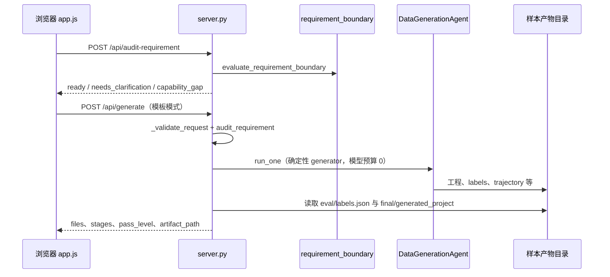

# 04｜Training、浏览器演示与维护工具

本章对应 **2026-11-09 当前工作区**。审查对象是实际存在的源码，包括尚未提交的改动；没有执行训练、服务启动、物理实现、数据发布或历史材料重生成。这里的“入口”表示代码可以从哪里调用，不表示本次已运行成功。

读完本章，应能分清四件事：模型训练与 FPGA 工程生成分别属于什么模块，浏览器按钮实际调用哪条链路，历史维护脚本会改写什么，以及哪些重复文件只是生成产物。

## 1. 先区分四种外围代码

| 代码范围 | 通俗解释 | 与当前 PC 2.1 主线的关系 |
| --- | --- | --- |
| `training/src/sr2fpga_training/` | 把数据整理成对话、检查训练数据、启动 LoRA 训练、合并模型 | 独立项目；当前 Paper-1 不训练模型。通过契约文件交换数据，源码不 import Agent |
| `app/` | 在浏览器填写需求、查看确定性模板生成的工程和工具结果 | 实际接的是保留的 `DataGenerationAgent` 链路，没有接 `execution/` 的 PC 2.1 M0–M5 执行器 |
| `agent/scripts/`、`contracts/tools/` | 历史审计、证据整理、文件校验、OpenXC7 调用 | 是有明确用途的维护入口；不能仅因日常主流程不调用就删除 |
| `outputs/` 与历史方法绘图脚本 | 制作文档、幻灯片和解释图 | 展示材料的生产代码；里面的架构文字和数字不构成当前实现或实验结果 |

`training-view-row-v2` 的 v2、PC 2.1 的 2.1、Python 包的 0.1.0 属于不同版本轴。它们并不要求相同，也不能相互替代。

## 2. Training：三个流程尚未串成一个正式训练流水线

### 2.1 全部生产模块

本表覆盖 `training/src/sr2fpga_training/` 的八个 Python 文件。

| 文件 | 核心符号与调用 | 输入 → 输出 | 使用边界 |
| --- | --- | --- | --- |
| [`__init__.py`](../../../training/src/sr2fpga_training/__init__.py) | `__version__`、`__all__` | 包导入 → 版本信息 | 无训练副作用 |
| [`contracts.py`](../../../training/src/sr2fpga_training/contracts.py) | `discover_repository_root()` → `load_registered_schema()`；`validate_training_view_provenance()` | 注册表和 schema → Training 自己的校验规则 | 验证注册版本与 schema 一致、路径仍位于 `contracts/`；不调用 Agent |
| [`prepare_dataset.py`](../../../training/src/sr2fpga_training/prepare_dataset.py) | `main()` → `convert_jsonl()` → `_row_to_messages()` | 多种 JSONL → 统一 `messages` JSONL | 转换格式，不授权训练，不晋级数据 |
| [`release_reader.py`](../../../training/src/sr2fpga_training/release_reader.py) | `load_training_view_rows_v2()` → `validate_training_view_row_v2()`；`render_training_view_row_v2()` | v2 行 → 经验证的行或对话 | 检查 schema、行哈希、重复 ID、禁止字段及 canary；仅渲染 `payload` |
| [`release_bundle.py`](../../../training/src/sr2fpga_training/release_bundle.py) | `inspect_promoted_release()` → `_inspect_treatments()` → `_validate_linked_artifacts()` | 已晋级 release + 外部期望值 → `InspectedTrainingRelease` | 只读验收 release；不创建数据、不启动训练、不认证签名 |
| [`training_dry_run.py`](../../../training/src/sr2fpga_training/training_dry_run.py) | `main()` → `dry_run_from_config()` / `dry_run_chat_jsonl()` → `_estimate_tokens()` | chat JSONL → 行数与估算长度报告 | 不加载 tokenizer、模型或 CUDA；长度是正则估算 |
| [`train_lora.py`](../../../training/src/sr2fpga_training/train_lora.py) | `main()` → `load_config()` → tokenizer/model/dataset → `SFTTrainer.train()` | YAML + 任意 `train_file` → adapter 与 tokenizer | 重型手工入口；没有调用 release inspector |
| [`merge_lora.py`](../../../training/src/sr2fpga_training/merge_lora.py) | `main()` → `PeftModel.from_pretrained()` → `merge_and_unload()` | 基础模型 + adapter → 合并模型 | 重型手工入口；不是训练数据验证步骤 |

### 2.2 旧数据转换：先识别行类型，再生成对话

实际入口在 `prepare_dataset.py:30`，关键顺序如下：

```text
convert_jsonl(source, target)
  ├─ 逐行 JSON 解析，拒绝非对象
  ├─ 若 contract_version == training-view-row-v2
  │    ├─ _row_to_messages → render_training_view_row_v2
  │    └─ 检查重复 row_id（发生在过滤之前）
  ├─ 按 sample_id_prefix / exclude_file_paths 过滤
  ├─ 旧格式由 _row_to_messages 分支转换
  └─ 所有行转换完成后，写 messages JSONL
```

“在过滤前校验 v2”很关键：不能通过过滤掉坏行，把一个已损坏的 canonical 文件伪装成有效文件。转换器将输出行保存在内存中，解析失败时尚未打开目标文件；这避免了常见的“写到一半才发现输入坏了”的覆盖问题。不过，它仍是整体加载，规模很大时占用与数据量成正比。

旧分支支持：现成 `messages`、`instruction/input/output`、`prompt/completion`，以及 requirement→HIS、HIS→project、requirement→project/file、failure→diagnosis/patch、project→QoR。分支根据字段组合判断；这使历史数据仍可用，也意味着旧行没有统一受到 v2 全套规则保护。

`view_type=requirement_to_file` 的明确旧契约行要携带 `source_episode_id`，且 `official_eval_unit=false`、`standalone_pass_credit=false`。没有 `view_type` 的更早字段型输入仍可走兼容分支。因此，“成功转换”只表示得到了对话，不能推出“数据具有正式发布资格”。

### 2.3 v2 release：数据本体、审计附件、发布授权分开

可以把 release 想成一个密封资料袋：模型能看的是 `views/*.jsonl`；sidecar、eligibility certificate 和 pool manifest 用来检查这些材料从哪里来、彼此是否匹配，不应直接拼进模型提示。

`release_reader.py:97` 先依据 `training_view_row` 注册 schema 检查行结构，再重新计算去掉 `row_sha256` 后的规范 JSON 哈希。`_assert_model_visible_payload()` 检查模型可见字段；`render_training_view_row_v2()` 只取 `payload.prompt_messages` 和 `payload.assistant_target`，不会把整份行信封序列化给模型。

`release_bundle.py:73` 进一步检查整个发布包：

1. 状态必须是 `promoted`，并声明 `training_authorized=true`。
2. 发布包中三个授权哈希必须等于调用者提供的 `PromotionAuthorizationExpectation`。
3. 泄漏策略和 canary 集合必须等于调用者提供的期望。
4. 实际文件集合、大小、SHA-256 必须与 inventory 完全一致。
5. pool 的 `E_final`、`E_traj`、mixture、行引用与各 treatment 视图保持绑定。
6. 每行与 sidecar、eligibility certificate、snapshot 相互对应；最后拒绝未被引用的内部文件。

哈希回答的是“内容是否还是那一份”，不回答“签名者身份是否合法”。这段代码比较外部传入的期望值，但不认证签名，也不重新审阅所引用的授权文件。它返回一个只读接口对象及 treatment 路径；文件系统本身不会因此变成不可写。

当前保留的 treatment 是 `M6U`、`M6F`、`M6T`、`M6F_E_TRAJ`。这些名称属于历史训练基础设施，不属于当前 Paper-1 的 M0–M5 方法总体。

### 2.4 手工训练：与发布验收之间仍有断点

真实调用链是：

```text
train_lora.main
  → load_config(YAML)
  → AutoTokenizer.from_pretrained
  → AutoModelForCausalLM.from_pretrained
  → load_dataset("json", train_file)
  → format_example → tokenizer.apply_chat_template
  → LoraConfig + TrainingArguments + SFTTrainer
  → train → save_model + tokenizer.save_pretrained
```

这里没有 `inspect_promoted_release()`，也没有自动执行 `training_dry_run()`。因此不能画成“release 验收 → 自动训练”的已闭合链路。`train_lora.py:40,53` 与 `merge_lora.py:19,31` 使用 `trust_remote_code=True`，属于实际模型加载的运行条件，不是纯文件转换。第三方训练 API 的当前兼容性未在本次安装或运行验证。

`training_dry_run.py:95` 的 token 数来自 `\w+|[^\w\s]` 正则。它没有应用真实模型 chat template，也没有采用真实 tokenizer；连续中文可能被计成一个词片段。因此其 `fits_max_seq_length` 只能用于粗筛，不能证明正式 tokenizer 下不会截断。CLI 默认只打印报告，指定 `--fail-on-truncation` 才会因估计超限返回失败。

### 2.5 七个 Training 脚本逐一说明

| 脚本 | 实际动作 | 需要注意的副作用 |
| --- | --- | --- |
| [`setup_server.sh`](../../../training/scripts/setup_server.sh) | 创建 `training/.venv` 或 `TRAINING_VENV_PATH`，安装 `training[train,serve]` | 创建环境、联网装重依赖；不是轻量诊断 |
| [`train_lora.sh`](../../../training/scripts/train_lora.sh) | 定位仓库、可选激活环境，调用 `sr2fpga_training.train_lora` | 启动真实训练 |
| [`merge_lora.sh`](../../../training/scripts/merge_lora.sh) | 读取模型/adapter/output 环境变量，调用合并模块 | 加载模型并写模型目录 |
| [`serve_qwen_vllm.sh`](../../../training/scripts/serve_qwen_vllm.sh) | 选 Qwen 模型，校验显式本地目录，执行 `vllm serve` | 持续 GPU 服务；脚本对 FlashInfer sampler 有专门环境设置 |
| [`serve_vllm.sh`](../../../training/scripts/serve_vllm.sh) | 可 source 本地 `serve_vllm.env`，执行带兼容参数的 Gemma 服务 | 本地 env 是 shell 代码；文件中的兼容性提示不是本次已复验结论 |
| [`test_api.sh`](../../../training/scripts/test_api.sh) | 向可配置 API URL 发出 chat completion 请求 | 真实网络/推理请求；名称含 test 并不意味着零成本 |
| [`test_gemma_transformers.py`](../../../training/scripts/test_gemma_transformers.py) | 顶层加载 tokenizer/model，渲染 chat template 并 `generate` | 导入即执行，见本章问题 P-01 |

## 3. 浏览器 Demo：页面、HTTP 桥与旧 Agent 的分工

### 3.1 全部文件的职责

| 文件 | 职责 | 不承担的职责 |
| --- | --- | --- |
| [`index.html`](../../../app/index.html) | 表单、模式选择、工程文件浏览区、H/L 状态容器、说明 | 不运行 HDL 工具、不计算正式评分 |
| [`styles.css`](../../../app/styles.css) | 布局、断点适配、状态颜色与加载动画 | CSS 颜色不是评测证据 |
| [`app.js`](../../../app/app.js) | 获取任务表、发送审查/生成请求、呈现返回文件；自由模式构造交接包 | 不调用 PC 2.1 执行器，不直接请求模型 |
| [`server.py`](../../../app/server.py) | 本地 HTTP API、输入检查、旧 Agent 桥接、产物读取 | 不实现另一套研究评分逻辑 |
| [`test_server.py`](../../../app/test_server.py) | 静态文件白名单、API、上下文/边界、状态保留等测试 | 不等价于完整浏览器自动化测试 |
| [`README.md`](../../../app/README.md) | 启动方式与演示边界 | 文档声明需由源码与具体产物核对 |

### 3.2 点击“生成完整工程并验证”时发生什么



后端 `generate_demo()` 在 `server.py:450`。它会再次执行需求审查，所以前端按钮不是唯一守门者。只有 `ready` 才启动旧 Agent；停止时返回空工程和停止原因。`_DemoProjectGenerator.generate()` 给确定性项目补上 README，再交给 Agent 验证、记录。

公开任务列表来自 `TASK_FAMILY_IDS` 与任务 catalog 的显示名称。`_template_context()` 会生成一个模板预览，解析其 manifest 与端口，从而给前端提供真实支持的接口、reset、交付范围。它不是大模型理解自然语言的过程。

后端提供四个 API：`GET /api/health`、`GET /api/tasks`、`POST /api/audit-requirement`、`POST /api/generate`。生成请求受类级 `generation_lock` 串行保护。静态访问只允许 `/`、`index.html`、`app.js`、`styles.css`；`server.py` 与仓库其他文件不会通过这条静态路由直接提供。

### 3.3 上下文为什么经常让 Demo 停下来

前端发送 `engineering_context` 后，后端要求顶层名、时钟、reset、接口、端口、目标平台、验证意图和交付范围。时钟检查有穷且为正，并转成 Hz 传给 `PlatformProfile`；其他大多数字段必须与所选确定性模板一致。

这意味着 Demo 不是任意需求生成器。用户填了不同顶层名或不同接口，并不会自动改写模板；`_context_gaps()` 会返回 `capability_gap`。文本中的位宽、频率、复位与表单冲突时，`audit_requirement()` 返回需要澄清。旧 API 请求如果完全不提供 `engineering_context`，仍保留兼容默认行为；这与当前网页始终发送该对象要区分。

### 3.4 自由需求模式实际只交接材料

`app.js:234` 的 `freeModeFiles()` 在浏览器内组装三个文件：`requirement.md`、`generation_prompt.md`、`boundary.json`；`renderFreeHandoff()` 显示 `HANDOFF`，H/L 全部为 `not_run`。这条分支不会调用 `/api/generate`，没有生成 RTL，也没有启动仿真。交接内容在页面内存中展示和复制，不会自动保存为服务端工程目录。

### 3.5 状态应如何理解

`_stage_statuses()` 根据 `labels.json` 中的检查项呈现阶段状态，并保留 `not_run` 原因。没有 trusted oracle 时，候选自带 testbench 不能让 L2 获得可信语义通过。缺少本地工具时也不会因为 UI 成功收到 HTTP 响应而变成通过。

页面下方流程步骤在成功收到响应后统一加上 `done` 样式（`app.js` 的表单 submit 回调），因此它只可理解为“请求处理结束”；真正的判定应读取独立 H/L 状态卡和 `pass_level`。这处视觉语义适合后续改进，但并不改变落盘 labels。

## 4. Agent 的三个外置脚本

| 文件 | 调用关系 | 为什么仍保留 |
| --- | --- | --- |
| [`analyze_phase_d_h2_failures.py`](../../../agent/scripts/analyze_phase_d_h2_failures.py) | `main()` → `analyze_dataset()` → `_replay_h2()` → `validate_system_his_h_stages()` | 对旧 Phase D 已有候选，用当前 H2 重新分类；只说明校验器行为变化，不是新模型表现 |
| [`audit_phase_d_pilot.py`](../../../agent/scripts/audit_phase_d_pilot.py) | `main()` → `audit_run()` → 冻结、配对、repair provenance、工具记录等检查 | 24 episodes / 6 pairs / 4 sources / 最多 4 次 FIR L4 是写死的特定历史审计范围，不能拿来审计任意当前 campaign |
| [`openxc7_pnr.sh`](../../../agent/scripts/openxc7_pnr.sh) | 读 manifest → 写 Yosys 脚本/XDC → Yosys → nextpnr-xilinx → JSON 日志包装 | 是实际物理实现适配器；支持旧 manifest 和 `project-package-v1` 两条字段分支 |

H2 replay 的输出路径必须位于 frozen dataset 根之外（`analyze_phase_d_h2_failures.py:199`）。历史审计脚本的 `--output` 则直接写调用者指定路径（`audit_phase_d_pilot.py:299`），没有同等的冻结目录保护；调用时必须避免指向输入证据。这是维护接口的保护差异，本次没有调用或覆盖历史数据。

OpenXC7 有 `--probe-tool-environment` 分支，只收集工具版本与可执行文件哈希。正常分支会写 `eval/openxc7_*`、运行综合和布局布线；不能以“检查工具”为由误跑正常分支。其 XDC 是由 manifest/HIS 端口与时钟生成的通用约束，并不等于完整板卡引脚、I/O 时序或上板验证。`openxc7_report.json` 包装的是工具日志，后续评判仍需要正确的解析与协议。

## 5. contracts/tools：六个维护程序与真实写入边界

这些工具位于 contracts 下，但主要维护历史数据与证据，不是六种契约版本，也不是当前候选运行时的六个阶段。

| 文件 | 主要调用链 | 文件副作用 |
| --- | --- | --- |
| [`build_dataset_inventory.py`](../../../contracts/tools/build_dataset_inventory.py) | `main()` → `write_inventory()` → `inventory_records()` → `sha256_file()` | 扫描一个 release 与对应 exports，原子写 `datasets/manifests/<release>.sha256`；不是只读命令 |
| [`inventory_tracked_tmp.py`](../../../contracts/tools/inventory_tracked_tmp.py) | `build_inventory()` → `tracked_tmp_entries()` → `git ls-files/cat-file`；结合 classification map | 写历史 tmp 分类 inventory；不移动/删除文件，也不重新执行候选 |
| [`plan_legacy_evidence_migration.py`](../../../contracts/tools/plan_legacy_evidence_migration.py) | `build_plan()` 从 task ledger 找 `tmp/` 引用，确定 run 与目标路径 | 写迁移计划；不复制证据 |
| [`verify_phase_a_backup.py`](../../../contracts/tools/verify_phase_a_backup.py) | `verify_phase_a_backup()` → layout/checksum/workspace/restore sample 检查 | 读取明确指定的外部备份，写复核记录；不是创建或恢复备份 |
| [`curate_legacy_evidence.py`](../../../contracts/tools/curate_legacy_evidence.py) | `build_curation_preview()` → 可选 `apply_curation()` | 默认预览；`--apply` 才把经过复核的备份证据复制到稳定 reports 路径，冲突文件拒绝覆盖 |
| [`promote_regenerated_evidence.py`](../../../contracts/tools/promote_regenerated_evidence.py) | `build_promotion_preview()` → 可选 `apply_promotion()` | 选择、脱敏、校验再生成证据；apply 会写 reports 并改 task ledger 的路径引用 |

可以把这组关系理解成：**列清单 → 生成迁移计划 → 检查来源 → 预览将复制什么 → 显式 apply**。`curate` 使用旧备份的原始证据，`promote_regenerated` 使用声明的再生成来源并记录内容转换，所以不是可以随意合并的重复脚本。

路径限制、哈希与原子写避免若干误操作；它们不自动授予证据晋级权限。尤其 `promote_regenerated_evidence.py:869` 会改 ledger，而 `build_dataset_inventory.py:61` 默认就写 manifests。仅为了读代码，不应直接运行这些写入入口。本次仅审查源码，没有扫描外部备份、读取私有配置或执行证据晋级。

## 6. 展示材料也属于代码，但有不同生命周期

当前 `outputs/` 内共 71 个 `.py/.mjs` 制作文件，按六组覆盖如下。它们的路径已整理，旧路径的删除不意味着新路径中的制作源文件消失。

| 组与代码数量 | 构建关系 | 维护时真正应该改哪里 |
| --- | --- | --- |
| `project-notes/project-overview/src/`：1 | `build_project_overview.py:268 main()` → `add_markdown()` + `build_docx()`，由 `SECTIONS/TABLES` 生成中文说明 | 文本数据和 Word 样式函数；旧 HIS/非 DNN 研究叙述作为历史材料保存 |
| `presentations/project-overview/src/`：1 | `generate_ppt.py` 顶层创建 `Presentation`，逐页调用绘图助手，最后保存 PPTX | 单文件中的页面定义；导入也会写成品，不应用 import 方式“检查”它 |
| `presentations/project-overview-redesign/src/`：41 | `create_redesign_modules.mjs` 写 37 个 `slide-NN.mjs`、`project_deck_data.mjs`、`render_helpers.mjs`；另有 `make_pdf_from_previews.py` | 生成器中的 `deckData/helperSource` 为上游；单页模块只是调用 `renderSlide(..., deckData[index], n)` |
| `presentations/team-task-brief/src/`：1 | `build_hnai_fpga_team_brief.mjs` 以 `@oai/artifact-tool` 创建并导出幻灯片 | 该文件中的页面与绘图函数；完整依赖环境本次未重建 |
| `presentations/team-sync/src/`：14 | `extract_sources.py` 从三份原始 Word 抽取文字；`create_slide_modules.mjs` 将 `deckData` 与 helper 写成 12 个独立页面模块 | 生成器及原始文案；缺原文时 extractor 先报错，不覆盖已有摘录 |
| `presentations/team-sync-redesign/src/`：13 | `loadDeckData()` 读取原版生成器，取出其 `deckData` 表达式；`makeSlideSource()` 写 12 页改版模块 | 改版布局与原版数据分别维护；原版 `const deckData` 的文本边界也是隐含接口 |

`make_pdf_from_previews.py` 要求项目 `preview/` 中恰好有 37 张 `slide-*.png`，按数字排序后用 Pillow 合并。它不是读取 PPTX 重新排版，也不会自己生成预览。

独立的 [`render_m3_method_figures.py`](../../../docs/research-program/paper1-v1/figures/m3/render_m3_method_figures.py) 位于研究写作目录：`main()` 调用 `figure2_overview()`、`figure3_matched_design()`、`figure4_authority()`；共同使用 `setup/box/arrow/label/save`，导出 SVG/PDF/PNG/TIFF。该图针对历史 v1.7 的 RQ/G3/G4b 叙述，不能从函数名推断它已同步到当前研究方案。

这些文件说明项目最初探索过 HIS 分层、MLIR/CIRCT、训练及不同方法比较。这里的保留代码帮助追踪发展过程，但不构成“当前已实现这些体系”的证明。

## 7. 测试能证明什么，不能证明什么

| 测试文件或组 | 覆盖面 | 主要限制 |
| --- | --- | --- |
| `training/tests/test_prepare_dataset.py` | 多种旧输入格式、过滤、CLI 与错误行 | 兼容转换，不是正式数据资格验收 |
| `test_training_view_provenance.py` | REQ2FILE 来源与无独立 credit；不 import Agent | 保留无 `view_type` 的历史兼容路径 |
| `test_training_view_v2_reader.py` | v2 哈希、payload-only 渲染、重复行、禁止字段、canary | 合成数据检查；不能保证任意自然语言都不会携带泄漏内容 |
| `test_training_dry_run.py` | 估算长度、config、CLI alias、截断失败选项 | 未调用真实 tokenizer 或训练器 |
| `test_training_cli_smoke.py` | 轻量安装后的 `--help`、转换和 dry-run | `--help` 在重依赖导入前返回，不能证明训练 API 能运行 |
| `test_training_smoke_assets.py` | 小型 fixture 与注册旧 exports 的转换；示例配置 | 不启动训练；其中部分检查会读取旧数据 release |
| `test_training_package_boundary.py` | AST import 边界、entry points、轻模块不加载重后端 | 结构边界验证，不是训练效果验证 |
| `test_training_config_policy.py` | 示例配置、脚本路径与本地 override 忽略规则 | 递归扫描 configs 的测试会连同存在的 local 文件一起读，应识别其实际范围 |
| `test_serving_entrypoints.py` | 假 `vllm` 捕获 shell 参数；静态检查 smoke 源码 | 仍执行 shell，可能 source 本地 env 或激活已有 venv；不证明真实模型兼容 |
| `app/test_server.py` | HTTP 白名单、错误信息、任务表、工程上下文、状态语义 | 本地 HTTP，不是浏览器端完整交互；时钟落盘测试会调用真实 Agent |
| `compatibility_tests/test_promoted_training_release_reader.py` | Agent 造合成发布包、Training 独立验收，校验篡改与授权期望 | 测试同时导入两边是集成测试设计，不代表 Training 生产代码跨项目 import |
| 其他三个 `compatibility_tests/` 文件 | 活跃文档链接、命名/历史规范、tmp 退役记录 | 文档与组织约束，不能代替功能验证 |

当前工作区没有 `.github/` 目录，因而没有可在该目录核对的 GitHub Actions 配置。这不推断仓库外的服务端 CI 设置。

本章没有运行整套 Training/app 测试。仅执行了下节注明的内存探针。项目总验证结果应以本次审查的总验证记录为准，不能借用旧手册的通过数量。

可重复的探针源码见 `periphery-probes.py`（本地 `artifacts/documentation/full-review-20261109-01/periphery-probes.py`），本次输出见 `periphery-probes.json`（本地 `artifacts/documentation/full-review-20261109-01/periphery-probes.json`）。输出记录了相关源码 SHA-256，区分静态检查与实际执行观察；这些是代码审查记录，不是正式研究证据。探针仅调用纯内存数据转换、需求审查和隔离的前端 helper，不访问模型、网络、私有配置或 HDL 工具。

## 8. 已确认的问题与建议

以下均未在本次修改实现。优先级按影响排序；P2 表示应安排修复，P3 表示较低优先级健壮性改进。它们均不构成当前 PC 2.1 候选性能结论。

### P-01｜P2：裸 pytest 可能在收集时启动模型加载

- **位置**：`training/scripts/test_gemma_transformers.py:11`、`:16`；根 `pytest.ini`。
- **触发**：从仓库根运行未限定目录的 `pytest`。该文件符合默认 `test_*.py` 命名，根配置未设置 `testpaths` 来排除 scripts。
- **原因/影响**：模块顶层直接 `from_pretrained()`，无 `if __name__ == "__main__"` 隔离。缺依赖时可能收集失败；依赖齐全时可能加载/下载大模型并初始化 GPU。收集测试不应隐式变成模型运行。
- **证据等级**：源码和 pytest 配置静态确认；本次刻意没有导入或收集这个脚本。
- **修复方向**：把 smoke 的重动作移入显式 `main()` 并加守卫，或将其改名为非测试入口；同时声明正常测试目录。现有 shell smoke 保持显式运行语义。

### P-02｜P2：自由需求交接包丢掉用户补充的接口和交付约束

- **位置**：`app/app.js:234 freeModeFiles()`；`app/server.py:509 audit_requirement()`。
- **触发**：用户通过自由需求模式填写 `interface_spec`、`io_spec`、`verification_intent`、`deliverables`，且需求审查返回 `ready`。
- **原因/影响**：交接包只写项目名、顶层、位宽、需求文本与 boundary；没有序列化完整 `engineering_context`。后端 boundary 也没有保留上述全部字段。只存在于表单中的端口或交付要求会在交接时丢失，下游据此生成的工程可能不符合原请求。
- **证据等级**：已执行内存复现。真实 `audit_requirement()` 对一条明确的计数器自由需求返回 `ready`，独特的接口/端口/验证标记没有进入响应；Node `vm` 单独执行 `freeModeFiles()` 时，四类标记均未进入三个输出文件。无网络、模型或 HDL 执行。
- **修复方向**：让交接包携带完整请求快照，提示词引用该快照；加入“每个工程上下文字段都能在交接包追溯”的浏览器端回归。

### P-03｜P2：旧消息校验把 JSON null 当成有效文本

- **位置**：`training/src/sr2fpga_training/prepare_dataset.py:292`；`training_dry_run.py:78`。
- **触发**：旧 `messages` 行中的 `content` 是 JSON `null`，或其他非字符串值。
- **原因/影响**：代码先执行 `str(value).strip()` 再判断是否为空。`None` 变成非空字符串 `"None"`，脏数据被当作用户/助手真实文本。
- **证据等级**：已执行 `_row_to_messages()` 内存复现，两个 null turn 被转换为两个内容为 `"None"` 的 turn。该现象针对旧消息路径，不应扩大为 v2 schema 路径同样接受 null。
- **修复方向**：先检查 `content` 的字符串类型，再 trim；将两份旧消息校验整理为 Training 内部共享函数，保留调用方错误类型和行号。

### P-04｜P3：dry-run 对空数据和非对象行的反馈不完整

- **位置**：`training_dry_run.py:29`、`:41`、返回统计段。
- **触发/已复现结果**：JSON 行为 `[]` 时抛 `AttributeError`，没有给出 `DryRunError` 的格式诊断；空输入返回 `rows=0`、`valid_rows=0`、`fits_max_seq_length=true`。
- **影响**：调用者只看退出码或 fits 字段时可能把空集当作可训练输入；错误文件缺少统一、带行号的说明。
- **证据等级**：用 `StringIO` 代替文件对象执行当前函数，两个结果均已观察。首次磁盘临时目录探针受到 sandbox 权限错误阻断，随后改为纯内存验证；未据此改动权限或源代码。
- **修复方向**：先验证每行为对象，拒绝零样本训练输入；长度可用性与数据可训练性采用明确不同字段。

## 9. 冗余清理：哪些可以合并，哪些不该误删

| 现象 | 分类 | 建议 |
| --- | --- | --- |
| `prepare_dataset` 与 `training_dry_run` 两份 `_validate_messages` | 真实相近逻辑，且共享 null 处理缺陷 | 适合提取为 Training 内部函数，用现有格式/错误测试保护兼容性 |
| Training 与 Agent 各自读注册 schema、算 canonical hash | 有意跨项目隔离，不等于废代码 | 共用文件契约；不要为“去重”直接让 Training import Agent |
| `release_reader._load...` 与 `release_bundle._load_rows` | 相近但语义不同 | 前者要求非空 canonical JSONL，后者还受发布包/pool 约束；合并前要明确空 treatment 规则 |
| 37 个 redesign 单页 `.mjs` | 自动生成的薄适配层 | 以生成器为源；不要误认为 37 套独立业务流程 |
| team-sync 两版各 12 页重复绘图 helper | 自包含生成模块导致的重复 | 可在未来复用构建框架时抽离，但保留能重建历史成品的源版本 |
| 旧审计/迁移脚本没有主运行时 import | 显式 CLI 与历史用途 | 按“历史维护工具”导航，不依据零 import 入边删除 |
| LoRA 与服务代码不在当前 Paper-1 使用 | 保留的独立能力 | 继续标注范围；删除需单独确认未来用途与兼容资产 |
| 历史 PPT 里的 HIS-L0/L1/L2、CIRCT、M6 叙述 | 历史设计材料 | 标记年代/状态，不据其恢复已经退役的主流程 |

本轮没有发现足够证据可以直接宣布整块外围代码“安全可删”。明确的维护收益首先来自入口隔离、补全交接信息、统一同一项目内的小型校验逻辑，以及让历史材料与当前运行代码分层导航。
