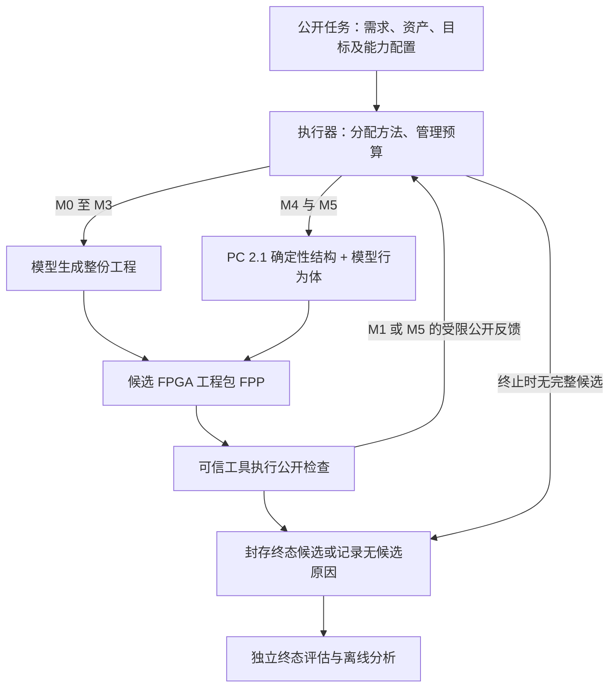

# SR2FPGA 项目整体设计与介绍

_面向新成员的中文总览，基于 2026 年 11 月 17 日路线 A 工作树。_

---

## 🎯 项目定位

SR2FPGA 是一个面向现场可编程门阵列（Field-Programmable Gate Array，FPGA）的工程生成与评估研究项目。它从自然语言硬件需求出发，将顶层接口、数据格式、时序协议和数值规则整理成可核验的输入，再让模型生成寄存器传输级（Register-Transfer Level，RTL）实现和工程清单。工程可以包含多个 RTL 文件及模块，由可信工具链统一加载、仿真和综合，并把结果绑定到具体的候选版本。

路线 A（Paper-1）研究工程契约能否帮助模型遵守跨模块约束、确定性构建能否减少工程结构错误，以及预算内的公开反馈修复能否改善端到端结果。当前研究对象是三个大语言模型（Large Language Model，LLM）推理子系统。早期并行的路线 B 研究 AI 生成的测试台对已暴露 RTL 语义违例的漏报，其协议、评估数据和结果保留在历史记录中。详见 [路线索引](routes/README.md)、[Paper-1 v2.3 修订](specs/2026-10-28-sr2fpga-paper1-llm-case-amendment-v2.3.zh.md)及其 [v2.2 基础计划](specs/2026-09-15-sr2fpga-paper1-research-plan-v2.2.zh.md)。

## 🏗️ 整体架构与数据流



1. **准备任务。** 任务定义者确定可公开的需求、顶层接口、时钟和复位、握手约束及精确的整数运算规则。公开资产随任务附上大小和哈希，便于复核交给模型的输入。研究方案要求核心任务在模型调用前确认已具备执行条件。
2. **生成与构建。** 执行器按方法选择直接生成、先写规划、先提交契约或从契约构建结构。确定性构建器根据已校验的设计，生成模块外壳、端口与连接，并检查模型行为体能否在规定的边界内装配。
3. **验证与修复。** 评估器独立解析候选、比对实际端口、运行可信测试台和参考判定。M1 与 M5 可用允许公开的诊断修复各自负责的文件或设计。模型接口只接收公开输入和过滤后的反馈。评估器保管测试刺激、预期结果和原始日志。
4. **封存与分析。** 控制器记录候选哈希、预算、阶段状态和失败原因。整个配对批次关闭生成后，终态评估用封存候选执行。离线分析从预先定义的位置匹配结果，保留未评分的位置及其原因。

实现入口见 [PC 2.1 执行器](../agent/src/sr2fpga_agent/execution/README.md)、[评估器源码](../agent/src/sr2fpga_agent/execution/evaluation.py)及[离线分析](../agent/src/sr2fpga_agent/analysis/README.md)。

## 📦 两个关键交付对象

| 对象 | 解决的问题 | 主要内容 |
| --- | --- | --- |
| **Project Contract（PC，工程契约）** | 设计打算怎样组织，哪些连接和声明可以提前检查？ | PC 2.1 将公开需求、目标和工具能力配置绑定到设计提案。它描述模块层级、参数、端口、连接、张量形状、量化编码及可静态检查的关系。控制器负责写入绑定，模型提交 `design`。 |
| **FPGA Project Package（FPP，FPGA 工程包）** | 评估工具应加载哪些源码，从哪个顶层启动？ | 由 `manifest.json`、声明的 RTL 源文件以及适用的构建和依赖信息组成。标准清单允许至少一个源码条目，具体任务仍可规定层级或组织形式。一个 RTL 文件也可以定义多个模块。 |

以两条 8 位整数通道的流接口为例，PC 可以声明通道数、数据位宽、掩码和端口关系，校验器检查声明之间的一致性，构建器据此生成接口结构。实际传输是否发生在 `valid && ready` 的时钟沿，以及下游暂停时数据是否保持，由 RTL 仿真和独立事务检查判定。详见 [PC 2.1 设计](specs/PC-2.1-AI-stream-contract-design.zh.md)、[PC 实现入口](../agent/src/sr2fpga_agent/pc/README.md)、[FPP 清单 Schema](../contracts/project-package/project-package-v1.schema.json)及[格式注册表](../contracts/manifest.json)。

## 🧪 Paper-1 如何比较生成方法

| 方法 | 初始候选怎么来 | 公开反馈修复 |
| --- | --- | --- |
| M0 · Direct | 从公开需求直接生成 FPP | 无 |
| M1 · Direct-Repair | 复用 M0 的初始结果 | 修改候选文件或重新生成 FPP |
| M2 · Structured-Direct | 先生成无类型约束的规划，再生成 FPP | 无 |
| M3 · PC-Free | 生成并校验 PC，再由模型生成整份 FPP | 无 |
| M4 · PC-Skeleton | 复用 M3 的 PC 及准入结果，由构建器生成结构，模型补齐行为 | 无 |
| M5 · PC-Online | 复用 M4 的初始结果 | 更新允许修改的设计决策或行为体，重新走适用的构建与检查流程 |

主比较 `M4−M3@initial` 让两者从同一份 PC 出发，比较确定性结构构建及其编辑边界带来的效果。`M5−M1@B4` 比较两个完整系统在相同总预算下的表现。B4 对两个修复方法各设最多四次逻辑模型调用，初始生成和修复均计入，正式的令牌、工具与时间等限额仍待冻结。统计以独立设计簇为单位，同一设计的配置或重复嵌套在簇内。两个主比较属于同一个 Holm 多重检验族。详见 [v2.2 方法与评估方案](specs/2026-09-15-sr2fpga-paper1-research-plan-v2.2.zh.md)及[执行器方法说明](../agent/src/sr2fpga_agent/execution/README.md)。

## 🧩 当前开发案例

| 案例 | 实现什么 | 固定示例关注什么 |
| --- | --- | --- |
| [量化 QKV 投影](../agent/src/sr2fpga_agent/tasks/llm_qkv/README.md) | 把同一输入分别投影为查询（Query）、键（Key）和值（Value） | 4 个 Query 头和 2 个 KV 头的布局、整数重定标，以及三路输出各自暂停时的数据保持 |
| [带 KV Cache 的解码注意力](../agent/src/sr2fpga_agent/tasks/llm_attention/README.md) | 保存历史 Key 和 Value，当前查询对有效历史计算注意力结果 | 4 步缓存容量、4 个 Query 头共享 2 个 KV 头、整数查找表近似及复位失效 |
| [门控前馈网络](../agent/src/sr2fpga_agent/tasks/llm_ffn/README.md) | 前馈网络（Feed-Forward Network，FFN）的两路投影、激活门控、输出投影和残差加法 | 整数激活查表、逐元素配对、饱和及同输入残差 |

以 KV Cache 为例，候选接收当前步的 Q、K 和 V，并将 K、V 追加到缓存。第二步输出要使用前两步有效的 K、V，复位后的第一步则从空缓存开始。公开任务规定头分组、整数舍入和接口行为，独立整数参考按实际接收的事务重算输出，测试台据此核对连续调用、背压和复位。三个案例分别使用自己的固定合成配置，串接时需要另行定义并验证量化转换和整层接口。详见 [案例代码与开发命令](../agent/src/sr2fpga_agent/tasks/README.md)及[覆盖范围](code-guide/llm-case-coverage.zh.md)。

## 🔬 验证层级与当前进度

| 验证 | 回答的问题 |
| --- | --- |
| PC 静态检查 | 适用契约方法的输入绑定、层级、连接和声明是否一致？ |
| L0 · 工程一致性 | 清单、源码和顶层声明是否满足共同的工程准入规则？ |
| L1 · 解析与接口 | 工具能否解析和展开候选，实际顶层端口是否符合要求？ |
| L2 · 功能 | 可信测试台与独立参考能否在实际执行轨迹上确认结果、握手和复位行为？研究方案区分公开测试与独立终态测试。 |
| L3 · 综合 | 指定工具和脚本能否对候选完成综合？当前开发记录包含通用 Yosys 综合。 |
| L4 · 物理实现 | 在指定器件和约束下，布局布线、资源利用和已检查的时序路径表现如何？ |

正式主终点 `VPP-L3` 要求**同一封存候选**通过共同工程准入、指定 L1、公开 L2、一次独立隐藏 L2 及指定 L3，并满足相应的来源、边界和预算条件。通用综合给出通用逻辑单元统计，器件资源映射和布局布线需要各自的工具记录。详见 [v2.2 基础计划](specs/2026-09-15-sr2fpga-paper1-research-plan-v2.2.zh.md)及[验证与分析说明](code-guide/06-evaluation-analysis.md)。

当前工作树已实现 PC 2.1 校验与构建、M0–M5 开发执行器及离线分析。仓库记录显示，三个固定手写对照工程均通过了编译、独立仿真和通用 Yosys 综合，使用了零次模型调用。任务目录将三个家族均标记为部分实现（`partial`）、正式资格未就绪（`not_ready`）。正式设计簇、数据划分、验证器资格、预算冻结和新总体的 L4 证据仍待完成。Paper-1 方案已采用，正式实验尚未授权。详见 [当前工程状态](current-status.md)、[案例迁移记录](migrations/llm-case-migration-20261028.md)和[任务目录](../contracts/task-catalog/sr2fpga-task-catalog-v0.2.json)。

## 🗂️ 代码与资料入口

| 目录 | 职责与入口 |
| --- | --- |
| `agent/` | [Agent](../agent/README.md) 负责生成、验证、修复和记录。当前主线源码分布在 `pc/`、`execution/`、`tasks/`、`analysis/`。历史 Runner 和 System-HIS 继续服务旧配置和产物。 |
| `contracts/`、`datasets/` | [契约](../contracts/README.md)定义跨项目文件格式与注册信息。[数据发布](../datasets/README.md)保管不可变的版本化发布。 |
| `training/` | [训练子项目](../training/README.md)负责数据转换、微调、模型合并与服务，通过版本化文件与 Agent 衔接。Paper-1 的比较使用既定模型。 |
| `artifacts/`、`reports/` | [运行产物](../artifacts/README.md)保留候选、工具日志、预算和开发结果。[报告](../reports/README.md)保存经整理的证据及其适用范围。 |
| `docs/`、`references/` | [文档索引](README.md)连接规范、状态和开发指南。[参考资料](../references/README.md)保存论文和硬件背景材料。 |
| `app/`、`outputs/` | [演示应用](../app/README.md)与[对外展示材料](../outputs/)服务展示和交流。 |

## 🚀 本地上手

使用 Python 3.11 或更新版本，从仓库根目录在 PowerShell 中运行。第一组命令查看当前工作树的入口，然后准备三组公开开发输入。`llm-public-01` 应是未使用过的输出目录名。`prepare` 只准备公开输入和来源记录，模型和硬件工具调用数均为零。

```powershell
$env:PYTHONPATH = (Resolve-Path agent/src).Path
python -B -m sr2fpga_agent.pc --help
python -B -m sr2fpga_agent.tasks.llm prepare --case all --output artifacts/paper1-ai/llm-public-01
```

具备 Yosys、Icarus Verilog 和 `vvp` 后，可执行手写对照检查。`--synthesize` 会额外运行通用综合。固定样例、六方法回放配置和安装要求见 [Agent 上手说明](../agent/README.md)及[中文代码手册](code-guide/README.md)。

```powershell
python -B -m sr2fpga_agent.tasks.llm check-reference --case all --output artifacts/paper1-ai/llm-reference-01 --synthesize
```
