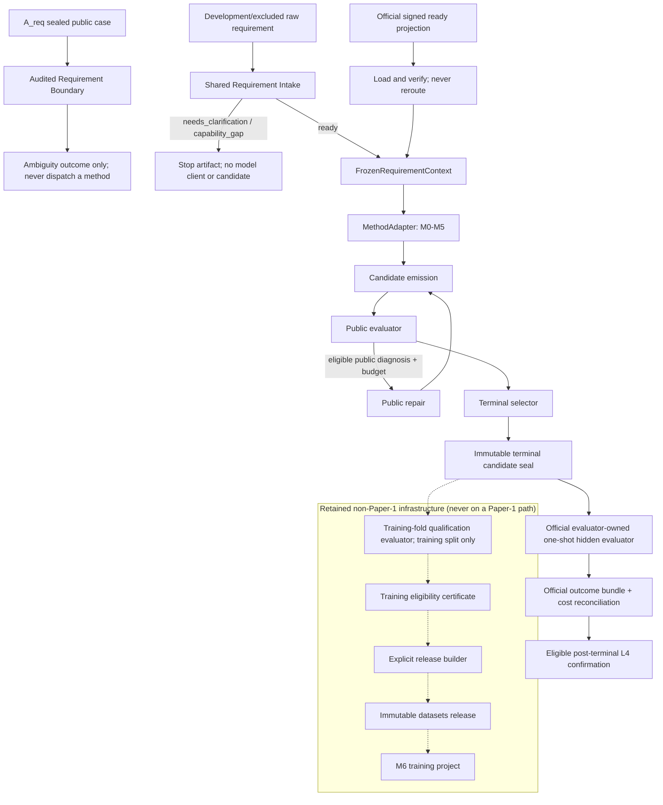
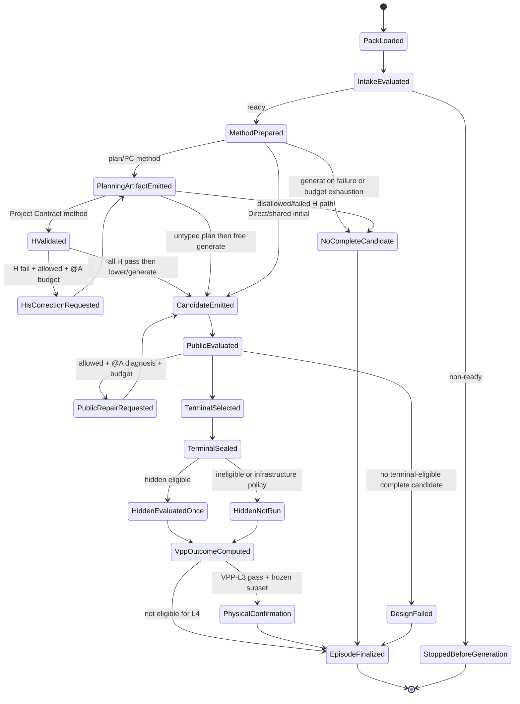

# SR2FPGA Paper-1 代码架构与开发规范

> 术语按 [2026-09-08 命名表](2026-09-08-sr2fpga-terminology.md) 同步：工程契约（Project Contract，PC）
> 当前序列化为 System-HIS v1.2；输出为 FPGA 工程包（FPGA Project Package，FPP）。
> DSC 表示设计空间契约，DP 表示单个架构设计点；内部标识和历史证据名称保留。

## 0. 状态、权威与适用范围

- **规范版本：** `sr2fpga-paper1-code-dev-v1.13`
- **生效日期：** 2026-09-14
- **规范类型：** Paper-1 下位实现设计规范（implementation design spec）
- **研究上位权威：**
  [`paper1-v2.1`](2026-09-14-sr2fpga-paper1-research-plan-v2.1.zh.md)（2026-09-14 采纳）
- **⚠ 尚未按上位权威同步：** 本规范仍按 `paper1-v1.8`
  ([历史基线](2026-08-14-sr2fpga-paper1-research-program-design.md))
  的方法族、G0-G9 gate 序列与预算公式编写，与现行计划的 B4 预算、两假设
  Holm 族和 WP0-WP6 工作包不一致。两者冲突时以研究计划为准；对齐工作属 WP0
- **机器格式权威：** [`contracts/manifest.json`](../../contracts/manifest.json)
  注册的版本化 contracts
- **当前事实权威：** 当前代码、可复现测试、证据 ledger，以及
  [`docs/current-status.md`](../current-status.md)

本规范把 Paper-1 的研究协议转换为可实施的代码架构、接口、状态机、
artifact 生命周期、开发顺序和验收测试。它不修改 Paper-1 的 estimand、
方法条件、信息权限、统计规则、held-out 设计或 gate 顺序；冲突时以上位
English freeze 为准。

本规范首先约束 G1-G3 的代码闭环，并定义 G4a/G4b、G6 campaign materialization
与 G7 official execution 所需的机器接口。
它**不授权**付费 API campaign、正式 hidden evaluation、数据 release、模型训练、
模型发布或结果声明。`official_vpp` 必须保持 fail-closed，直到签名 G4b
manifest 通过验证。

以下变更记录按版本升序排列。每条开头标注该版本的性质：引入新规范条款、取代既
有条款，或只同步实现进度而不改变规范语义。v1.0 与 v1.1 的条目在本文进入仓库
前已不存在，本文不追溯重建；引用这两版时以本节之后的正文为准，不得假设它们包
含未被后续版本覆盖的条款。

v1.2（取代范围定义）落实 `paper1-freeze-v1.3` 的范围修订：Paper-1 目标期刊为
ACM Transactions on Reconfigurable Technology and Systems（TRETS），方法集合
冻结为 M0-M5，不训练模型。RQ3、M6U/M6F/M6T/M6TR 及其训练授权链不再属于
Paper-1 关键路径。仓库现有 training contracts、exporters、inspectors、
`train_lora` 和 `merge_lora` 作为非 Paper-1 基础设施保留；其存在、缺口或运行
结果均不得阻塞或支撑 Paper-1 声明。本次不做 contract migration，也不删除兼容
reader。

v1.3（引入 target-profile adaptation 面，其强制措辞已被 v1.7 取代）落实
`paper1-freeze-v1.4` 的 target-profile adaptation amendment：G4a/G4b 必须冻
结成对 profiles、功能不变量、必须/允许/禁止变化和 profile-compliance
commitment；G8 必须在完整 pair 分母上产生 `TPA-L4`。该实现面仍是 `missing`，
不得从现有两个 L4-open 工件推断 adaptation、跨器件或跨厂商能力。

v1.4（同步实现进度，不改变规范条款）记录 development/excluded evaluator
authority 的落地：每个 attempt 在 evaluation 前进入 immutable candidate
authority，public diagnosis 是 repair 的唯一 evaluator 输入，registered
`@1`/`AT_A` selection 决定 terminal，terminal public 与 opaque development
hidden 只消费同一 verified terminal seal。

v1.5（同步实现进度，不改变规范条款）接入可选的 development/excluded
evaluator-owned trusted public L2 harness：配置时以固定 top、工具参数与
manifest/bundle commitment 执行，未配置时保持 `not_run(needs_oracle)`。

v1.6（同步实现进度，不改变规范条款）新增 reducer-only sanitized hidden
outcome，并在不改动 official VPP 的前提下产生独立 development VPP。它仍不提
供 official VPP、G3 acceptance 或 G4b authority。

v1.7（取代 v1.3 的 target-profile 强制措辞）同步 `paper1-freeze-v1.5`：
RQ1/RQ2 为核心 empirical line；G3 需要独立、artifact-derived 且可为 positive
的 non-official acceptance authority；planned sample 必须使用 first-class
`semantic_instance_id`、`decoding_seed` 和 `paired_block_id`；共享初态、
balanced order、三种 cost view 与 two-axis hidden closure 均是新增设计债。
official hidden/VPP 与 G4b authorization 仍不属于 G3。v1.3 中 target-profile
的强制措辞由此改为 conditional：只有 `tpa_extension_status=enabled` 时，
pair/compliance/`TPA-L4` 才是 G4a-G8 required surface；disabled 不阻塞核心
G4b。该同步不声称上述新接口已经实现，也不产生任何研究 outcome。

v1.8（取代 v1.7 的重复测量身份定义）同步 `paper1-freeze-v1.6`：paired
execution 的重复测量身份改为 `(semantic_instance_id, replicate_id)`；
`requested_decoding_seed` 只作为独立 provider provenance；本地
`execution_schedule_seed` 单独控制 balanced order。G4b 必须冻结
`documented_seed_control|stochastic_blocked` 之一。前者要求 independently
reviewed eligible capability profile；后者估计冻结 provider/config 下的
stochastic expected effect，并禁止 common-randomness、seed-effect 或
bitwise-replay 论断。G3 只需从不可变 protocol/documentation-review/per-call
observations 重算 classifier 与 strict guard 的正负 fixtures，不等待现实
provider eligible。当前 Runner 已实现 development-only replicate/
schedule/order authority，但仍无 mode-aware G4b verifier 或现实 eligible
provider；因此该同步与后续实现均不产生 G3 closure 或结果。

v1.9（引入 RQ1 统计与 analysis contract 义务）同步 `paper1-freeze-v1.7` 的结
果前 RQ1 统计修订：`M4-M3` 与 `M4-M0` 构成两项主要 Holm family，`M3-M2` 是强
制报告的 secondary estimation contrast。`M4-M3` 的规范解释是 deterministic
materialization 与 editable-surface policy 的联合增量，不是 skeleton-only
effect。该同步不改变 M0-M5 dispatch、episode 数、信息权限、预算、RQ2/RQ0/RQ4
或 v1.6 decoding-control 规则；它只增加 G4a/G4b analysis contract、RQ1
gate-conditional joint/marginal- power report、RQ2 Holm-adjusted
marginal-power report、结果 reducer 与 claim activation 的实现义务，不产生任
何 outcome 或 gate closure。

v1.10 封存 2026-08-28 development/excluded generation 与 gateway errata。OpenAI-
compatible gateway 现在显式区分 Chat Completions 与 Responses wire API，记录
`reasoning_effort`/response-storage policy，并将这些配置连同 `max_tokens` 绑定到
measurement freeze 与 paired model-provenance hash；Responses 不转发 seed，因而不能使用
现有 development seed-capability v1 通过 strict paired-confirmatory guard；Chat
Completions 配置若声明 Responses-only reasoning/storage 选项则在 source/client 创建时
fail closed，不能静默忽略。Logical
`call_id` 的 v1 Schema 下界修正为与 writer 一致的 zero-based。Project Contract H1 现在要求
top clock/reset 也存在于 `top.ports`，并把 `top.parameters[*]` 与
`components[*].parameters[*]` 约束为具有非空字符串 `name` 的对象；不自动把字符串
parameter 归一化为对象，registered System-HIS v1.2 Schema 保持不变。Canonical timing-
constraint 与 predicted-QoR 路径由 deterministic skeleton layout 单点定义，而不是冒充
backend capability profile 字段。Deterministic skeleton 在任何 HIS2PROJECT API 前执行
static consistency preflight；被拒的 raw HIS2PROJECT 文本使用 text media type 保存；相同
repair output 消耗本次调用后以 non-repairable `NoProgress` 停止，并保留 parent/produced
artifact refs。以上均为 development protocol correction，不改变
`paper1-freeze-v1.7`、正式 M0-M5 定义或 `g3_accepted=false`。

迁移策略保持 additive/read-compatible：既有 System-HIS v1.2、seed-capability v1、
model-gateway-provenance v1、model-output refs 与 measurement freezes 不原地改写；旧
`application/json` model-output refs 仍按 bytes 读取；seed-capability v1 视为 Chat
Completions probe identity，Responses 需要未来 versioned capability contract 才可能进入
strict paired mode；新增 freeze 字段只由 v1.10 producer 写入。M4/M5 shared immutable
initial project、M5 `@1`/`@A` correction separation、positive G3 reducer 与完整 scenario/
cost closure 继续是 G3 debt，本版本不宣称关闭。

v1.11（同步实现进度）实现 G3a development paired-block identity/order
authority。注册的 `paired-block-v1` 绑定 semantic instance、replicate、
public projection、共同 effective model/gateway identity、decoding-control
provenance、独立 schedule seed 与完整 M0-M5 Williams row，且所有
official/pass-credit/G3/G4b 位固定 false。Runner 在创建 run 目录前以纯函数规
划确定性 payload/ref，拒绝 method order、block membership 与共同模型配置冲突；
runtime 只在 run-scoped ArtifactStore 物化并 verified read-back，随后由
artifact order 驱动 freeze 与串行 loop。相同 ref/ordinal 进入 episode-pack
audit projection、measurement freeze、generation/completion events、hidden
commitment 与每个 trajectory attempt 的 input hash；full-pack runner
reconciliation v2 可选地携带成组 block/order 字段，并从 JSONL 实际顺序、六个
packs、freeze 与 trajectories 重算。旧 episode-pack-v1、trajectory-v2 和不含
该可选组的 runner-reconciliation-v2 仍可由当前 reader 读取；旧 closed Schema
reader 不保证读取新增可选字段。Partial excluded block 与
`development_derived` 兼容样本不签发 block artifact。该切片只关闭 G3a 实现债，
不关闭 G3，也不构成模型或实验结果。

v1.12 实现 G3b development conformance，G3 仍未验收。三个新增 registered
development contracts 分别承载 method-neutral block preparation events、三节点 shared-
checkpoint manifest 与 paired-block three-view cost reconciliation。Complete excluded block
在 measurement freeze 后、method loop 前 eager 物化 Direct initial project（S_D）、shared
Project Contract（S_H）与从 S_H 生成的完整 behavior-filled initial project（S_P）；M4/M5 消费
相同 S_P ArtifactRef，只有合法 repair 才可使 terminal candidate 分化。Strict verifier 从
独立提供且 fingerprint-verified 的 preparation policy 出发，重算 exact paired identity/key/
graph/consumer/content/event-chain/close-total invariants。当前 offline fake-provider fixtures
的 clean block 为 6 次 physical initial calls，对应 10 次 standalone-attributed initial calls，
并对 actual、standalone 与 `M1-M0`/`M4-M3`/`M5-M4` 三个 checkpoint-specific
incremental views 的全部 13 axes 做 artifact-derived 对账；count axes 保持 integer，duration
axes 保持 numeric，unavailable value 保留 reason 而不是替换为 zero。Shared preparation
保持 method-neutral，不计入 execution ordinal zero。普通 failed/`not_run` method 在
incomplete companion 中保留合法 trajectory/event/cost lineage；checkpoint-blocked method
使用 null trajectory 与 closed measured-zero exclusive cost。Clean interrupted run 可对冻结
method-order 的全部完成前缀 `k=0..6` 幂等 resume，且不重复 preparation call/event/charge；
inconsistent、partial-next-method、corrupt、incomplete-manifest 或 legacy-in-place 状态必须
使用新 run ID。支持的 standalone model-call ceiling override 继续有效，malformed policy
在 preparation side effect 前 fail closed。Visibility 与 tamper 路径也 fail closed。这不声明
外部加密不可变性，且没有产生 real-model、training、official held-out、evidence promotion
或 paper outcome。所有 official/pass-credit/RQ/G3/G4b 位仍固定 false；M5 H-stage
scenario/episode authority、capability-to-call binding、two-axis hidden missingness、remaining
repair probes 与 positive `g3-acceptance-v1` reducer 仍属于 G3c/G3d。

v1.13（编辑性一致性修订，不改变 artifact 语义）修复本文内部、以及本文与仓库
事实之间的不一致。本版本不新增、不放宽任何 MUST/SHOULD 条款，不改变任何已注
册 contract 的形状、effective-information hash、事件语义或测试期望，因此无需
contract migration。具体为：变更记录改为升序并补齐版本性质与取代关系标注；
§3.1 补记第三条代码偏差并同步到 G3b；§4 架构图显式标出非 Paper-1 的 training
支路；§6 目标分层降级为非规范性参考并记录实际偏差；§7.4 的 paired identity
绑定改为与 v1.8 一致的 `(semantic_instance_id, replicate_id)`，并补上 M5 对
shared HIS 的消费；§13.4 与 §17.2 指明 `tpa_extension_status` 由
`campaign-freeze-v1` 承载且默认 `disabled`；§14.1 显式命名 13 轴；§14.2 的英
文段落改为中文，并显式记录 `failure_origin` 同名不同义的风险；§17.1 改为非穷
举分类说明，以 `contracts/manifest.json` 为唯一权威；§17.2 按「已注册但缺
official authority」与「完全未注册」拆分；§20.3 补 Linux/WSL 命令；§24 说明
本文与 `docs/superpowers/specs/` 的关系。本版本不产生任何 research outcome、
gate closure 或 official authority。

本文使用以下实现状态：

- `implemented`：当前代码存在，且有聚焦测试覆盖所述行为；
- `partial`：已有基础组件，但尚不满足完整协议或 gate acceptance；
- `missing`：没有可执行路径或没有所需机器 contract；
- `not_evaluated`：没有产生研究 outcome，不能由实现状态推断结果。

规范性词语含义：

- **必须（MUST）**：不满足即违反本规范；
- **应（SHOULD）**：默认实现，偏离时必须记录理由与测试；
- **可以（MAY）**：不改变研究语义时可选。

## 1. 第一性目标与非目标

### 1.1 代码要解决的真正问题

给定可能不完整、歧义或超出 backend 能力的需求，系统必须输出二者之一：

1. 一个冻结、内部闭合的完整 FPGA 项目，以及由候选系统之外建立、与需求和
   项目哈希绑定的适用范围内证据；或
2. 一个诚实的终止状态，例如 `needs_clarification`、`capability_gap` 或
   evaluator/runner 建立的 `not_run`。

系统不得通过偷改需求、把未知任务映射到最近 family、让候选 testbench
自证、隐藏重试、选择 best-of-N、泄漏 hidden 反馈或排除失败样本来制造成功。

### 1.2 可信交付单元

Paper-1 的最小评测单元不是单个 Verilog 文件，也不是
Project Contract，而是：

```text
frozen requirement projection
+ method condition and complete provenance
+ coherent multi-file FPGA project
+ public attempt/repair history
+ immutable terminal candidate digest
+ evaluator-owned hidden outcome or explicit not_run
+ reconciled cost and missingness
```

Schema、H0-H3、L0、L3、mutation score 或 trajectory 文件均只是
支撑机制，不能单独构成项目正确性或研究结果。

### 1.3 非目标

本轮架构开发不应：

- 重写所有现有 `agent.py` / `runner.py`；
- 把 deterministic generators 变成模型条件；
- 把 Family Recipe 并入 Project Contract Core Contract；
- 用更宽松的检查让旧 artifact 获得新 pass credit；
- 运行任何 Paper-1 模型训练，或在 G4b 前运行 official outcome；
- 把有限 OASA 通过描述成任意开放世界需求理解；
- 把候选 TB、隐藏 oracle 或 evaluator secrets 暴露给候选或 repair 路径。

## 2. 不可违反的架构不变量

1. **完整项目优先。** 所有 headline 方法输出完整 project package；
   REQ2FILE 仅是兼容性 derived view，不获得项目级 pass credit。
2. **共同 requirement facts。** M0-M5 只消费同一冻结 public requirement
   projection；development/excluded run 可以执行 shared intake，A_req 对 intake
   本身评分，而 official VPP 只能加载并验证 evaluator-adjudicated frozen ready
   projection，不能重新 route 或改变 disposition。
3. **显式方法。** `method_condition` 决定 adapter；`source`、provider、model
   仅是 provenance，不能反向定义研究方法。
4. **方法适用性。** M0/M1/M2 的 H0-H3 为 `not_applicable`；Project Contract
   方法才执行 H-stage。
5. **三层分离。** Project Contract Core Schema、Backend Capability Profile、
   Family Recipe 永远是三个独立层。
6. **public/hidden 分离。** repair 只看 frozen public policy 允许的诊断；
   hidden evaluator 只在 terminal seal 后运行一次，永不回流。
7. **候选不能自证。** Candidate TB、`TEST_PASS`、预测 QoR 与 generated
   requirement trace 不得成为 hidden authority。
8. **事件先于汇总。** Attempt、预算、patch、tool、outcome 都必须从不可变
   raw event 推导；summary 不能成为唯一事实源。
9. **失败也计费。** 失败调用、parser/schema retry、repair、tool timeout 与
   infrastructure retry 均是 first-class event。
10. **状态不混淆。** `not_run` 不是 design fail；infrastructure failure
    不是 model fail；H/L pass 也不是 hidden correctness。
11. **Paper-1 不训练。** 任何 training view、checkpoint 或训练结果均不进入
    Paper-1 方法、gate、estimand 或 claim。
12. **跨项目只走文件 contract。** 保留的 Training 不导入 Agent；Agent 不导入
    Training 或重型 ML runtime。

## 3. 当前实现快照与缺口

此表是 2026-08-30 G3b development checkpoint 的实现快照，不是实验结果、正式 gate
签名或远端发布状态。

| 能力 | 状态 | 当前实现 | 主要缺口 |
| --- | --- | --- | --- |
| 统一 Requirement Boundary | `implemented` | `requirement_envelope.py`、`requirement_boundary.py`；所有当前方法在 generation 前执行 | 仍是有限 deterministic policy；无 official replay campaign |
| RQ0/OASA contract 与 runner | `partial` | sealed manifest loader、Phase A/B、exactly-one replay、event interceptor、witness 与 cluster reducer | 无 signed fixture population、冻结 interval/threshold 或 official campaign |
| M0 Direct | `implemented`（开发路径） | `DirectProjectGenerator`；H0-H3=`not_applicable` | 尚非 episode-driven official adapter；无 official hidden |
| M1 Direct-Repair | `partial` | Direct + budgeted `ProjectRepairer`；每个 attempt 进入共同 development public/selection/terminal authority；可配置 trusted public L2 | 缺 official hidden/VPP 与 official budget authority |
| M2 Structured-Direct | `partial`（开发路径） | provider-neutral adapter、frozen-context untyped plan → canonical free-project 两调用；标准 Runner 已接入且 H-stage/skeleton/repair 调用为零；attempt/terminal authority 与可选 trusted public L2 已统一 | 无 official campaign authority |
| M3 PC-Free | `partial` | context-native frozen REQ2HIS、H0-H3、true no-skeleton full-project facade、与 M4 shared-PC coordinator；显式 development Runner dispatch、attempt/terminal authority、可选 trusted public L2 与 sanitized hidden reducer 已接入 | 缺 full-axis official budget 与 official authority |
| M4 PC-Skeleton | `partial` | context-native frozen REQ2HIS、H0-H3、trusted skeleton、behavior fill、与 M3 shared-PC coordinator；显式 paired development Runner dispatch、attempt/terminal authority、可选 trusted public L2 与 sanitized hidden reducer 已接入 | implicit compatibility path 尚存；缺 full-axis official budget 与 official authority |
| M5 PC-Online | `partial` | 标准 Runner pre-candidate dispatch、context-native 单次 PC correction、完整 H0-H3 外层重验、verified-envelope/behavior-region-only project-repair facade、共享 logical call ceiling；所有返回 attempts 进入共同 authority，可配置 trusted public L2，并归约 sanitized development hidden outcome | repair facade ownership 仍属 compatibility orchestration；缺 official authority |
| H0/H2 authority | `implemented` | registered Schema；registered capability profile + dry lower；34 个 deterministic writer 全部通过 H0-H2 | 仅为 G1 conformance，不是功能证明 |
| H1/W1-W10 | `implemented`（有界） | 逐规则 `pass/fail/not_applicable`、正负 fixture、注册 conformance matrix；34 个 deterministic writer 无 fail；W3 27 pass/7 合法 N/A，W5 34 pass | 仅证明契约一致性，不是功能正确性证据 |
| Generic value-aware H3 | `implemented`（有界） | Envelope/trace/value mapping | 不是任意 requirement correctness 或 functional proof |
| Logical model-call ledger | `partial` | 失败调用计费，active internal attempts=1；M0-M5 Runner sample 已按真实 attempt 创建/路由/关闭 write-once `AttemptCostLedger`。Complete excluded block 另由 method-neutral preparation ledger eager 记录 S_D/S_H/S_P，verified reducer 对账 actual/standalone/三种 incremental 的全部 13 axes；fake-provider clean block 为 6 physical/10 standalone-attributed initial calls，shared cost 不进入 ordinal zero。Registered `trajectory-v2` 继续重验 method-exclusive authority、seal、cost 与 hidden lineage | G3b development conformance 已实现；仍缺 official authority、two-axis hidden closure 与可产生正式 VPP/G3 acceptance 的 reducer 输入 |
| Public/hidden/L4 separation | `partial`（开发边界） | development/excluded Runner 在每个 immutable attempt 上调用 evaluator-owned public authority；sanitized diagnosis 是 repair 的唯一 public-tool 输入；registered `@1`/`AT_A` selection 产生 terminal seal，terminal public 与 opaque hidden 只消费该 exact seal；可选 trusted harness 产生 public L2；reducer-only hidden artifact 产生 sanitized development `pass/fail/not_run`；raw evaluator data 不越界 | 无 official process/outcome、signed G4b commitment 或 authority |
| Common project contract | `partial` | registered package/envelope、canonical+legacy resolver、role-based common L0、独立 PC consistency、write-once per-attempt/terminal seal 与 reconstruction API；development/excluded Runner selection 和 evaluator dispatch 已统一消费 | Legacy Recorder/release 仍为 compatibility view；official loader、commitment 和 command gate 缺失 |
| Runtime trajectory/view Schema validation | `partial` | legacy Recorder view 保留；registered `trajectory-v2` 逐 attempt 验证 raw event refs、cost summary、identity/hash lineage，并重新验证 registered selection、selected authoritative outcome、terminal public、matching public-L2 harness commitments、exact seal、opaque hidden ref 与可选 sanitized hidden outcome；正常和 aborted accounting path 均写新 artifact；episode/full-pack 另行归约 development VPP | legacy view 未验证为 v1；official full-pack VPP 固定为 `not_evaluated` |
| Retained training-view infrastructure | `partial`（非 Paper-1） | eligibility certificate、canonical v2 exporter/sidecar、matched candidate pools、unpromoted release、Training structural inspector | 不属于 Paper-1 gate；不得据此产生论文方法或结果声明 |
| Catalog/evidence/stage semantics（G2） | `implemented`；本地关闭 | catalog v0.2.2、ledger/alias/stage/L4 provenance 回归 | 该关闭不是模型结果；历史 artifact 仍需 G4b migration/exclusion policy |
| Training infrastructure | `partial infrastructure`（非 Paper-1） | arbitrary-file conversion/dry-run、手工 LoRA/merge、v2 reader 和 promoted-shape inspector | 保留供未来独立研究；Paper-1 不调用、不补齐、不评测 |
| M6 outcomes | `withdrawn from Paper-1`, `not_evaluated` | 无 | 不属于 Paper-1 方法或结果矩阵 |

### 3.1 当前三个首要代码偏差

本节与 §3 表格同为 2026-08-30 G3b development checkpoint 快照。G3a 的
paired-block identity/order authority 与 G3b 的 shared-checkpoint/cost-view
conformance 已实现（见 §7.4、CD9）；G3c/G3d 的 M5 H-stage scenario/episode
authority、capability-to-call binding、two-axis hidden missingness、
remaining repair probes 与 positive `g3-acceptance-v1` reducer 仍未实现。以
下偏差均为实现状态，不是实验结果。

**剩余 orchestration ownership 偏差：** role-based project package/envelope、
frozen episode pack、write-once store/seal、M0-M5 adapters、M2/M3 emissions 和
pre-candidate executor 均已形成有界、受测 core。显式 M2-M5 development pre-candidate
dispatch 已接入 Runner：M2 是 untyped plan → free project，M3 是 no-skeleton PC → free
project，M4/M5 是 skeleton-fill，M5 另有一次 bounded complete-H correction。M5 project
repair facade 与部分 implicit compatibility paths 尚未统一拥有 orchestration；但所有返回
attempts 已进入共同 development/excluded public authority、registered selection、terminal
reseal、terminal-public/hidden dispatch 与 trajectory reconciliation；可选的 hash-bound
trusted public L2 harness 和 sanitized development hidden/VPP reducer 也已接入；缺少完整
acceptance fixtures，因此仍
不能解释为 G3 closure。

**正式 evaluator authority 偏差：** development/excluded public 与 hidden boundary 已从
独立 store 消费 verified seals，且 public raw data/hidden data 不回流；配置并验证 trusted
harness 时 public L2 可产生 development-only `pass/fail`，否则仍因 `needs_oracle` 为
`not_run`。hidden 对 Runner 仍只返回 opaque ref；另一个 reducer-only artifact 可生成
sanitized development hidden outcome 和 development VPP。不存在 signed G4b
official loader、commitment、command guard 或 outcome producer。保留的 candidate training release、Training inspector
与手工训练入口属于非 Paper-1 基础设施，不构成当前 gate 缺口。

**package 分层偏差：** §6 规划的 `domain/`、`intake/`、`methods/`、`execution/`、`evaluation/`、
`accounting/`、`storage/` 子包目前一个都不存在；`agent/src/sr2fpga_agent/`
仍是约 80 个平铺模块加 `generation/`、`oracles/`、`task_families/` 三个子包，
CD1-CD6 的交付物（`episode_executor.py`、`method_adapters.py`、
`public_evaluator.py`、`artifact_store.py`、`cost_accounting.py` 等）都以平
铺文件落地。§6 原本以「只有对应 work package 开始时才创建目录」为条件，而该
条件早已满足，因此 §6 自本版本起降级为非规范性参考（见 §6）。该偏差不影响任
何 contract、visibility 或 pass-credit 语义，但会持续增加模块间意外耦合的风
险；收敛计划必须与一次独立的重构 work package 绑定，不得夹带在功能切片里。

## 4. 目标系统架构



虚线 `RET` 子图是仓库保留的非 Paper-1 基础设施（§18）。按 §2 不变量 11，
Paper-1 不运行其中任何一步，也不得把该支路的存在、缺口或运行结果当作 Paper-1
的方法、gate 或结果证据。实线路径 `R -> ... -> L` 才是 Paper-1 的目标架构。

### 4.1 渐进迁移原则

现有 `cli.py`、`runner.py` 和 `DataGenerationAgent` 保持兼容 façade。
新增功能必须先通过独立核心接口进入，再逐步让旧入口委托新核心；禁止一次性
搬迁所有 generation/checker/oracle 代码。

现有下列 primitives 可保留原位置：

- `generation/` 的 Direct、REQ2HIS、HIS2PROJECT、skeleton fill；
- `his_validation.py` 与 Project Contract checkers；
- `contract_skeleton.py`；
- `path_safety.py`、tool wrappers 与 QoR parsers；
- deterministic `project_generator.py`，但仅作为 reference/template。

## 5. Repository 与依赖边界

| 项目 | 负责 | 不负责 |
| --- | --- | --- |
| `contracts/` | 语言无关 Schema、registry、catalog、policy contract | runtime state、Python orchestration、结果 |
| `agent/` | intake、方法执行、public evaluation、repair、candidate seal、evaluator orchestration、events | 模型训练、dataset release 原地改写 |
| `training/` | release validation、view rendering、token audit、SFT/LoRA、selection、merge | 生成/修复 FPGA 项目、导入 Agent |
| `datasets/` | 显式晋升后的不可变版本化 release | 临时候选、prepared data、checkpoint |
| `artifacts/` | ignored candidate、run、evaluator、prepared、checkpoint 输出 | 机器 contract 或默认提交证据 |
| `reports/` | 经审计的稳定 evidence 与 named-run report | 自适应 runtime scratch |

目标依赖方向：

```text
contracts files  <- agent readers/writers
contracts files  <- training readers
datasets files   -> training
agent runtime    -X-> training runtime imports
training runtime -X-> agent runtime imports
candidate        -X-> evaluator private storage
```

## 6. 目标 package 分层

**本节自 v1.13 起为非规范性参考。** 下列结构是期望的收敛方向，不是任何 work
package 的验收条件；§22 DoD 不检查它。当前实际布局见 §3.1 的 package 分层偏
差：`agent/src/sr2fpga_agent/` 仍是平铺模块，本节所列子包均未创建。改动本节
不需要 contract migration，也不使任何 campaign 失效；真正要求的边界写在 §5（
项目间依赖方向）和 §15（visibility），那两节才是规范性的。

```text
agent/src/sr2fpga_agent/
  domain/
    episode.py                 # public/private refs, immutable IDs
    method.py                  # MethodContract and applicability
    candidate.py               # candidate snapshot/seal
    outcome.py                 # status vocabulary and references
  intake/
    context.py                 # FrozenRequirementContext
    audit_runner.py            # A_req only
    clarification_replay.py    # exactly-one replay
  methods/
    base.py
    direct.py                  # M0/M1 primitive adapter
    structured_direct.py       # M2
    his_free.py                # M3
    his_skeleton.py            # M4/M5
  execution/
    episode_executor.py
    state.py
    terminal_selector.py
  evaluation/
    common_l0.py
    public_evaluator.py
    hidden_evaluator.py
    physical_confirmation.py
    outcome_assembler.py
  accounting/
    events.py
    budget.py
    cost.py
  storage/
    artifact_store.py
    contract_writer.py
```

`agent.py` 逐步变为 façade；`runner.py` 只负责 config、pack loading、调度、
恢复和 aggregation，不再拥有方法语义、visibility 或 pass-credit 规则。

Training 的目标分层：

```text
training/src/sr2fpga_training/
  contract_registry.py
  release_reader.py
  view_renderer.py
  prepare_release.py
  token_audit.py
  training_plan.py
  checkpoint_selection.py
  provenance.py
  inference_preflight.py
  train_lora.py
  merge_lora.py
```

现有 `prepare_dataset.py` 保留为 development/legacy converter，不自动获得
Paper-1 release 资格。

## 7. 核心 domain model

Python 内部继续使用 frozen `dataclass`、`Enum` / `Literal` 和 `Protocol`；
文件边界必须使用注册 JSON Schema。不得引入只为单一接口服务的重型 ORM
或跨项目 Python dependency。

### 7.1 FrozenRequirementContext

Requirement Intake 每个 episode 只执行一次，输出不可变 context：

```python
@dataclass(frozen=True)
class FrozenRequirementContext:
    requirement_id: str
    revision_id: str
    public_text: str
    fact_records: tuple[RequirementFactRecord, ...]
    platform_profile_id: str
    platform_profile_sha256: str
    capability_profile_id: str
    capability_profile_sha256: str
    disposition: Literal["ready"]
    public_projection_sha256: str
```

Development/excluded path 可以从 raw request 构造此对象；A_req 执行并评分
intake；official VPP 只能调用 `load_and_verify_frozen_ready_context()` 从签名
episode pack 读取对象，不得重新执行 boundary、提问、补默认值或改变
disposition。

M0-M5 prompt builder、H3、repair 均只读此对象，不得再次 route、重新推断
默认值或从 evaluator-only `family_id` / `task_type` 补事实。

当前 `ProjectRequest.task_type` 可继续服务 development 和 deterministic
reference；official pack 不得把 evaluator task metadata 伪装成 user fact。

### 7.2 FrozenTargetProfilePair

```python
@dataclass(frozen=True)
class FrozenTargetProfilePair:
    profile_pair_id: str
    semantic_instance_id: str
    baseline_target_profile_id: str
    baseline_target_profile_sha256: str
    variant_target_profile_id: str
    variant_target_profile_sha256: str
    change_axis_ids: tuple[str, ...]
    functional_invariant_ids: tuple[str, ...]
    required_change_ids: tuple[str, ...]
    allowed_change_ids: tuple[str, ...]
    forbidden_change_ids: tuple[str, ...]
    profile_compliance_commitment_sha256: str
    required_terminal_stage: Literal["L3", "L4_OPEN"]
```

该对象由 evaluator-owned G4b pack 产生。pair 的两个成员必须共享同一冻结语义
义务和 hidden-oracle semantics；model/adapter 只能看到各成员的公开 target profile
和声明公开义务，不能看到 compliance verdict、private commitment 或另一个成员的
outcome。任何 post-outcome pair、axis、invariant 或 rule 修改都使 campaign 失效。

### 7.3 MethodContract 与 MethodAdapter

```python
@dataclass(frozen=True)
class MethodContract:
    method_condition: MethodConditionId
    declared_model_stages: tuple[ModelStageId, ...]
    emits_system_his: bool
    h_stage_applicability: Literal["required", "not_applicable"]
    planning_representation: PlanningRepresentation
    project_generation_kind: ProjectGenerationKind
    uses_deterministic_skeleton: bool
    allows_his_correction: bool
    allows_project_repair: bool
    model_visible_field_ids: tuple[RegisteredFieldId, ...]
    allowed_edit_surface_id: RegisteredPolicyId
    budget_allocation_id: RegisteredBudgetId

class MethodAdapter(Protocol):
    contract: MethodContract

    def emit_initial(
        self,
        context: FrozenRequirementContext,
        services: GenerationServices,
        shared_artifacts: SharedArtifactRefs,
    ) -> MethodEmission: ...

class HisCorrectionCapable(Protocol):
    def correct_his(
        self,
        context: FrozenRequirementContext,
        planning_artifact: PlanningArtifactRef,
        diagnosis: PublicHisDiagnosis,
        services: GenerationServices,
    ) -> PlanningArtifactRef: ...

class ProjectRepairCapable(Protocol):
    def repair_project(
        self,
        context: FrozenRequirementContext,
        candidate: CandidateRef,
        diagnosis: PublicProjectDiagnosis,
        services: GenerationServices,
    ) -> ProjectCandidateEmission: ...
```

上述 ID/type 必须是 closed `Enum` / `Literal`，或由注册 contract resolver 验证的
registered ID；不得让自由字符串在运行时悄悄创造新方法、stage、visibility、
edit surface 或 budget 语义。

`MethodEmission` 是 closed union：`PlanningArtifactEmission |
ProjectCandidateEmission | MethodStageFailure`。Project Contract adapter 先显式发出
planning artifact；EpisodeExecutor 负责 H validation、H correction、lowering 和
project emission，不能把 pre-candidate H retry 隐藏在 `emit_initial()` 内。

`GenerationServices` 必须是 closed allowlist，只暴露 gateway、公开 prompt/context
refs、budget/event sink、candidate writer，以及 MethodContract 允许的
skeleton/PC facade。Runner、private evaluator、hidden store 或完整 artifact root
不得注入 adapter 进程。

H-stage applicability、skeleton policy、repair privilege 和预算不得再由类名、
metadata 字符串或 provider kind 推断。无 repair 权限的方法不实现 repair
Protocol；中央 RepairController 同时检查 MethodContract flag、attempt profile 和
budget 后才允许转换，禁止用 no-op/raise 方法伪装 capability。

### 7.4 PairedArtifactCoordinator

需要共享初态的 comparison 不能让两个 adapter 分别重调远端模型。Coordinator
先物化 method-neutral shared artifact，再给 treatment wrapper 只读引用：

- M0/M1 共享 `initial_project_package_sha256`（S_D）；各自 candidate ID/seal
  仍含 method condition；
- M3/M4/M5 共享同一 `shared_his_artifact_sha256`（S_H）。M5 与 M3/M4 消费的是
  逐字节相同的 frozen HIS artifact，不得各自重新调用 REQ2HIS；
- M4/M5 共享由 S_H 派生的完整 behavior-filled initial project（S_P）；
- identity 由 `paired_block_id`、requirement revision、`semantic_instance_id`、
  `replicate_id` 和 model provenance 绑定，而不是 method-specific episode ID。
  按 v1.8，`requested_decoding_seed` **不是** identity binder，只作为独立
  provider provenance 记录；本地 `execution_schedule_seed` 只控制 balanced
  order，同样不参与 identity；
- paired hidden evaluator 使用相同 frozen case seed/commitment；
- event 记录 artifact 生成一次、各方法的消费 lineage，以及 G4b 冻结的三种成本
  视图：block-level actual campaign consumption、每个方法的 standalone-attributed
  end-to-end cost、shared checkpoint 之后的 incremental contrast cost。

由此，一个 clean complete block 的 shared checkpoint 为 S_D、S_H、S_P 三个节
点，对应 §20.2 的 6 次 physical initial calls（S_D 1、M2 的 plan 与 project
各 1、S_H 1、M3 的 free project 1、S_P 1）与 10 次 standalone-attributed
initial calls（M0 1、M1 1、M2 2、M3 2、M4 2、M5 2）。这两个数只有在 M5 也把
S_H 计入自身 standalone 归因时才成立。

v1.12 的 complete excluded path 已实现这一 eager checkpoint 与 development cost-view
surface：S_D/S_H/S_P 在 method loop 前完成并由 verified manifest/readers 重验；partial 与
legacy path 保留 lazy compatibility 行为且不获得 G3b/G3 credit。当前 ArtifactStore 提供
本地 content-addressed、write-once 与 cross-linked read-back 语义；本规范不把它扩大解释为
外部 cryptographic immutability。

### 7.5 Candidate 与 terminal seal

每个 candidate snapshot 必须至少绑定：

```text
candidate_id
parent_candidate_id
episode_id
method_condition
attempt_id
requirement_projection_sha256
project_package_sha256
file_ownership_manifest_sha256
public_evidence_refs
creation_event_id
```

Terminal seal 额外绑定 terminal selection rule、model/decoding provenance、
public acceptance state、预算摘要、tool versions 和所有文件哈希。seal 后 candidate
目录只读；任何文件变化生成新 candidate，不能原地覆盖。

### 7.6 状态词汇

- Requirement disposition：`ready | needs_clarification | capability_gap`
- Runner execution：`completed | not_run | infrastructure_error`
- H stage：`pass | fail | not_run | not_applicable`
- Tool stage：`pass | fail | not_run | infrastructure_error`
- Candidate lifecycle：见第 8 节
- Training eligibility：`eligible | excluded | release_invalid`

不得用一个 `success: bool` 折叠以上状态。

## 8. Episode 状态机



每个转换必须写 append-only event。禁止转换：

- `HiddenEvaluatedOnce -> PublicRepairRequested`；
- `PhysicalConfirmation -> PublicRepairRequested`；
- `TerminalSealed -> CandidateEmitted`；
- non-ready intake -> model/provider/candidate/public evaluator；
- hidden failure -> candidate replacement 或第二次 hidden score。

Hidden/evaluator 基础设施 retry 只能对同一 terminal candidate hash 重放，并
记录新的 infrastructure event；它不能重新生成候选。Pre-candidate provider
transport retry 使用单独的冻结 policy、幂等 key 与 budget/event 语义。

`HiddenEvaluatedOnce` 表示 semantic outcome 已 committed；之后不得再次执行。
`HiddenNotRun(reason)`、generation failure、invalid candidate、public prerequisite
failure、budget exhaustion 与 infrastructure outcome 均必须进入固定分母和
missingness reducer，而不是被 happy path 丢弃。

## 9. Requirement Intake 与 OASA

### 9.1 共同 intake

必须区分三个入口：

- **Development/excluded：** 可以从 raw requirement 执行 shared boundary，
  产生可调试的 FrozenRequirementContext 或 stop artifact；
- **A_req/OASA：** 执行被审计 boundary，interceptor 在任何 M0-M5 调用前
  停止；
- **Official VPP：** 只加载并验证 G4b 前 evaluator-adjudicated、签名的
  frozen `ready` projection。不得重新 route、重新提问、自动选择另一个
  disposition 或改变 requirement revision。

输入仅允许：

- raw public requirement；
- 用户明确结构化字段；
- 冻结 public platform defaults；
- public capability profile ID/hash。

输出必须保存每条 fact 的 `user_explicit | platform_default |
system_assumption | unresolved` provenance。歧义优先于 capability gap：若合理
解释中既有可支持也有不支持路径，返回 `needs_clarification`，不得猜一个解释。

Family Recipe 只能在 disposition=`ready` 后选择，并保持 exact-only、
fail-closed。完整 decision/policy metadata 为 evaluator-only；只有合法
`applied` recipe body 可以进入对应模型 prompt。Primary held-out headline
条件不得接收 family-specific recipe。

### 9.2 OASA 独立状态机

```text
SEALED_CASE
-> PUBLIC_PROJECTION
-> PHASE_A_DISPOSITION
-> INTERCEPT
-> optional EXACTLY_ONE_ANSWER_REPLAY
-> FINAL_AUDIT_OUTCOME
```

OASA 不创建 project candidate，不调用 M0-M5，也不进入 VPP。
Gold disposition、material-interpretation witness、critical fact、permitted
default、answer branch 和 capability rationale 均为 evaluator-only。

`not_run` 只由 runner/evaluator 建立，不是模型可选择的 disposition；它保留在
总分母和 cost 中，但不进入 semantic confusion/false-block/false-proceed。

`ambiguity_outcome-v1` 与 cluster reducer 必须记录 critical fact、capability、
permitted default 与 explicit assumption 的 precision/recall，unknown-family
coercion、repeated-known-fact rate、one-replay closure、counterfactual consistency
和 generation-boundary violation。若 intake 含随机模型，同一 base cluster 的
任一冻结 seed false-proceed，则该 cluster 的 primary safety outcome 失败；
seed-average 只作诊断。

### 9.3 OASA 待实现模块

- sealed case manifest loader；
- witness/adjudication contract；
- permitted-default 与 explicit-assumption gold IDs；
- exactly-one clarification replay 与 lineage hash；
- downstream-event interceptor；
- private canary visibility spy；
- base-cluster-aware summary 与 frozen interval implementation；
- 独立 CLI，不复用 project runner。

## 10. Method adapters

| 方法 | 必须实现的 stage | Project Contract | Skeleton | Public repair |
| --- | --- | --- | --- | --- |
| M0 | full-project generation | 无 | 无 | 无 |
| M1 | 与 M0 相同 initial + repair | 无 | 无 | project |
| M2 | untyped plan + free full-project | 无 | 无 | 无（headline） |
| M3 | frozen REQ2HIS + free full-project | 有 | 无 | 无（headline） |
| M4 | 同一 frozen REQ2HIS + skeleton behavior fill | 有 | 有 | 无 outer EDA repair |
| M5 | M4 + repair | 有 | 有 | PC correction + project |

### 10.1 配对约束

- M1 必须复用对应 M0 的 `project_package_sha256`，再增加 repair。方法专属
  candidate ID/seal 不要求相同。
- M3 与 M4 必须按 method-neutral `paired_block_id` 复用逐字节相同的 frozen
  generated-PC artifact；用 `shared_his_artifact_id` 和 SHA-256 证明。
- M5 与 M4 初态相同。
- `R_generic / R_HIS` repair probe 从同一个 frozen failing M4 candidate
  开始，仅声明的 PC-aware diagnosis 字段不同。
- `source × model × method` 必须正交；任意已支持 gateway 应能运行任意已实现
  adapter。Provider-specific class 名只能留在兼容层。
- Paired methods 必须复用相同 hidden evaluator commitment/case seed；差异只来自
  声明的 method treatment。

### 10.2 `@1` 与 `@A`

- `@1` 只执行 MethodContract 声明的 initial generation stages；outer PC
  correction、project repair 和内部 retry 均为 0。Initial H failure 是该方法的
  first-emission failure，不能在 `@1` 中偷偷修复。
- `@A` 才可按 MethodContract 和冻结预算执行 PC correction、parser/schema
  retry 或 project repair。每类动作必须属于独立 budget axis/event type。
- M0/M2/M3/M4 headline `@1` 不提供 outer project repair；M1/M5 的 `@1`
  仍是其 repair 之前的 first emission measurement，repair 效果只在 `@A`/final
  outcome 中报告。
- Campaign manifest 必须冻结 attempt profile、stage allocation、terminal rule
  和方法间 matched budget。

### 10.3 M2 untyped plan

新增 `untyped-plan-v1` 时只能验证容器可解析性和 required generic fields，
不得引入 Project Contract semantic kinds、cross-field checker 或 deterministic
lowerer。建议最小字段：

```text
design_summary
file_plan
implementation_notes
verification_notes
```

第二 stage 自由生成完整 project package；plan 本身不获得 H-stage 或 pass
credit。

### 10.4 M3 true no-skeleton

M3 接收与 M4 相同的 Project Contract JSON，但第二 stage 直接生成完整 project。
实现必须提供 spy，证明未调用 `contract_skeleton.py`、deterministic task
generator 或 behavior-region filler。

### 10.5 保留的 M6 词汇（非 Paper-1）

以下词汇只用于解释仓库已有 contracts 和兼容代码，不是 Paper-1 的规范性方法：

- M6U/M6F 使用 M4 deployment pipeline，只替换冻结 checkpoint；
- M6T first-emission 同样使用声明的 deployment pipeline；
- M6TR 是 M6T checkpoint 加与 M1/M5 匹配的 public repair budget；
- source/model/checkpoint provenance 必须与 method condition 分开记录。

Paper-1 runner、campaign freeze、统计矩阵和 TRETS 论文不得实例化这些条件。

<a id="11-method-neutral-common-project-contract"></a>
## 11. Method-neutral common FPP delivery contract

### 11.1 Role-based package

应新增注册 `project-package-v1`，以 manifest role 而不是固定路径定义准入。

**共同必需：**

- `manifest.json` 及 contract version；
- 完整 manifest-declared RTL source set；
- manifest-declared top module，且在 source set 中存在；
- top/interface declaration；
- build/tool metadata；
- episode 规定为 applicable 的 constraints。

File ownership/editability 不是候选自报的共同文件；由 trusted candidate builder
在候选包外生成第 11.3 节的 `project-envelope.json`，并作为 candidate seal 的必需
输入。

**条件适用或 advisory：**

- `system_his.json`；
- H0-H3 report；
- candidate testbench；
- predicted QoR；
- family-specific helper files；
- L4 constraint/board wrapper。

不得要求所有方法的 top source 固定为 `rtl/top.v`。Manifest 可以声明其他安全
相对路径。Path safety 必须继续拒绝绝对路径、父目录跳转、隐藏 evaluator 路径
和未声明文件。

### 11.2 文件 ownership

每个文件必须记录：

```text
path
sha256
file_role
owner = model | trusted_builder | composite
origin = model_generated | deterministic
editable
snapshot_id
```

M4 的同一 RTL 文件可能同时含 trusted skeleton 与 model behavior，必须使用
`owner=composite` 加 stable region/edit-region IDs、trusted-span hashes、
model-region hashes 和 generation/repair event refs。或者把 behavior/delta 保存为
独立 model-owned artifact，再由 trusted composer 重建完整文件。不得把整个
composite 文件简单标为 model 或 trusted。

只有允许的 `owner=model && editable=true` 文件/region，或 composite 文件中的
声明 model region，可成为模型训练 target 或 repair patch target。Candidate TB
即使 model-owned 也不是默认训练 target；view policy 还必须检查允许的
file/region role。

Evaluator-owned material 不得作为 candidate-relative file record；只能在外层
envelope 中保留 opaque commitment/hash reference。Trusted skeleton、public/
hidden harness、oracle、constraints、board shell 和评分代码不得成为 assistant
target。

### 11.3 Trusted project envelope

候选 `manifest.json` 只声明 build intent，不能自证 ownership、editability 或
pass credit。Trusted candidate builder 必须在 candidate package 外生成
`project-envelope.json`，绑定 episode/method policy、规范化 file records、region
ownership 与 project Merkle root。

Envelope digest 不包含自身；实现使用排序后的 leaf records/Merkle root 或等价
无自引用 canonical digest。Repair、seal、evaluator 与 training release 只信任
该 outer envelope，不信任模型输出中的 ownership 字段。

### 11.4 两类一致性检查

必须分开记录：

```text
common_project_l0          # 所有方法共同
his_project_consistency    # 仅 Project Contract 方法适用
```

Project Contract 的额外检查不得被称为 method-neutral L0，也不得使 Direct baseline
按定义失败。

<a id="12-system-hish-stage-与两层-repair"></a>
## 12. Project Contract、H-stage 与两层 repair

### 12.1 三层 contract

```text
Project Contract Core Schema
  -> 定义合法形状与通用语义

Backend Capability Profile
  -> 定义当前 lowerer 支持的 kinds/protocols/scenarios

Family Recipe
  -> 可选生成提示信息，不属于 machine contract 或验证证据
```

Unsupported capability 必须返回 `capability_gap` 或 adapter requirement，不能
被提示词重命名为已支持类型。

### 12.2 H0-H3

- H0：只执行 manifest-registered Draft 2020-12 Schema；
- H1：Project Contract 内部完整性与 W1-W10；
- H2：registered capability + lowerability + dry lower；
- H3：FrozenRequirementContext 与 trace/value mapping fidelity。

顺序固定为 H0 -> H1 -> H2 -> H3。某层失败后，后续层为 `not_run`。
H0-H3 pass 只说明 contract 候选可接受，不证明 RTL 功能或 hidden correctness。

必须区分两个不同责任边界：pre-generation intake 确认一个已消歧需求整体超出
frozen backend profile 时返回 `capability_gap`；gold-ready episode 中模型生成了
unsupported kind/protocol/scenario 时是 H2 `fail` 和 design failure，绝不能回写
成 requirement capability gap 或移出 VPP 分母。

<a id="123-system-his-repair"></a>
### 12.3 Project Contract repair

H0-H3 任一失败只有在 attempt profile=`@A`、MethodContract
`allows_his_correction=true` 且 budget 可用时才能进入 `SystemHisRepairer`。
否则形成显式 H-stage failure。允许 correction 时必须满足：

- 消耗共享 episode budget；
- diagnosis 只含当前 failed H stage 的 public diagnostics；
- patch scope 只允许 `system_his.json`；
- repaired PC 从 H0 重新跑全部适用 H stage；
- 全部 pass 后才调用 HIS2PROJECT；
- 重新 lower/rebuild 完整项目，旧派生 RTL 不得复用；
- failed call、invalid candidate 与 successful transition 分开记录。

### 12.4 Project repair

Project repair 只有在 MethodContract `allows_project_repair=true`、attempt
profile=`@A` 且 budget 可用时执行。它只能消费 public evaluator diagnosis，
修改 MethodContract 允许的 edit surface。Trusted/evaluator-owned artifact 一经
修改，automatic pass credit 永久取消。Patch 必须绑定 pre/post candidate hash、
target stage、regression 和 rerun event。

## 13. Evaluation architecture

### 13.1 Public evaluator

Public evaluator 是唯一可向 repair 返回诊断的 evaluator。目标 stage：

- common L0 package check；
- L1 lint；
- evaluator-owned public L2 smoke/contract scenarios；
- L3 synthesis；
- 允许公开的 sanitizer diagnostics。

Candidate-generated TB 可以作为交付 artifact 或非权威 smoke input，但不能自动
获得 semantic L2 pass credit。没有 evaluator-owned oracle 时记录
`not_run(needs_oracle)`。

**2026-08-25 implementation update：partial。** 2026-08-24 的 terminal-shadow
slice 已迁入 development/excluded Runner authority。已注册
`development-terminal-public-outcome-v1` 并实现 one-shot terminal-shadow authority。它只从
candidate store 读取 verified terminal seal，在物理分离的 evaluator store/workspace 重建
项目，执行 common L0、L1 与 L3，忽略 candidate-owned testbench。后续 trusted-L2 slice
允许 development/excluded task 配置注册的 hash-bound harness：只编译 candidate manifest
RTL 与 trusted files，并固定 top、语言、超时和 `simulator_exit_zero` pass rule；未配置时
public L2 保留为 `not_run(needs_oracle)`。raw command/log/path/exception 只写 evaluator store；public artifact
仅含 closed status/reason codes，且固定 `repair_visible=false`、
`pass_credit_authority=false`、`official_outcome=false`、`vpp_l3=null`。Development reducer
可把该 outcome 与 exact terminal/profile/method 对账。每个 attempt 现先 sealed，再由
evaluator-owned public authority 产生唯一可供 repair 使用的 sanitized diagnosis；registered
`@1`/`AT_A` selection 从 authoritative outcomes 选择 terminal，并对 exact terminal seal
重新执行该 public authority。Attempt 与 terminal outcome 必须绑定相同 harness
commitment；不一致时 fail closed。该路径仍固定 development-only，不能产生 official VPP。

### 13.2 Terminal selection

对每个 `(semantic_instance_id, replicate_id, method_condition)` 选择恰好一个
terminal candidate：

- `@1`：每个声明模型 stage 一次，内部 retry=0；
- `@A`：最早达到 frozen public acceptance 的 candidate；否则预算耗尽时最后
  一个完整 candidate；
- 无完整 project 时为 design failure，不得挑选其他 replicate 的 best candidate。

### 13.3 Hidden evaluator

Hidden evaluator 必须由 evaluator-owned 独立进程/工作目录执行。输入只允许：

```text
terminal candidate ref + SHA-256
public contract/profile hashes
private evaluator commitment reference
frozen tool/environment policy
```

它必须重新验证 candidate hash、edit surface、tool version 与 evaluator contract。
Raw hidden case、path、ID、seed、hash、stdout/stderr、status、score 和 summary 只写
evaluator-owned storage，不返回 generation/repair 进程。

Official hidden ledger key：

```text
episode_id
method_condition
replicate_id
decoding_control_mode
requested_decoding_seed_or_null
terminal_candidate_sha256
hidden_evaluator_commitment_sha256
```

同一 key 最多一个 semantic evaluation。Infrastructure retry 只能复用完全相同
terminal hash，并由预注册 policy 允许。

Official held-out hidden outcome 使用独立 `official_hidden_outcome-v1`，必须含
`evaluation_scope=official_heldout`、split ID、purpose、public/private pack hashes
和 one-shot ledger ref。Training release builder 必须拒绝任何引用此 contract 的
episode，且 `official_hidden_outcome_reference_count` 必须为 0。

Training-fold qualification 使用不兼容的
`training_qualification_outcome-v1`，必须含
`evaluation_scope=training_qualification`、training split ID、purpose、pack hash
和 evaluator evidence refs。它只能对签名 training split 签发 eligibility，不能
替代 official held-out scoring。

当前 `hidden_deterministic`、`l2_hidden_pass` 或 independent oracle bundle 名称
不构成该边界已经实现的证据。

### 13.4 L4 physical confirmation 与可选 target-profile adaptation

L4-open / L4-commercial 仅对 **VPP-L3 pass 且属于冻结 representative subset**
的 terminal candidate 执行，不能触发 repair。L4 cost/result 在
`EpisodeFinalized` 前进入同一总成本对账，但状态字段与 VPP-L3 分开；所有原始
固定分母 episode 仍由 reducer 计数。L4 failure、tool missing 与 infrastructure
error 分别记录；`.bit` 与 board evidence 不属于 L4。

`tpa_extension_status` 是 `campaign-freeze-v1` 的 required field，取值为
`disabled | enabled`，由 G4b signer 在签名 campaign manifest 时冻结，之后不
得更改。它不属于 `FrozenTargetProfilePair`，也不由 runner config、环境变量或
artifact 是否存在推断。`campaign-freeze-v1` 尚未注册（见 §17.2），因此当前没
有合法来源可以把它置为 `enabled`；在存在已验证的 campaign freeze 之前，所有
verifier、runner 与 reducer 必须按 `disabled` 行为并 fail closed，而不是把缺
失字段当作 `enabled` 或跳过检查。

仅当 `tpa_extension_status=enabled` 时，对签署的 target-profile pairs，executor 必须从同一冻结 semantic obligation 分别
构造 baseline/variant episode，并将 `profile_pair_id`、member role、公开 profile hash、
invariant/change-policy hash 和 compliance commitment 绑定到 terminal/outcome。Reducer
只有在两个成员均完成规定的功能、project/constraint compliance、L3 与 L4-open 检查
时才生成 `TPA-L4=1`；baseline-only、survivor-only、缺失 member 或 post-hoc rerun
均不得获得 adaptation credit。结果仅覆盖签署的 tool/device/profile/change axes。

## 14. Budget、events 与 repair accounting

### 14.1 EpisodeBudgetLedger

目标 ledger 必须分别冻结并对账：

```text
logical_model_calls
input_tokens
output_tokens
cached_tokens
provider_transport_attempts
planner_parser_schema_retries
outer_repair_attempts
public_tool_calls
hidden_evaluator_tool_calls
hidden_infrastructure_retries
wall_time
eda_time
hidden_evaluator_runtime
```

以上 13 项即全文所称的 **13-axis 对账面**（§3、§7.4、§17.2、§20.2、CD6、CD9
中的「13 axes / 13 轴」均指此表）。count 轴保持 integer，duration 轴保持
numeric，unavailable 的轴保留 reason 而不是替换为 0。增删任何一轴都必须同步
修改全文所有引用该数字之处，并按 §17.3 发布新的 `cost-summary` 版本。

所有动作先 `reserve`，再执行；失败动作仍消费对应预算。Budget exhaustion 产生
明确 event/outcome，不能变成 provider failure 或静默 break。

当前 `ModelCallBudget` 继续作为 logical-call primitive，但不得被标为 complete
Paper-1 global budget。

G4b 必须冻结 hidden semantic evaluator cost 是逐 episode 计入还是作为所有方法
一致的 common overhead；同一 campaign 只能选择一种规则并完整报告。Episode
pack/campaign freeze 还必须包含 requirement-block 内 randomized/balanced method
execution order、randomization seed 和实际 order events，避免 gateway/cache/order
偏差混入方法效果。

### 14.2 AttemptEvent

新增注册 `attempt-event-v1`。每条事件至少包含：

```text
event_id
parent_event_id
episode_id
candidate_id
attempt_id
method_condition
stage
visibility_class
event_type
status
started_at / duration
input_artifact_hashes
output_artifact_hashes
budget_reservation
cost_delta
failure_origin
```

这里的历史 `failure_origin` 字段表示 candidate-source provenance，不是 tool/oracle
execution-failure cause。`attempt-event-v1`、`trajectory-v2`、Runner metadata 和 ledger
共同限制为 `natural_llm`、`synthetic_injected`、`deterministic`、
`deterministic_template`、`compositional_assembly` 或 `null`；未知自由文本在 artifact
写入前 fail-closed。

Oracle execution evidence 使用另一套独立的封闭 origin 词表：
`natural_model_failure`、`toolchain_environment_failure` 与
`oracle_environment_failure`。`failure_type` 仍是更细粒度的机器标识（例如
`functional_mismatch` 或 `oracle_hash_mismatch`）。失败的 execution 必须同时
携带两个字段；通过的 execution 两个都不得携带。注册的
`development-oracle-run-evidence-v1` 与运行时类型边界在原子持久化前强制这些
不变量，并把 pass-credit 与 official-outcome authority 固定为 false。它们不
改变 terminal selection、pass credit 或 official hidden-evaluator authority。


**命名风险（已知，未解）：** 上述两套词表在 artifact 中当前使用同一个字段名
`failure_origin`，只能靠所在 contract 区分语义——`attempt-event-v1` /
`trajectory-v2` / ledger 里的 `failure_origin` 是 candidate-source
provenance，`development-oracle-run-evidence-v1` 里的是 execution-failure
cause。代码现状与此一致，本版本不改名，以免 spec 与已注册 contract 脱节。任
何 reader、reducer 或分析脚本都不得跨这两个 contract 复用同一张取值表；两者
的取值集合互不相交，跨表取值必须 fail closed。未来若要消除这个同名不同义，必
须按 §17.3 发布新版本 contract（建议把 oracle 那套改名为
`execution_failure_origin`）并保留旧 reader，不得原地改写既有 artifact。

Provider transport retry 是 infrastructure event，不能静默增加 model-call
次数。Parser/schema retry 必须显式计费；active official builder 的内部
`max_attempts` 必须为 1。

### 14.3 Repair 数量定义

分开报告：

- `repair_calls_attempted`：调用发生，失败调用也计；
- `repair_transitions`：存在 diagnosis + non-empty valid patch/delta + 实际
  rerun；
- `repair_successes`：target failure 修复、无 regression，且达到冻结终态规则。

Attempt ID 差、`repair_trajectory` bucket 或 H failure 不得推断 transition。

### 14.4 B2：自然失败 repair pilot 预注册计划

本节只定义供 review 的 G5/G4b 输入，不授权模型调用、样本数量、provider、
model 或真实 episode。G5 执行前必须由 evaluator owner 生成 checksummed excluded
manifest，并由用户另行授权；G4b 之前不得把该 pilot 解释为 official RQ2 outcome。

**总体与选择：**

1. 先冻结新的、非 official requirement population、六个 core behavioral category、
   `semantic_instance_id`、method、decoding seed、执行顺序、provider/model provenance
   与 matched budget，再打开任何 generation outcome。
2. 所有初始 episode 都保留在冻结分母中并标记 `failure_origin=natural_llm`。不得在
   看到结果后补样、替换失败、只保留易修复项目或用 synthetic transition 补足自然失败。
3. evaluator-owned selector 只从 immutable initial candidate 的 public outcome 选择
   repair-eligible failures；selector 的版本、输入 manifest hash、排序/抽样 seed、cap
   与 tie-break 必须在选择前固定。若采用 cap，未入选 failure 仍进入 prevalence 与
   selection-flow table。
4. `R_generic` 与 `R_HIS` 必须从同一个冻结 failing M4 candidate 分叉，拥有相同
   public pre-state、repair-visible diagnosis、全局 call/tool/wall budget 和 terminal
   rule。分叉后 artifacts、events、candidate IDs 与 seals 独立。

**资格与停止：**

- repair eligibility 仅由预注册 public failure stage、方法权限、有效 immutable
  candidate、剩余预算和无 infrastructure failure 决定；hidden outcome 永不参与选择；
- generation/parse failure、candidate-invalid output 和 budget exhaustion 留在总分母，
  但在没有可修 candidate/diagnosis 时记录 `repair_not_eligible`，不得伪造 transition；
- provider transport、runner/evaluator/tool infrastructure failure 按冻结 retry 规则处理，
  最终记 `not_run(reason)`，不得换样；
- patch 为空、edit surface 非法或 `touched_trusted_artifacts=true` 时立即停止该分支，
  保留失败事实，`automatic_pass_credit=false`，不得进入 repair-success numerator；
- 若 M1、M5 或 paired repair probe 没有真实 transition，RQ2 对应比较保持
  unsupported；synthetic engineering smoke 不能解除该条件。

**必须从 episode/events 重建的汇总：**

- frozen total、initial completion、natural public-failure prevalence；
- repair-eligible、selected、attempted call、valid transition、repair success；
- initial/final public stage、public acceptance、terminal eligibility、one-shot hidden
  `pass`/`fail`/`not_run`，以及 `P(hidden failure | public acceptance)`；
- method、behavioral category、semantic instance 与 failure-stage 分层；
- provider/runner/tool/evaluator missingness、retry、timeout、budget exhaustion 与所有
  未入选原因；
- `repair_calls_attempted`、`repair_transitions`、`repair_successes` 三个不同分母，
  不用 attempt ID 或 bucket name 代替。

**G5 review packet 必须冻结：** requirement manifest、method/model/seed/order、selector
规则与 hash、repair-visible projection、edit-surface policy、matched all-axis budgets、
retry/abort threshold、terminal/hidden eligibility rule、missingness table layout、paired
estimand 和报告模板。数量、provider/model 及是否进入 G5 只能在该 packet review 后由
用户授权；G4b 再决定哪些规则进入 signed campaign manifest。

## 15. Visibility 与安全模型

至少定义：

```text
generation_visible
repair_visible
audit_only
evaluator_only
release_internal
```

所有 serializer 使用 allowlist，禁止先拼完整对象再用 blacklist 删除秘密字段。

### 15.1 Effective information hash

必须覆盖规范化的：

- model-visible facts、values、provenance；
- public defaults；
- prompt/template version；
- public project contract；
- 合法 Recipe body（若 applied）；
- adapter-visible prior artifact；
- decoding config。

Token 数相同不等于信息等价。

### 15.2 必需 spy tests

1. OASA sentinel：gold、answer、witness、private capability rationale、Recipe
   decision 不得进入 boundary prompt、PC、project 或 repair。
2. Hidden sentinel：hidden evaluator ID/seed/path/case/hash/output/status/score
   不得进入 candidate、diagnosis、patch、events 的 repair-visible projection 或
   任何候选或 repair 可见投影。

Candidate workspace 不得暴露 deterministic generators、task templates、trusted
TB、reference models、mutations、held-out project/PC、datasets、API credentials
或无关 repository state。

## 16. Artifact store 与不可变性

目标物理分区：

```text
artifacts/agent/candidates/<run>/<episode>/
artifacts/agent/public-eval/<run>/<episode>/
artifacts/evaluator/private/<run>/<episode>/
artifacts/evaluator/outcomes/<run>/<episode>/
```

- candidate 区只含模型可见/可编辑的公开项目 material；
- public-eval 区只含 frozen policy 允许 repair-visible 的诊断；
- evaluator/private 和 outcomes 不得位于 candidate root；
- raw event、candidate snapshot、outcome 采用 content-addressed/append-only；
- summary、labels、paired results 必须可由 events 重建；
- `final/` 不得覆盖旧 terminal snapshot；
- 从 `artifacts/` 晋升到 `datasets/` 必须是显式版本化操作；
- runtime 不得原地改写已发布 dataset。

最小本地 filesystem API：

```python
put_blob(content: bytes) -> ArtifactRef
put_validated_json(contract_id: str, payload: object) -> ArtifactRef
append_event(event: AttemptEvent) -> EventRef
seal_candidate(candidate_ref: ArtifactRef, envelope_ref: ArtifactRef) -> TerminalRef
read_verified(ref: ArtifactRef) -> bytes
```

同 key/同 hash 写入幂等；同 key/不同 hash 必须拒绝。无需数据库或对象存储。
新 ArtifactStore 是 raw authority；当前 `DatasetRecorder` 逐步降为
event-derived `LegacyRecorderProjection`，禁止新旧布局双向写入导致漂移。Patch
finalization 通过新 event/derived view 表达，不覆写历史事实；删除 summary 后必须
能从 store/events 重建。

## 17. Machine contract 设计

### 17.1 当前已注册

[`contracts/manifest.json`](../../contracts/manifest.json) 是当前注册面的**
唯一权威**。下表只是按用途分类的导航，**不是穷举清单**，也不得被当作注册面的
定义；任何 reader、verifier 或 review 都必须以 manifest 为准，不得依赖本节是
否列出某项。截至 2026-08-30，manifest 共注册 57 项，分为以下几类：

- Project Contract：core v1.2、backend capability、W1-W10 well-formedness 与
  compatibility/quarantine；
- OASA：requirement audit、ambiguity case manifest、events、clarification replay、
  outcome 与 witness；
- project/evaluation：episode pack、project package/envelope、terminal candidate、
  official-hidden outcome 与 training-qualification outcome；
- training candidate release：eligibility certificate、row sidecar、pool、release
  manifest、legacy `training_view_row_legacy` v1 与 canonical
  `training_view_row` v2；以及
- trajectory v1、event-derived trajectory v2 与 task catalog v0.2；以及
- G3b development companions：`development-block-preparation-event-v1`、
  `development-shared-checkpoint-manifest-v1` 与
  `development-paired-block-cost-reconciliation-v1`。

注册只证明 artifact shape。`official-hidden-outcome-v1` 与
`training-qualification-outcome-v1` 尚无 official/production producer；promoted
release shape 也不等于验签或训练授权。

### 17.2 G3-G4b Paper-1 machine contracts 的缺口

下面两张表按注册状态拆分。**表 A** 的 contract 已注册并有 development
producer，缺的只是 official authority；**表 B** 完全未注册，是 G3 acceptance
与 G4b authorization 的硬阻塞。只有表 B 清空、且 `g3-acceptance-v1` 能产生
positive 结论，G3 才可能验收。

**表 A：已注册，缺 official authority。**

| Contract | Owner/producer | Consumer | Visibility / current gap |
| --- | --- | --- | --- |
| `model_gateway_provenance` v1 | gateway wrapper | accounting/analysis | 已注册 audit-only contract；built-in OpenAI-compatible Chat Completions adapter 转发 frozen seed 并记录 fingerprint，Responses path 与 Anthropic-compatible adapter 显式记录 `not_forwarded/unsupported`；Runner 将带 provenance 的完成/失败 model-call event 写成 immutable development/excluded artifact。`supported` 必须另有 hash-bound capability evidence；当前无该证明，且所有 official/pass-credit/G3/G4b authority 固定为 false |
| `development_provider_seed_capability` v1 | development probe | runner/preflight | 已注册 development-only contract，且 v1 identity 限于 Chat Completions；绑定 provider/model/hashed gateway、完整固定协议、文档 snapshot/source/review provenance 与有序 per-call observations。reader/guard 从 raw 字段重算 counts/status、output/fingerprint 结论、token totals、classification、limitations、profile ID 与 eligibility，summary tamper fail closed；缺失/不一致 fingerprint 单列 `backend_identity_unverified`。仅独立 review 的 `deterministic_documented` 且完整匹配 profile 可成为 paired-confirmatory candidate；CLI self-review 不能授予正向资格。strict Runner guard 在网络与 run-directory side effect 前拒绝 missing/mismatched/ineligible profile，并拒绝 Responses 错配 v1 capability。2026-08-26 DeepSeek 三次非空输出/fingerprint 匹配但 seed 未文档化且仅 self-reviewed，故仍为 `unverified`；OpenAI probe 为 authentication infrastructure error；二者均不 eligible，且 contract 固定无 official/pass-credit/G3/G4b authority |
| `attempt_event` v1 | executor | recorder/analysis | 已注册 closed Schema；write-once writer/reducer 与当前 development/excluded Runner producers 已测试；仍无 official authority |
| `cost_summary` v1 | accounting reducer | analysis | 已注册且可从 closed raw events 重建；当前 development/excluded method trajectories 与 G3b full-pack companion 可做 13-axis 对账，仍无 official authority |
| `paired_block` v1 | development pure planner / future G4a-G4b pack builder | runner/accounting/analysis | 已注册并由 excluded complete-block Runner 物化；绑定 first-class semantic/replicate identity、public/model provenance、decoding mode、requested-seed provenance、独立 schedule seed 与一条合法 Williams row。Reader 重验 Schema 与 seed/order cross-field rule；ref 贯穿 audit-only pack、freeze、events、trajectory input hash 与 full-pack v2 optional reconciliation。Partial/legacy samples 不签发；所有 authority 位为 false，且尚无 provider capability-to-call binding 或 G3 acceptance |
| `development_block_preparation_event` v1 | method-neutral block-preparation ledger | checkpoint manifest / cost reducer | 已注册；writer/replay 重验 event ID、parent/sequence、source partition、13-axis close total 与 false authority；仅 excluded development conformance |
| `development_shared_checkpoint_manifest` v1 | block-preparation coordinator | `block_preparation` verified reader / Runner resume / cost reducer | 已注册；exact S_D/S_H/S_P graph、consumer set、artifact digest 与 event-set verified read-back 已实现。Runner 注入 verified `SharedArtifactRefs`，method adapters 只消费下游 artifact refs，不直接读取 manifest；partial/legacy 无 G3b/G3 credit |
| `development_paired_block_cost_reconciliation` v1 | cost-view reducer | analysis / future G3 reducer | 已注册；从 raw preparation events、six trajectories 与 full-pack-v2 重建 actual/standalone/三种 incremental 13-axis views；不是 positive G3 authority |

**表 B：完全未注册。** 这些是 G3 acceptance 与 G4b authorization 的硬阻塞：
在 `g3_acceptance` v1 注册并能产生 positive 结论之前，G3 不可能验收；在
`campaign_freeze` v1 与 `g4b_authorization_receipt` v1 存在且有独立 verifier
之前，任何 official campaign、official VPP 或结果声明都必须 fail closed。
`target_profile_pair` / `target_profile_outcome` 两行只有在
`tpa_extension_status=enabled` 时才是 required surface（见 §13.4）；
`disabled` 时它们不得存在。

| Contract | Owner/producer | Consumer | Visibility / current gap |
| --- | --- | --- | --- |
| standalone `requirement_envelope` / `requirement_disposition` v1 | Intake | adapters/H3/audit | 当前语义分散在 runtime/episode artifacts；尚无独立注册 contract |
| `benchmark_split` v1 | G4a/G4b pack builder | runner/leakage audit | evaluator-only/public commitment；未注册 |
| `method_condition` v1 | protocol | runner/adapters | runtime vocabulary 存在；独立 artifact contract 未注册 |
| `paired_outcome` v1 | analysis reducer | paper analysis | 未注册 |
| `g3_acceptance` v1 | development gate reducer | G4a/G4b verifier | 未注册；既有 outcome contracts 固定 non-official 且不可授予 G3 pass |
| `target_profile_pair` v1 | optional extension pack builder | runner/evaluator | conditional；pilot v1 非 official，无 official pair loader/compliance authority |
| `target_profile_outcome` v1 | optional extension evaluator/reducer | extension analysis | conditional；无 official `TPA-L4` producer |
| `infrastructure_missingness` v1 | runner/evaluators | analysis | 未注册 |
| `campaign_freeze` v1 | G4b signer | official guard | 未注册、无 signer/verifier |
| `g4b_authorization_receipt` v1 | independent verifier | official guard | 未注册；无 verifier-derived unlock |

core `campaign_freeze-v1` 必须把下列内容设为 required，而不是自由 metadata：research
freeze/hash、split/sample、semantic clusters、method contracts、randomized/balanced
execution order 与 seed、prompts/effective-information hashes、base model/tokenizer、
all-axis budgets、terminal rule、paired hidden commitments/seeds、tool/evaluator
hashes、infrastructure retry/abort thresholds、contrast-specific MOI/design
alternatives、non-inferiority margin、primary cost axis、RQ1/RQ2 独立 Holm family、
RQ1 mandatory secondary role、threshold-test/CI implementation hashes、RQ1 的
statistical-success/validity-gate/claim-activation indicator、gate-conditional
joint/marginal power report、RQ2 Holm-adjusted marginal-power report、estimators/
multiplicity、positive G3 ref、G5 provenance，
以及四个 primary held-out family 全部 oracle-ready
commitments，还有 `tpa_extension_status`（`disabled | enabled`，required，
默认与缺失行为见 §13.4）。只有 `tpa_extension_status=enabled` 时，它还必须绑定 target-profile pair population、
baseline/variant profile hashes、change axes、functional invariants、required/allowed/
forbidden changes、compliance commitments、L3/L4 endpoint、`TPA-L4` estimator、
full-pair denominator 和 paired-cost rule。

### 17.3 Runtime validation 规则

- Contract path/version 必须经 manifest resolver 获取，不在业务代码硬编码路径；
- writer 在原子写入前 validate；reader 在使用前 validate；
- Schema 文件存在不等于 runtime conformance；
- 新 required field 或语义不兼容时新增版本，保留旧 reader 或显式 quarantine；
- 每个 contract 测试至少包含 canonical positive、missing required、unknown
  field、wrong version、hash mismatch 与 visibility leak negative fixture；
- artifact migration 只能生成新 artifact，不原地改写证据。

当前 Recorder 形状不符合 registered contract 的输出必须标为
`legacy_unversioned`，不得冒充 trajectory v1。Official writer 只写
canonical contract。保留的 `training-view-row-v1` 仅由 legacy converter 读取，
不进入 Paper-1。若 CD6 为 trajectory 增加 required event semantics，必须发布
`trajectory-v2` 并生成新 artifact，不能覆盖历史证据。

## 18. 保留的 training release 与 M6 架构（非 Paper-1）

本节是对仓库已有 training 基础设施的实现清单，便于兼容和边界审计。它不再定义
Paper-1 deliverable、gate 或 work package；Paper-1 不要求补齐本节缺口，也不运行
本节描述的训练、promotion 或 checkpoint 流程。若未来恢复训练研究，必须另立研究
协议、授权和证据边界，不得沿用 Paper-1 结果作隐式训练许可。

### 18.1 不信任 raw Recorder labels

`DatasetRecorder.write_final()` 的 caller-supplied `vpp_l3=true` 等布尔值不能
签发正式训练资格。正式资格必须来自 evaluator-owned evidence certificate，
绑定 evidence bundle hash、terminal hash、budget reconciliation、trusted edit
surface 与 policy hash。

Recorder 可以继续产生 candidate exports 和 diagnostic views，但不得直接发布
Paper-1 release。

### 18.2 E_final

Episode 进入 `E_final` 必须同时满足：

- 属于签名 training split；
- Requirement Boundary=`ready`；
- 存在完整、可序列化的 initial project snapshot，并在任何 tool feedback 前冻结；
- terminal snapshot 通过 `training_qualification_outcome-v1` 绑定的 training-fold
  evaluator-owned VPP-L3；
- trusted edit surface intact；
- method-applicable H stage 通过；
- 完整 model/file/prompt/source provenance；
- 全轴 budget compliant；
- hidden raw material 未进入 view；
- `official_hidden_outcome` reference count=0；
- family/alias/semantic/provenance leakage audit 通过；
- `source_class` / `failure_origin` policy 允许。`B_ref`、`B_template`、
  `reference_deterministic` 和 `deterministic_template` 必须排除。

Natural model data、实际执行的 synthetic transition 和 mutation-control 是否可
进入、如何配比、是否计入 transition threshold，必须由 G4b 的 source-mixture
policy 预先冻结；仅记录 provenance 不等于允许混合。

同一 `E_final` episode IDs：

- M6U 读取 outcome-blind initial snapshot；
- M6F 读取 verified terminal snapshot。

M6U/M6F 还必须匹配 family/source mixture、optimizer family、update count、总
training-token budget 和预声明 sampling/padding。没有完整 feedback 前 initial
project 的 episode 不属于 E_final，除非 G4b 在看 outcome 前冻结了单独的
missingness/exclusion 规则。

### 18.3 E_traj

`E_traj` 必须是 `E_final` 的子集，且存在真实：

```text
public pre-state failure
-> public diagnosis
-> non-empty valid patch/delta
-> actual rerun
-> targeted failure repaired
-> no regression
-> final VPP-L3 pass
```

M6T 使用 public transition；`M6F[E_traj]` 使用相同 IDs、family/source mix、
optimizer、update count、token budget 和 sampling/padding 的 final endpoints。
低于 G4b threshold 时 M6T、M6TR 和不再需要的 `M6F[E_traj]` comparator 同时
取消；M6U/M6F 仍必须执行。

### 18.4 新 training contracts

| Registry key / version | Status | Producer | Consumer | Visibility / binding |
| --- | --- | --- | --- | --- |
| `training_eligibility` v1 | registered / candidate protection | evaluator-owned eligibility builder | pool builder | release-internal; evidence/episode/snapshot hashes |
| `training_view_eligibility_sidecar` v1 | registered / candidate protection | treatment renderer | pool/release inspectors | release-internal row/certificate/snapshot binding |
| `training_pool_manifest` v1 | registered / candidate protection | pool builder | release builder | release-internal; sorted IDs and set hash |
| `training_view_row` v2 | registered / canonical | treatment renderer | Training release reader | model-visible payload only; `row_id/row_sha256/source_episode_id/snapshot_id/treatment` |
| `training_release_manifest` v1 | registered / candidate protection | release builder | promotion authority/Training | public checksum/state manifest; signature and promotion record are separate |
| `training_plan` v1 | missing | G4b signer | training CLI/orchestrator | signed plan; pool/view/dev/model/schedule hashes |
| `training_run_and_checkpoint_provenance` v1 | missing | training runner | audit/merge/inference | audit-only run/checkpoint/artifact hashes |

最后一项的命名必须三处一致：manifest registry key=
`training_run_and_checkpoint_provenance`、Schema ID/version=
`training-run-and-checkpoint-provenance-v1`、默认 artifact filename=
`training_run_and_checkpoint_provenance.json`。Writer/reader 不得另造缩写变体。

`training_view_row-v2` 只包含该 treatment 的 model-visible payload；eligibility
proof 以 `row_sha256` 关联 sidecar，renderer 只读取 `payload`，不得渲染 audit
envelope。

M6U payload 使用独立 allowlist，禁止 verdict/status、diagnosis、patch、tool
feedback、hidden reference、任何 `verified*` 字段、terminal-selection 信息或
eligibility reason；每一禁项都必须有 negative fixture/canary。

只有允许 role 的 `owner=model && editable=true` 文件/region 可成为 assistant
target。Composite RTL 必须导出 model region/behavior delta，或由 region contract
重建的 model-owned payload，不能凭整文件 owner 导出。Trusted skeleton、
candidate/evaluator TB、constraints、oracle 与评分代码不得作为 REQ2FILE 或
full-project assistant target；只允许受控 hash/context reference。

QoR view 必须绑定成功的 named stage、tool/version、raw report hash 和完整
provenance，不能仅因 JSON 文件存在而导出。

### 18.5 Training 正式入口

正式 M6 command 只接受 `training_release_manifest` 和 G4b 签名
`training_plan-v1`，不直接接受任意 JSONL、外部 dev file 或运行时 metric：

```python
release = open_release(manifest_path)
plan = open_training_plan(plan_path)
prepared = prepare_treatment(release=release, plan=plan, treatment="M6F")
result = run_training(
    prepared=prepared,
    seed=plan.require_seed(seed),
    dev_file=plan.dev_artifact,
    checkpoint_metric=plan.checkpoint_metric,
)
```

**当前偏差（2026-08-24）：** `sr2fpga-train-lora` 仍直接接受任意 YAML
`train_file`，不调用 promoted-release inspector，不验证 G4b/plan/promotion，也未
强制 seed、dev artifact 或 checkpoint metric；`train_lora` 与 `merge_lora` 还默认
`trust_remote_code=True`。它们只能作为 manual/legacy infrastructure，不能作为
Paper-1 正式入口或 CD8/CD10 closure 证据。

`training_plan-v1` 必须冻结 treatment/pool/view hashes、M6U/M6F matched
schedule、M6T/`M6F[E_traj]` matched schedule、seed set、train/dev hashes、
optimizer/update/token budgets、checkpoint metric/tie-break 和 sampling/padding。
正式 CLI 只能引用 plan 字段。

`trainable_treatment` enum 只允许 `M6U | M6F | M6T | M6F_E_TRAJ`；M6TR
只能是 deployment/evaluation condition，不能作为独立 training treatment。

必须 pin base model/tokenizer revision 与 checksum；默认禁止
`trust_remote_code=True`，除非 G4b 显式批准并绑定 code revision。必须有真实
tokenizer audit，任何 required project/trajectory truncation 默认 hard fail。

至少三个 training seeds；checkpoint 只由 development metric 选择。保存训练
config、environment、curves、checkpoints、adapter/merge hashes、inference config、
accelerator、wall time、tokens 和 cost basis。

CD8 只能在 `artifacts/` 创建 candidate release 和 promotion verifier。真正写入
`datasets/` 的独立 promotion authority 不导入 Agent 或 Training runtime，并在
创建任何 release 目录前验证 G4b signature/hash、training plan、checksums、
leakage 与完整性；失败时零副作用。

## 19. Gate 到代码 work package 的映射

### CD1 — Common project 与 G1 closure

**2026-08-25 实现进度：** role-based package/envelope contracts、canonical+legacy
resolver、common/PC L0 分层、非固定 top path、optional candidate TB/QoR/constraint
以及 Direct canonical generation policy 已实现并通过轻量回归。Candidate TB 只保留
交付 artifact 身份，不产生正式 semantic L2 credit。CD3 的 outer-envelope-aware
write-once per-attempt/terminal seal、selection、reconstruction 与 evaluator dispatch 已由
development/excluded Runner 统一消费；official authority 仍缺失。W1-W10 fixtures 与 Schema/H0/H1/H2/reset/lowerer/
compatibility matrix 已实现；writer 已从真实 RTL 发出 typed connections 与明确的
combinational declaration：W3 在 27 个有跨组件连接的项目上通过、在 7 个无此类
连接的单模块项目上合法 N/A，W5 在全部 34 个项目上通过。注册的
`system-his-compatibility-v1` 进一步固定 canonical v1.2、legacy v1.1 quarantine、
method-inapplicable 与 unknown fail-closed 策略，并由 Runner/Recorder 消费。

**G1 gate 决定（2026-08-18）：本地关闭。** 17 个权威验收节点以及当时的完整轻量
回归（1,317 passed，428 subtests passed）均通过。该历史验收计数不是当前完整
surface 计数。该决定仅说明当前 checkout
满足 G1 implementation/conformance acceptance；不授权训练、模型 pilot、official
hidden evaluation 或结果声明。

交付：

- `project-package-v1`、最小 ownership/region schema 与 trusted outer envelope；
- role-based parser；同时迁移 `REQUIRED_PROJECT_FILES`、`_validate_manifest`、
  `check_project_package_l0`、`_validate_expected_rtl_structure` 及 prompt/repair
  parser callers；
- candidate TB/predicted QoR 从 universal required files 移除；timing constraint
  变为 episode/manifest-declared applicable；
- 固定 `rtl/top.v` 和 family-specific module-count/shape 检查移出 common L0；
- `common_project_l0` / `his_project_consistency` 分离；
- W1-W10 每条正负 fixture；
- Schema/H0/H1/H2/reset/lowerer/compatibility conformance matrix。

验收：Direct 无 PC、无 candidate TB、无 predicted QoR、manifest-declared
non-`rtl/top.v` top 时仍可通过 common L0；candidate TB 不授予 semantic pass
credit；所有 Project Contract positive/negative fixtures 结论一致且可重算。

### CD2 — G2 catalog、evidence 与 stage semantics

**2026-08-24 实现进度：本地关闭。** catalog v0.2.2、`clock_divider`、T7、
T10/T11 sample-level evidence、L3 runtime naming、ledger provenance 与两个 L4-open
artifact hash bindings 已由当前 contracts/tests/ledger 复核。该 gate closure 不给
任何生成方法、模型或物理泛化结论。

交付：修复 `clock_divider`、T7、T10/T11 sample-level evidence、L3 Yosys/
`synth_xilinx` naming、ledger 日期/来源、QoR 与 L4 provenance；由 ledger 重建
human-readable status。

验收：former-defect regressions 在旧输入上失败、新输入上通过；每个 stage
identifier/tool/hash 与实际 runtime 一致；catalog intent 不自动获得 evidence。

### CD3 — Frozen context、visibility 与最小可信 core

**2026-08-25 实现进度：partial。** episode pack、manifest resolver、frozen public
context、write-once content store、append-only events、budget reservation、candidate
seal/reconstruction 与 one-shot primitives 已实现并有 tamper/spy tests。Development/
excluded Runner 已将每个 attempt、registered terminal selection、terminal public 与 opaque
hidden dispatch 统一到该 core；Legacy Recorder/release 仍为 compatibility view，official
pack loader、commitment loader 与 command gate 尚未实现。

交付：

- manifest-aware contract resolver；
- `FrozenRequirementContext` 与 public/private episode pack；
- method condition、region ownership、visibility serializer；
- 最小 write-once ArtifactStore：`put_blob`、`put_validated_json`、
  `append_event`、`seal_candidate`、`read_verified`；
- 最小 budget reserve/event 与 one-shot ledger；
- private canary spy tests。

验收：同一 ready fact hash 被所有 adapter 消费；non-ready 零 model/client/
workspace；evaluator family metadata 不进入 prompt；同 key 不同 hash 写入被拒绝；
seal/tamper/one-shot primitives 可独立验证。

### CD4 — First-class M0-M5 adapters

**2026-08-24 实现进度：partial。** closed M0-M5 contracts、provider-neutral
adapters、M2 untyped-plan/no-H path、M3 true no-skeleton path、paired artifacts、
repair privilege checks 与 pre-candidate `EpisodeExecutor` 已测试。显式 M0-M5
development Runner dispatch 已覆盖各 pre-candidate 路径、共享 frozen Direct/PC
artifacts 并产生独立 method records。一个真实 fake-provider excluded `run_batch`
已从同一 frozen projection 执行 M0-M5；Agent downstream H validation 复用 episode
pack 的 frozen public context，不再由 legacy request 重建 evaluator-side task facts。
M5 project repair 与部分 implicit compatibility paths 尚未迁移，executor 也尚未拥有
public/terminal/hidden 阶段。
另有一个 Runner-level B1 engineering smoke 使用 `synthetic_injected` mutation 与 fake
provider 验证 public lint failure、diagnosis、预算化 project repair、rerun、regression、
`automatic_pass_credit` 以及 trusted-testbench edit 的 fail-closed 拒绝。它不属于
evidence ledger 或 RQ2，且没有运行自然模型失败样本。

交付：provider-neutral MethodAdapter registry、closed GenerationServices、显式
pre-candidate H states、capability-specific repair protocols、PairedArtifactCoordinator、
M2 untyped plan、M3 true no-skeleton、source/model/method 解耦。

验收：一个 gold-ready excluded episode 在相同 public projection 上运行 M0-M5；
M0/M1 initial package hash 相同；M3/M4 PC hash 相同；H/repair applicability
正确；无权限 adapter 的 repair spy 调用=0。

### CD5 — Public/hidden/L4/profile-adaptation 分离

**2026-08-25 实现进度：partial。** development hidden authority 要求独立
candidate/evaluator stores，只消费 verified terminal seal，按 frozen ledger key one-shot
并仅返回 opaque ref。Development/excluded Runner 现将每个 attempt 映射为 method-aware
immutable seal：M0-M3 为 model-owned whole-file snapshot，M4/M5 保留 trusted-skeleton/
model-behavior composite ownership；envelope-invalid attempt 使用 non-crediting v2 seal，
只能产生 evaluator-owned L0 diagnosis，不能成为 complete terminal。独立 one-shot public
authority 产生唯一可供 repair 使用的 sanitized diagnosis；registered `@1`/`AT_A` selection
从 authoritative outcomes 选择 terminal。Terminal public 与 hidden 只消费 exact verified
terminal seal，二者分别返回 registered sanitized public outcome 与 opaque hidden ref，并进入
`trajectory-v2`/Runner events。Candidate TB 不获 public L2 credit；配置并验证 trusted
harness 时 public L2 可产生 development-only `pass/fail`，否则为
`not_run(needs_oracle)`。Evaluator authority 可另行发布 reducer-only sanitized hidden
outcome 并计算 development VPP；不存在签名 G4b commitment、official evaluator process、
official VPP 或 G4b authority。

2026-08-24 的 opt-in 前置 slice 已注册 `public-evaluation-candidate-v1` 与
`development-attempt-public-outcome-v1`：前者在 public evaluation 前绑定 exact
attempt/method/episode、完整 envelope/creation-event artifact ref 与 immutable project
blobs；后者由独立 store 的 one-shot development authority 消费，只返回 sanitized、
non-terminal、non-crediting outcome。2026-08-25 迁移后，这些 contracts 已由 Runner
per-attempt authority 消费；repair visibility 只通过受控 sanitized diagnosis projection，
selection/terminal contracts 仍固定 development-only、non-official 边界。

交付：public evaluator、terminal selector/immutable seal、official hidden 与
training qualification 两种不兼容 evaluator contracts、evaluator-owned CLI/
process/store、post-terminal L4、hidden spy/tamper/double-call tests。
若 `tpa_extension_status=enabled`，同时交付 evaluator-owned target-profile pair loader、
profile-compliance evaluator、pair outcome reducer，以及阻止 model/repair 看到另一个
member outcome 的 spy test。

验收：hidden failure 不产生 repair；恶意 candidate TB 无法制造 hidden pass；
official outcome 无法进入 release；L4 只对冻结 VPP-L3 survivor subset，failure
不回到 repair；hidden infra retry hash 不变；enabled extension 的 `TPA-L4` 只能从
完整、hash-matched、无 forbidden change 的 signed pair 产生。

### CD6 — 全轴 budget、reducers 与 artifact reconciliation

**2026-08-24 实现进度：partial。** 共享 logical-call ceiling、失败调用计数和部分
append-only event 已存在。现新增注册 closed `attempt-event-v1` 与
`cost-summary-v1`，以及 write-once `AttemptCostLedger` 和独立 reducer。Reducer 从
verified raw events 重建 summary，校验 content-derived event ID、严格 sequence/parent
chain、唯一末尾 close、13 轴声明总量和 unavailable reason；伪造 close total 会失败。
`ModelCallBudget` 可选接入当前 attempt router，记录 logical call reservation、provider
transport attempt、failed call、budget exhaustion。内建 OpenAI/Anthropic-compatible
provider 的内部 transient retries 现按真实 attempt 数进入 ledger；non-stream JSON 与
OpenAI-compatible/Anthropic stream event 明确给出的 input/output/cache usage 均逐轴保留。
stream reader 在异常路径也提交错误前已观测 usage；同一 logical call 的 retry usage 逐
attempt 累加，任一 attempt 未观测到某轴时该 logical-call 轴保持 `unavailable`，不以其余
attempt 的部分值冒充完整总量。缺失、非法或 custom-client usage 仍为 `unavailable` 而非
0 或字符数估算。M0-M5 Runner
sample 现为每个真实 attempt 建立独立 ledger；进入
下一 attempt、正常返回或异常退出时关闭并从 raw events 重建 summary。outer repair
reservation、CommandRunner/Vivado public tool、attempt wall/EDA，以及 development hidden
call/runtime producer 已接入。parser/schema retry 现有独立 fail-closed reservation；active
builder 冻结该预算为 0，与 internal `max_attempts=1` 一致。hidden dispatch 无内部 retry，
因此正常 attempt 的 hidden-infrastructure retry 为 0。事件同时绑定 sample failure
origin、稳定 per-attempt logical candidate ID、frozen-input hashes 与 candidate-project
output hash。现注册 `trajectory-v2`，从 verified raw attempt events + cost summaries
重建独立 write-once artifact；正常与 aborted accounting path 均生成，且不会覆盖 legacy
Recorder trajectory。canonical final attempt 现按方法生成 immutable project envelope 与
terminal seal；M0-M3 使用 model-owned whole-file ownership，M4/M5 使用由 behavior markers
和可信 materialization events 约束的 composite ownership。Reducer 只有在该 seal 与最终
attempt/candidate 完全匹配时才允许 `lineage_complete=true`；noncanonical package、缺失
attempt identity 或无法证明 composite ownership 时保留显式 incomplete reason。Registered
terminal selection、selected authoritative outcome、terminal-public ref 与 exact terminal
seal 已进入 trajectory authority；official budget/tool-version authority 仍未完成。现新增 registered closed
`development-tool-environment-v1`：Runner 在 measurement freeze 前仅探测一次
Icarus/Verilator/Yosys 核心 executable，记录 executable hash、version-output hash、
首个非空 version line 与稳定 missing/probe-failure reason，不持久化本机绝对路径；
content-addressed ref 同时进入 freeze、每个 attempt 的 input lineage，Recorder 的
legacy `tool_versions.json` 只由该 verified snapshot 投影。该 development artifact 固定
`terminal_binding=false`、`pass_credit_authority=false`、`official_authority=false`；L4/
commercial tool、terminal seal 和 evaluator dispatch 的 binding 仍待独立授权后完成。另有 registered closed
`development-l4-qor-provenance-v1` 随每个 L4-open/commercial QoR record 记录 named
source stage/status、core-tool snapshot ref，以及实际归档 log/report 的 relative path、
byte size 和 SHA-256。若 exact launched OpenXC7/nextpnr/Vivado version 尚未采集，则
`l4_tool_version_status=not_captured` 且 `provenance_status=incomplete`；raw report 存在
不能把该缺口升级成 complete authority。该记录同样固定无 terminal/pass-credit/official
authority。现另有 `development-l4-tool-environment-v1`：built-in OpenXC7 wrapper 的
`--probe-tool-environment` 在同一 WSL/Nix 环境中只查询 `yosys`、`nextpnr-xilinx`、
`python3` executable/version hashes，不运行 synthesis/P&R；commercial lane 查询实际
Vivado executable 与 `-version`。Runner 默认不执行可能实例化 WSL/Nix/Vivado 的 probe，
只有显式 `SR2FPGA_L4_VERSION_PROBE` 授权才运行；否则写入
`probe_not_authorized`，而不是伪造 version。core/L4 snapshot refs 同时进入 measurement
freeze、attempt input lineage 和 L4 QoR provenance。该 development snapshot 仍固定无
terminal/pass-credit/official authority，且本 checkout 尚无授权 real-L4 probe evidence。
另有 registered closed
`development-public-evaluation-v1`、`development-episode-outcome-v1`、兼容保留的
`full-pack-outcome-reconciliation-v1` 与当前 runtime 使用的
`full-pack-outcome-reconciliation-v2`：从 verified authoritative public outcomes、trajectory、
raw cost、selection 与 terminal seal 对账，并保留 legacy Recorder compatibility facts；repair transition
必须由 diagnosis、valid patch 与 rerun 重建，calls 必须等于 raw-event
`outer_repair_attempts`。Reducer 保留 scoreable/design/infrastructure missingness、全部 excluded
分母与 zero replacement。Trusted harness 可使 development public L2 scoreable；sanitized
hidden outcome 可使独立的 development VPP 产生 pass/fail/not-evaluated。Scripted M0-M5
fixture 的 development VPP 为 6/6 pass，但 official VPP 仍全部 `not_evaluated`。该切片仍不构成 G3
closure；official VPP reducer 需要未来 official public/hidden authority 输入。

交付：完整 `attempt-event-v1`、EpisodeBudgetLedger、event-derived trajectory/
VPP/cost/repair/missingness reducers、runtime Schema validation、legacy recorder
projection。

验收：failed model call、provider transport/parser retry、public/hidden tool、
wall/EDA timeout、budget exhaustion 均能从 raw events 对账；summary 删除后可
完全重建。

### CD7 — OASA replay runner

**2026-08-24 实现进度：partial。** sealed loader、Phase A/B、exactly-one replay、
event interceptor、witness 与 cluster-aware reducer 已测试。signed fixtures、冻结
interval/threshold 和 official RQ0 campaign 尚不存在。

交付：sealed manifest、case/witness/outcome contracts、Phase A、exactly-one
replay、interceptor、cluster metrics/interval、audit visibility spy。

验收：ready/default/clarification/gap 全覆盖；gold non-ready 下游 generation
event=0；not_run 独立；第二次 replay 被拒绝；随机 intake 任一 seed false-proceed
使 cluster primary outcome 失败。

### CD8 — Retained training candidate-release pipeline（非 Paper-1）

**Paper-1 状态：out of scope。** 以下仅记录 2026-08-24 仓库实现事实：
`training-eligibility-v1` evaluator-owned certificate、
canonical `training-view-row-v2` Agent exporter、registered release-internal
eligibility sidecar、M6U outcome-blind initial snapshot、M6F terminal snapshot、
M6T/`M6F_E_TRAJ` public-transition evidence binding、model-owned target
extraction、visibility/canary audit，以及仅允许 `artifacts/` 的原子 candidate
bundle writer 已实现并通过轻量测试。E_final/E_traj pool builder 与
`training-pool-manifest-v1` 现已实现 matched set、subset、transition hash、
mixture、policy/split 和 artifact reconciliation。Candidate release manifest、
artifacts-only atomic builder 与 read-only integrity verifier 也已实现完整 file
inventory、role/visibility/size/checksum、leakage policy 和 pool reconciliation；
Agent 只能签发 `candidate_unpromoted` / `training_authorized=false`。Training
promoted-release inspector 现已在不导入 Agent 的前提下独立复核 expected
campaign-freeze/training-plan/promotion-record hashes、leakage policy、inventory、
pool、row、sidecar、certificate 与 snapshot bindings；它不验证签名或解锁训练。
这些 API 尚未被 Runner/CLI 编排成生产 release pipeline；eligibility builder 的
evaluator checks 仍由 caller 提供，candidate bundle 也不携带可独立重算全部资格的
底层 evidence bundle。Independent qualification producer、promotion verifier、
training plan、provenance contracts 与 gated training entry 仍未完成；这些缺口不属于
Paper-1 关键路径，本进度也不构成数据发布、训练或 outcome evidence。

Paper-1 无本 CD 的新增交付或验收要求；已有测试仅用于保护仓库兼容性。

### CD9 — G3 full-pack smoke 与 G4a/G5 support

**2026-08-24 实现进度：partial；not accepted。** 新增 development-only
`full_pack_smoke` reconciler 与 fake-fixture test：从同一 frozen public projection 为
M0-M5 构建 excluded episode packs，运行 pre-candidate adapters，并核对 M0/M1 initial
project、M3/M4 PC、M3/M4 candidate separation 与 M4/M5 skeleton identity。附加
scenarios 覆盖 H repair、project repair、non-ready、opaque hidden fail 与 evaluator
exception `not_run`。报告强制写入 `official_outcome=false`、`rq1_evidence=false`、
`rq2_evidence=false`、`g3_accepted=false` 和 `g4b_authorized=false`。第二个 slice
新增并注册 closed `full-pack-smoke-report-v1`，实际持久化通过 runtime schema
validation；scenario facts 禁止未声明字段与 raw hidden output。

第三个 slice 注册 `full-pack-runner-reconciliation-v1` companion：它以 v1 smoke report
为 source，逐方法重读且验证恰好一个 M0-M5 `trajectory-v2` 集合、所有 referenced raw-cost
summary axes、shared public-projection input binding、matching terminal seals 与 opaque
development-hidden refs；method mismatch 与 content-addressed blob tamper 均 fail-closed。
companion 固定 `official_outcome=false`、`rq1_evidence=false`、`rq2_evidence=false`、
`g3_accepted=false`、`g4b_authorized=false`。第三个 slice 的初始测试通过 trusted
ledger/seal/reducer primitives 构造 excluded artifacts。

第四个 slice 新增 Runner-event assembler 与真实 fake-provider excluded `run_batch`
integration test：M0-M5 均经过 Agent attempt、cost ledger、method-aware terminal seal、
development hidden 和 `sample_completed`，再由 assembler 重读 episode pack、method
artifacts、`trajectory-v2`、cost summaries 与 opaque hidden refs，自动装配 v1 smoke 和
companion。该测试同时修正 frozen-context pre-candidate H3 与 legacy Agent H3 的双重语义，
并将 M4/M5 deterministic skeleton 各自持久化为独立 project artifact；reconciler 依据
真实 skeleton package hash，而不是最终候选 package 相等，验证 skeleton identity。
伪造 skeleton hash 会 fail-closed。

当前 per-attempt full-axis costs、authoritative attempt outcomes、registered `@1`/`AT_A`
selection、exact terminal-public/seal、opaque hidden lineage 与一次完整
excluded `run_batch` reconstruction 已能由 CD9 对账；新增 outcome companion 还能对账
diagnosis/valid-patch/rerun、outer-repair cost、三类 missingness、全六条 retained denominator
与 zero replacement，并把无 official authority 的 official VPP 固定为 `not_evaluated`。
可选的 development/excluded trusted public L2 与 sanitized hidden development reducer 已
接入，scripted fixture 可得到 6/6 development VPP pass。G3b 已实现 M0/M1 与 M4/M5
shared initial checkpoint lineage 及三种 13-axis cost view；但仍没有 positive
`g3-acceptance-v1` authority、per-call capability-to-call binding、two-axis hidden
missingness，且 M5 H-stage/repair probes 与 required G3 scenario matrix 尚未闭合。因此
现有 CD9 slices 仍不满足 accepted G3 closure。official hidden/VPP producer、完整
candidate benchmark、G5 provenance 与
enabled extension 的 profile-pair seals 是后续 G4a-G6 debt，不得作为让 G3 不可达的
验收条件。该 fake-provider engineering smoke 不构成实验结果或 evidence-ledger 记录。

**2026-08-28 G3a paired-block identity/order slice：已实现，G3 仍未验收。**
Complete excluded M0-M5 block 必须显式给出 `semantic_instance_id`、`replicate_id`、
`paired_block_id`、`decoding_control_mode`、requested-seed provenance 与独立
`execution_schedule_seed`。Pure planner 在 run-directory side effect 前验证 exact 六成员、
共同 public projection/effective model config 与合法 Williams row，计算确定性
`paired-block-v1` ref；runtime 物化、verified read-back 并按 artifact order 构造 freeze/
loop。相同 ref 与 ordinal 经 audit-only episode pack、measurement freeze、events、hidden
commitment 和每个 trajectory attempt 进入 full-pack v2 reconciliation；order/ref/freeze/
trajectory tamper fail closed。Partial excluded 与显式标记为 `development_derived` 的兼容
路径不签发 block artifact，也不得进入 G3/G4b。随后注册的
`development-provider-seed-capability-v1` 与 strict pre-dispatch guard 已能阻止缺失、
不匹配或不具资格的 provider profile 进入 paired-confirmatory execution；真实 DeepSeek
probe 仅证明冻结请求下三次输出/fingerprint 匹配，因 provider 未文档化 deterministic
seed control 且 documentation review 仅为 `self_reviewed_development` 而保持
`unverified`，OpenAI probe 则停在 authentication infrastructure error。Capability reader
现从完整 protocol 与有序 per-call observations 重算所有 summary/eligibility，aggregate
tamper fail closed；但逐 model-call `seed_control_evidence_ref`、capability seed 与 task
requested seed 的 Runner 级一致性、eligible provider profile 与 positive
`g3-acceptance-v1` 仍未实现。

**2026-08-29 G3b shared-checkpoint/cost-view slice：development conformance 已实现，
G3 仍未验收。** Measurement freeze 先绑定 preparation policy 与 exact checkpoint graph，
随后 eager 物化并 verified read-back S_D、S_H、S_P，再进入 artifact-defined method order。
`development-block-preparation-event-v1` 保持 method-neutral；
`development-shared-checkpoint-manifest-v1` 绑定 graph、consumer、artifact digest 与 event
partition；`development-paired-block-cost-reconciliation-v1` 从 raw preparation events、six
method trajectories 与 full-pack-v2 companion 重建 actual、standalone-attributed 和
`M1-M0`/`M4-M3`/`M5-M4` incremental views。Two-order fake-provider fixtures 均为
6 physical initial calls、10 standalone-attributed initial calls，M4/M5 完整初始工程 ref
相同，13 axes、failure/missingness、visibility、tamper 与 exact-complete resume 均 fail
closed。Shared cost 既不分摊为 physical invoice，也不计入 ordinal zero；partial/legacy
readers 保持可读但不获得 G3b/G3 credit。该切片没有运行 real model、training、official
held-out evaluation、evidence promotion 或 paper outcome，也不声明外部 cryptographic
immutability。G3c/G3d 仍需补齐 M5 H-stage scenario/episode authority、capability binding、
two-axis hidden missingness、required repair probes 与 positive G3 reducer/acceptance decision。

2026-08-25 的 artifact-derived repair slice 已将既有 repair engineering smoke 升级为
explicit excluded M1 authority fixture：attempt 0 在 evaluator-owned L1 失败并产生 diagnosis；有效且只触及
model-owned RTL 的 patch 后，attempt 1 重跑 L0/L1/public-L2/L3，`@A` 选择
`attempt-001`。Registered episode reducer 重读真实 completion refs，对账 project repair
call/transition/success=`1/1/1`、`outer_repair_attempts=1`、terminal/public/hidden lineage 与
development VPP pass；official VPP 保持 `not_evaluated`。这只补齐 L1 project-repair 一格。

同日完成的 pre-candidate-stop slice 覆盖 M4/H0-H3 四格。四个真实 excluded Runner
fixture 分别产生 H0、H1、H2、H3 failure，并绑定到完整的五事件 append-only method stream；
每格只有一次 REQ2HIS call，且在 project emission 前终止。Current registered
`development-pre-candidate-stop-outcome-v2` reducer 重读 episode pack，核对 platform 与
当前 backend capability profile 的 ID/hash，从 planning artifact 重新执行 H0→H3，再重建
事件顺序和 raw-cost-derived terminal-null trajectory。前序 H stage 为 pass、目标 stage 为
fail、后序 H/downstream 为 `not_run`；correction/repair/public/hidden/EDA 为 0，missingness
保留为 design outcome，development VPP false。Trajectory 输入必须同时绑定 episode-pack
和 public-projection hash，输出只绑定 stopped planning hash。Event 顺序、post-stop event、
report/platform digest、capability drift、跨 episode trajectory 与 planning blob 篡改均
fail closed；所有
official、RQ、G3 与 G4b flags 固定 false。v1 M4/H0 shape 保持可读兼容。

2026-08-26 完成的 M5 correction slice 覆盖 initial H0-H3 四格。四个真实 excluded
Runner fixture 均只允许一次 Project Contract correction，并在任何 candidate emission 前从
H0 重新执行到 H3。Registered `development-his-correction-outcome-v1` verified reader
重读 initial/corrected PC、exact pre-candidate event prefix、correction input/parent hash、
corrected candidate、terminal/development episode outcome、trajectory、cost summary 与 raw
attempt events；共享 budget 必须归约为 `req2his=1`、`system_his_repair=1`、
`his2project=1`，outer project repair=0。缺失/重排/额外 correction event、H report 或
stage payload 不一致、跨 episode/ref 交换、platform/capability drift、cost-stage forgery 与
blob 篡改均 fail closed。该 outcome 仅为 excluded development conformance，不能形成 official
VPP、RQ1/RQ2 evidence、G3 acceptance 或 G4b authority。

同日新增的 artifact-derived hidden-fail slice 只补齐 repair-capable M1 一格。真实
excluded Runner 在 repair provider 与剩余预算仍存在时先通过 evaluator-owned
L0/L1/public-L2/L3，再对同一 terminal seal 执行一次 hidden fail。Runner 只为 repair
projection 完整的 terminal 写出 registered episode outcome；verified reader 从 public、
trajectory、raw events/cost 和 hidden refs 重建完全相同的 artifact。该例对账 repair
call/transition/success=`0/0/0`、`outer_repair_attempts=0`、hidden call=1 与 development
VPP false。Exact-ledger 重放、伪造 pass credit、event-ref 重排、跨 episode lineage 与
blob 篡改均 fail closed，private canary 不进入 candidate/public artifacts。Official VPP
保持 `not_evaluated`。

现有 full-pack 的其余 project repair、non-ready、
broader hidden-fail/infrastructure scenarios 仍未统一绑定权威 artifacts；因此 blocker 仍为
`runtime_scenario_evidence_reconciliation`，G3 仍为 partial/not accepted。
该 blocker 通过新增的 `full-pack-runner-reconciliation-v2` 与
`full-pack-outcome-reconciliation-v2` 表达；已注册 v1 保持原 schema/blocker，不被
静默改写，以兼容既有 artifacts。

另已注册 closed `pilot-target-profile-pair-manifest-v1` 与
`development-target-profile-pair-outcome-v1`。前者固定 excluded-only population、稳定
pair/member/profile hashes、单一 change axis 或显式 compound profile、functional
invariant、required/allowed/forbidden change、compliance commitment、L3/OpenXC7-L4 endpoint
与 full-pair cost rule；后者保留两成员 missingness、violation IDs、verified cost-summary
refs 和 13 轴 paired cost，并从成员记录独立重建 development `TPA-L4`。二者均固定无
terminal/pass-credit/official authority。尚未创建 pilot fixture population、执行 profile
compliance 或 L4，也不能替代 CD5 evaluator-owned pair loader/compliance producer。

交付：成功、H repair、project repair、non-ready、hidden fail、infrastructure
not_run 的完整 excluded smoke；candidate benchmark/OASA manifests、seals、
commitments、analysis dry-run 和 G5 provenance。
若可选 extension enabled，增加 pilot-only target-profile pairs，覆盖候选 change axes、
invariant/compliance failure、member missingness 和 paired cost；这些 pairs 不进入
official population，也不是核心 CD9 acceptance dependency。

验收：同一 ready projection 的 M0-M5 pack 全部 artifact reconciliation；G5
requirements 不进入 official population；任何 adapter/prompt/visibility/budget
变更使对应 candidate protocol version 失效；enabled extension 的任何
pair/axis/invariant/compliance 变更同样使其 candidate protocol version 失效。

### CD10 — G4b official-campaign verifier 与运行解锁

**2026-08-24 实现进度：missing；official campaign 前硬阻塞。** 当前不存在完整的
签名/签发者验证、campaign freeze 或 official command guard。

交付：完整 `campaign-freeze-v1` verifier、no-side-effect guard 与 official command gate。

验收：未签名、hash/version mismatch、G5 reference 缺失、任一 primary held-out
oracle not-ready 均在 run dir、client 或 candidate 创建前失败。只有 verifier 通过后
才解锁 G6 official campaign materialization 与后续 official runner。
只有 `tpa_extension_status=enabled` 时，缺失 target-profile pair manifest、profile/member
hash mismatch、未签署 invariant/change/compliance rule 或不完整 pair population 才必须
在任何副作用前失败；disabled 时这些 artifacts 必须 absent。

## 20. 测试与验证规范

### 20.1 测试层级

1. Contract/schema tests：正负 fixture、closed objects、hash、version、visibility；
2. Pure unit tests：intake、route、method contract、state transition、budget reducer；
3. Adapter integration：fake provider + real parser/checker/skeleton；
4. Tool integration：本地 Verilator/Icarus/Yosys；缺工具为 `not_run`；
5. Security/spy：OASA 与 hidden 两套独立 canary；
6. Artifact reconciliation：raw event -> summary/trajectory/VPP/cost；
7. Excluded full-pack smoke；
8. Signed official campaign，仅 G4b 后执行。

### 20.2 最小验收矩阵

| 面 | 必需测试 |
| --- | --- |
| Intake | ready/default/clarification/gap；non-ready provider/workspace/generator=0 |
| Common project | manifest-declared non-`rtl/top.v` top；无 candidate TB/QoR 仍可 L0 |
| M0/M1 | H0-H3=`not_applicable`；共享 `project_package_sha256` 相同，method-specific candidate ID/seal 不要求相同 |
| M2 | 有 untyped plan；H checker/skeleton 调用=0 |
| M3/M4 | 同一 `paired_block_id` 的 frozen PC hash 与 hidden case seed 相同；M3 skeleton 调用=0；M4 必须调用 |
| G3b checkpoints/cost | complete block 在 method 前 verified S_D/S_H/S_P；M4/M5 完整初始工程相同；6 physical/10 standalone initial calls；actual/standalone/三种 incremental 的 13 axes、order、failure、unavailable、visibility 与 tamper fail closed；普通 failed/`not_run` 保留 lineage，checkpoint-blocked 为 null trajectory/measured-zero exclusive cost；clean prefix `k=0..6` resume 不重复 preparation，坏状态需新 run ID；合法 ceiling override 保留，malformed policy 在 preparation side effect 前拒绝 |
| H repair | H0/H1/H2/H3 各一失败；只改 PC；全 H 重跑；project 重建 |
| Project repair | L0/L1/public-L2/L3 失败；只改 allowed model files |
| Hidden | seal 后一次；hidden fail 不 repair；二次调用/tamper 拒绝 |
| Malicious TB | 无条件 `TEST_PASS` 仍被 evaluator-owned harness 判错 |
| L4 | 只对 terminal；failure 不 repair |
| Optional target profile | 仅 enabled 时：signed pair 两成员共享 semantic/oracle；required change 生效、forbidden change=0；完整 pair 才能生成 `TPA-L4`；disabled 时不得要求或生成 pair artifact |
| Budget | failed call、transport/parser retry、token/tool/wall/EDA 可对账 |
| Recorder | raw event 不可覆盖；writer/reader Schema validate；summary 可重建 |
| OASA | A_req 的 ready 也只写 audit outcome、不 dispatch M0-M5；one replay；critical-fact/capability/default/assumption precision/recall；known-fact repeat、unknown-family coercion；任一 seed false-proceed 则 cluster fail |
| Training | 缺 VPP/provenance/budget/origin、含 trusted/hidden target、引用 official hidden outcome 或 official ref count 非 0 均 fail |
| G4b guard | unsigned/hash/version mismatch 在任何副作用前失败 |

### 20.3 标准验证命令

Linux / WSL（部署与 CI 的实际执行环境）：

```bash
python3 -m pytest contracts/tests agent/tests training/tests compatibility_tests -q -p no:cacheprovider
```

Windows 开发机上的等价写法：

```powershell
python -m pytest contracts/tests agent/tests training/tests compatibility_tests -q -p no:cacheprovider
```

两者必须从仓库根执行。按 `.gitattributes`，`*.sh`/`*.py`/`*.yaml`/`*.env` 一
律为 LF；在 Windows 侧编辑时不得引入 CRLF。

开发时先跑最窄测试，再跑受影响项目，最后按风险运行完整轻量 surface。Unit/
integration tests 必须使用 fake clients；真实 API 只能在显式 opt-in excluded run
中使用。不得为文档或轻量改动安装/运行重型训练依赖。

## 21. 开发进度记录

2026-08-18 已开始执行 **CD1 common FPP delivery contract**：

1. 注册 `project-package-v1`；
2. 让 manifest 声明 top/source/file roles；
3. 从 universal required set 移除 candidate TB 与 predicted QoR；
4. 把固定 `rtl/top.v` 改为 manifest-declared top；
5. 分离 `common_project_l0` 与 `his_project_consistency`；
6. 同步迁移 manifest validator、family-shape checks、prompt/repair parser callers；
7. 增加 Direct 无 PC/TB/QoR、非固定 top path，以及 candidate TB 不授予
   common-L0/semantic pass credit 的回归；完整 malicious-TB evaluator test 留给
   CD5；
8. 不在该切片同时重构 `agent.py` 或实现 hidden evaluator。

前七项的 common-project 子切片已经实现；没有运行真实 API、训练、数据集 promotion
或 official outcome。第八项按约束保持：仅对 `_run_pipeline()` 做了 role-aware
artifact dispatch 与 `not_run` 语义的窄修改，没有在本切片重构整个 Agent 状态机。
随后已补齐注册的 W1-W10 stage/applicability matrix、逐规则正负 fixture、H1
逐规则输出，以及 Schema/H0/H1/H2/reset/lowerer/compatibility 测试锚点；34 个
deterministic writer 无 W-rule fail。当前 writer 的可执行覆盖为：W3 为
27 pass/7 合法 N/A，W5 为 34 pass；这些结果不能解释为
functional proof。CD3 后续已补 write-once envelope seal/reconstruction primitive；
2026-08-25 又完成 development/excluded per-attempt public、registered terminal selection、
exact terminal-public/hidden dispatch、可选 trusted public L2 与 trajectory reconciliation
的 authority 迁移；随后补齐 sanitized development hidden outcome 和独立 development VPP
reducer。Official authority 仍未完成。

随后注册并接入 `system-his-compatibility-v1`，补充所有 34 个 deterministic
writer 的 H0/H1/H2 联合回归、legacy quarantine、unknown fail-closed 与 Direct
common-L0 验收。G1 已按 English freeze 的 acceptance 在当前 checkout 本地关闭；
CD2/G2 随后也已本地关闭。当前主线停在 G3：补齐完整 acceptance fixtures；之后才进入
G4a/G5/CD10 authorization。
Paper-1 不启动模型训练。

## 22. Definition of Done

一个代码 work package 只有同时满足以下条件才完成：

- 所有新增/变更 artifact 有注册 version、producer、consumer 和 visibility；
- writer/readers 均 runtime validate；
- 失败和 `not_run` 路径有测试且保留在分母；
- 没有 private/hidden/trusted material 进入候选或 repair；
- 本 work package 新增或影响的预算与 transition 可从 raw events 对账；
- focused 和 broader relevant tests 通过；
- active docs 描述与实现一致；
- 没有运行 paid campaign、正式 hidden outcome 或 dataset promotion，除非用户另行
  明确授权且对应 gate 已关闭；Paper-1 不运行模型训练；
- 实现状态没有被写成模型效果或论文结果。

跨包 integration-gate 另有更强 DoD：CD6/G3 full-pack 之前，全部 model/tool/
transport/parser/repair/hidden/wall/EDA 预算、所有 candidate lineage 与 transition
必须能从 write-once raw events 完整重建和对账；在此之前任何单包完成都不得被
表述为 G3 closure。

## 23. 反过度声明红线

以下等价关系一律禁止：

- Schema 注册 = runtime conformance = G1 closure；
- `method_condition="M4"` = 完整 Paper-1 M4 episode；
- `hidden_deterministic` / `l2_hidden_pass` = official one-shot hidden；
- logical model-call ledger = 全轴 matched budget；
- `candidate_g4a_not_signed` deny set = G4b split；
- 历史 Phase D = 新协议 G5；
- attempt ID 差或 `repair_trajectory` label = 真实 repair transition；
- positive-view exporter 或 LoRA 脚本 = M6 已实现/已训练；
- `pass_level=L3` = VPP-L3；
- H0-H3 pass = project functional correctness；
- 正确 requirement disposition = project success；
- deterministic reference pass = model credit；
- 测试全绿 = gate 已签署或研究假设成立。
- 单个 profile L4 pass = target-profile adaptation 或跨平台可移植性。

## 24. 变更控制

G4b 前，本规范可按代码事实和 excluded pilot 修订，但必须更新版本、变更摘要、
受影响 contracts/tests 和 migration policy。G4b 后，任何影响方法语义、模型可见
信息、prompt、Recipe、预算、terminal selection、evaluator、split、training pool
或 primary metric 的变更都必须使对应 campaign 失效，而不是在结果文档中静默
修补。

不改变 artifact 语义的内部重构可以保持本规范版本，但必须证明 contract 输出、
effective-information hash、事件和测试不变。

**本文与 `docs/superpowers/specs/` 的关系。** 仓库存在两个 spec 目录，权威不
同：`docs/specs/` 只放 Paper-1 的上位 research freeze 与本下位实现规范，是当
前唯一规范性来源；`docs/superpowers/specs/` 是历史 slice 的
brainstorming→spec→plan 记录，只作背景，不构成 Paper-1 的规范、gate 或证据。
两者冲突时以 `docs/specs/` 为准。新增 Paper-1 规范条款必须写入本文并走本节的
变更控制，不得以新增一份 superpowers spec 的方式绕过。
