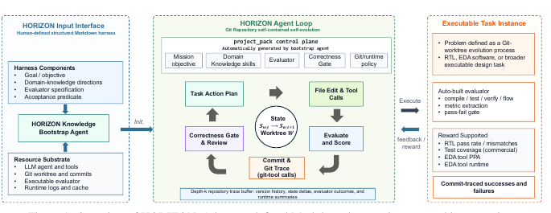
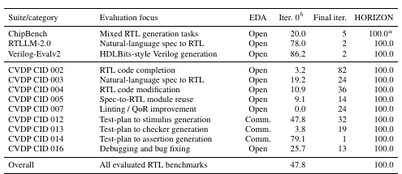
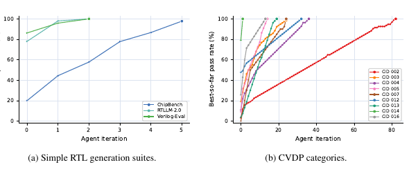
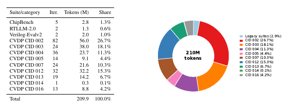
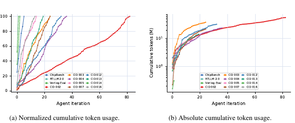
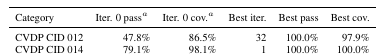
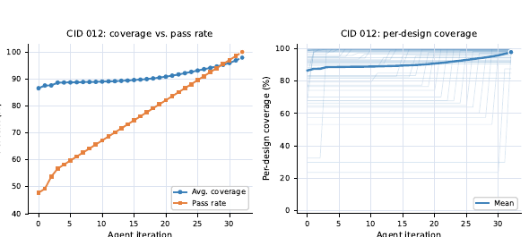

# Agentic Hardware Design as Repository-Level Code Evolution

Reader packet: [extraction and translation notes](translation_notes.md),
[source/provenance map](source_map.json), and the dated
[SR2FPGA positioning memo](sr2fpga-positioning-2026-08-12.md).

## 元数据

| 字段 | 内容 |
| --- | --- |
| 中文题名 | 将智能体硬件设计视为仓库级代码演化 |
| 作者 | Cunxi Yu, Chenhui Deng, Nathaniel Pinckney, Brucek Khailany |
| 机构 | NVIDIA Research |
| 版本 | arXiv:2606.28279v1, 26 Jun 2026 |
| 类型 | 方法/系统论文，预印本 |
| 来源版本 | arXiv:2606.28279v1（PDF 未纳入仓库） |
| 页数 | 12 |

> 阅读范围：本文按原论文全部章节、公式、图表和限制进行结构化阅读，保留关键原文—中文对照和稳定页码锚点。参考文献只保留书目信息，不逐条翻译。逐行机械翻译不是本任务目标；主目标是理解方法并支持与 SR2FPGA 的严谨比较。

## 术语表

| Canonical term | 首次定义/中文 | 源文变体 | 本文决定 |
| --- | --- | --- | --- |
| HORIZON | repository-level self-evolving agent framework；仓库级自演化智能体框架 | framework, agent loop | 始终用 HORIZON |
| structured Markdown harness | 结构化 Markdown 任务规约 | harness, input harness | 译为“结构化 Markdown harness” |
| project pack | 由 bootstrap agent 生成的任务控制包 | control plane | 保留英文并解释为“工程控制包” |
| executable evaluator | 可执行评价器 | evaluator, harness | evaluator 与 benchmark harness 按上下文区分 |
| acceptance predicate | 验收谓词/通过条件 | correctness gate, pass condition | 统一译为“验收谓词” |
| repository trace | 仓库轨迹 | git trace, trace buffer | 强调由 git 状态、diff、commit、notes 构成 |
| earliest-best iteration | 首次达到最佳结果的迭代 | convergence iteration | 不译成 Pass@1 |
| over-solving | 针对可见 evaluator 过度适配 | reward hacking | 两者相关但不完全等同 |
| CVDP | Comprehensive Verilog Design Problems | CID 002-016 | 类别编号保持原文 |

## 页面/章节索引

- pp. 1-2：摘要、引言、贡献
- pp. 2-3：背景与相关工作
- pp. 3-5：HORIZON 框架、project pack、repository trace、memory/session reuse
- pp. 5-9：实验、通过率收敛、token 消耗、coverage
- pp. 9-10：讨论与局限
- p. 10：结论
- pp. 10-12：参考文献

---

## 摘要

**Source:** p.1 S001

**Original:** We present HORIZON, a self-evolving agent framework that treats hardware design as repository-level code evolution. A Markdown harness is compiled into a project pack containing domain knowledge, an executable evaluator, an acceptance predicate, and a git/runtime policy; a hands-free agent loop then evolves an isolated git worktree, using repository operations for state management, tracing, and replay.

**中文：** 作者提出 HORIZON，把硬件设计任务重写为“仓库级代码演化”。输入的 Markdown harness 被编译成 project pack，其中固定领域知识、可执行 evaluator、验收谓词以及 git/runtime policy；之后 agent 在隔离 worktree 中自动编辑、评价、接受或拒绝版本。这里的核心创新对象不是某一种 RTL 生成模型，而是承载生成与修复过程的 repository protocol。

**Source:** p.1 S002

**Original:** We evaluate our approach on ChipBench, RTLLM, Verilog-Eval, and nine CVDP categories, achieving 100% benchmark completion across all suites with a fully hands-free agentic loop. However, we do not claim that agentic AI for hardware design is solved: these benchmarks are controlled proxies for a much broader engineering problem in chip design.

**中文：** HORIZON 在三个传统 RTL benchmark 和九个 CVDP 类别上报告最终 100% benchmark completion，但作者主动限定：这些任务只是更广泛芯片工程问题的受控代理，不能据此声称 agentic hardware design 已被解决。

## 1. Introduction

**Source:** p.1 S003

**Original:** Executable design tasks expose a limitation of single-turn code generation. A useful agent must place candidate artifacts inside a runnable workspace, invoke domain tools, interpret failures, and revise the artifacts until an explicit acceptance condition is satisfied.

**中文：** 单轮生成的关键缺陷不只是代码质量，而是缺少可执行闭环。有效 agent 必须在可运行 workspace 中放置候选工件，调用领域工具，解释失败，并持续修改直到满足明确验收条件。

**Source:** p.1 S004

**Original:** Git is not incidental bookkeeping in this design. It provides the isolated evolving environment and the trace substrate: diffs expose state changes, commits define accepted checkpoints, logs and notes store evaluator evidence, and the repository history becomes a replayable record of the agent's search.

**中文：** git 不是附属日志系统，而是演化环境和轨迹底座：diff 表示状态变化，commit 表示被接受的检查点，log/notes 保存 evaluator 证据，完整历史则是可回放的搜索记录。这是理解 HORIZON 与普通“生成—编译—修复”系统差异的关键。

**Source:** pp.1-2 S005

**Original:** This framing is broader than the benchmarks in this paper. Agentic AI for hardware design includes architecture exploration, microarchitecture, verification planning, physical-design interaction, EDA software, and methodology development; we do not claim that RTL agents are solved.

**中文：** 框架目标覆盖架构探索、微架构、验证规划、物理设计交互、EDA 软件和方法学，但本论文只实证 RTL benchmark。作者把 broader scope 明确写成 framing，而不是完成的验证。

**Source:** p.2 S006

**Original:** This paper makes three contributions. First, we introduce HORIZON ... Second, we show that this git-native self-evolution loop can sweep complete RTL benchmark suites to a 100% pass rate ... Third, we analyze the resulting traces, including token consumption and test-generation coverage.

**中文：** 三项贡献分别是：git-native repository hosting protocol；完整 benchmark sweep 的收敛结果；以及对 token 消耗和 test-generation coverage 的轨迹分析。注意贡献中没有训练新模型或证明 PPA 优化。

## 2. Background and Related Work

**Source:** p.2 S007

**Original:** RTL generation differs from ordinary code completion because the output defines hardware that must satisfy temporal and bit-accurate behavior ... A syntactically valid module is only a starting point; useful automation must connect generation to compilation, simulation, waveform or trace inspection, and repair.

**中文：** RTL 的困难来自时序、位精确行为、状态机、reset、ready-valid、memory 和 corner case。语法正确只是起点，必须接入编译、仿真、波形/trace 分析和修复。

**Source:** p.2 S008

**Original:** These approaches strengthen first-attempt accuracy but do not, by themselves, define how an agent should iterate against an executable harness.

**中文：** VeriGen、RTLCoder、ChipNeMo、OriGen、CraftRTL、ScaleRTL 主要增强 generator 或训练数据，但不能单独回答 agent 如何围绕 executable harness 迭代。HORIZON 把自己放在 generator-agnostic 外层协议位置。

**Source:** pp.2-3 S009

**Original:** HORIZON is complementary and more general: it is agnostic to the underlying generator and instead specifies how to host the entire problem as a versioned repository, organize and gate the repair loop with native git operations, and drive a whole benchmark suite to completion.

**中文：** 相对于 AutoChip、RTLFixer、VerilogCoder、MAGE 和 ACE-RTL，HORIZON 声称自己的差异不在具体 generator、planner 或 waveform tool，而在于用版本化 repository 和 native git operations 统一承载整个问题并驱动完整 suite 收敛。

**Source:** p.3 S010

**Original:** CVDP contains 783 human-authored problems across 13 task categories ... The benchmark reports 617 non-agentic and 166 agentic problems after quality filtering.

**中文：** CVDP 的价值在于任务类别较广，尤其包括 completion、modification、reuse、testbench stimulus、checker、assertion 和 debugging；其中 agentic problems 本身被封装为 mini-repositories。HORIZON 选择九个 code/verification generation 类别，而非所有 comprehension 类别。

**Source:** p.3 S011

**Original:** HORIZON carries the same repository-self-contained, evidence-gated principle to the hardware side: rather than evolving a solver or synthesis kernel, it evolves the design under test, RTL sources, testbenches, and verification artifacts.

**中文：** HORIZON 延续 AlphaEvolve、SATLUTION 和 ABCEvo 的 evidence-gated repository evolution，但演化对象从科学/EDA 软件改为 DUT、RTL、testbench 和 verification artifacts。

## 3. The HORIZON Framework

**Source:** p.3 S012

**Original:** A user provides a structured Markdown harness; a bootstrap agent compiles it into a project pack, the control plane that fixes the mission, domain skills, executable evaluator, correctness gate, and git/runtime policy.

**中文：** 输入 harness 先由 bootstrap agent 转换成 project pack。project pack 是控制平面，它固定 mission、领域技能、evaluator、correctness gate 和 git/runtime policy；真正的工作循环随后在该控制面约束下运行。

### Fig. 1. HORIZON 总体架构

**Placed near:** p.3 S012
**Source:** p.4 C001

**Original caption:** Overview of HORIZON. A human-defined Markdown harness is converted into a project pack that specifies the mission, domain skills, evaluator, correctness gate, and git/runtime policy. The resulting task is solved by a self-contained agent loop over git-traced repository states.

**中文图注：** HORIZON 总览。人定义的 Markdown harness 被转换为 project pack；agent 在 git-traced repository states 上执行计划、编辑/工具调用、评价、correctness review 和 commit，形成 depth-k trace buffer。

**Reading note:** 左侧是任务编译，中央是演化循环，右侧是 evaluator/reward。图中明确把 git worktree/commit 放在控制循环中心，而不是仅将最终 diff 另存为日志。

**Source:** p.4 S013

**Original:** The bootstrap agent converts this harness into a project pack. Let m denote the input harness. A bootstrap tool loop constructs p = G_phi(m), p = (pi_agent, E_p, A_p, Gamma_p, Omega_p).

**中文：** 公式 (1) 把 harness 编译过程形式化：`pi_agent` 是 agent policy/tool contract，`E_p` 是 evaluator，`A_p` 是验收谓词，`Gamma_p` 是版本和 artifact policy，`Omega_p` 是领域知识与仓库指令。该表示是任务控制结构，不是硬件语义 IR。

**Source:** pp.4-5 S014

**Original:** A "state" is a versioned snapshot of the repository ... and an "option" is one such episode between two checkpoints. The evaluator produces evidence y_t = E_p(w_t plus Delta_t), and the acceptance predicate determines whether the trace advances.

**中文：** 作者借用 semi-Markov 词汇仅用于给可回放对象命名，并不声称 LLM 行为满足 Markov 假设。state 是 repository snapshot 加 project pack、campaign state、logs/evidence 和允许使用的 memory；option 是两个检查点之间的一段可变长编辑/工具调用/审查过程。

**Source:** p.5 S015

**Original:** The reward can be scalar or vector-valued, for example, r_t = [Delta_pass, Delta_coverage, Delta_QoR, -tokens, -time].

**中文：** reward 可以是向量，容纳通过率、coverage、QoR、token 和时间。但本文只报告 pass、coverage、tokens，QoR 尚未进入实验结果。

**Source:** p.5 S016

**Original:** Successful commits become positive examples of repair strategies while rejected attempts are logged as negative examples ... so the repository's own history is the experience buffer rather than a separate datastore.

**中文：** 通过的 commit 是正例，拒绝 attempt 是负例，repository history 本身构成 experience buffer。论文提出这些轨迹可用于 policy analysis、reward modeling、curriculum 或 offline agent-RL，但本工作不训练/更新 policy。

**Source:** p.5 S017

**Original:** HORIZON reuses a persistent model session across iterations so that the harness, project pack, stable sources, and accumulated debugging context are served from the provider's prompt cache instead of being re-sent every turn.

**中文：** persistent session reuse 主要是成本机制：稳定上下文进入 prompt cache，每轮新增成本集中在当前 diff、最新 evaluator output 和 agent response。作者同时强调 source of truth 仍是 worktree、project pack、evaluator outputs 和 versioned trace。

## 4. Experiments

**Source:** pp.5-6 S018

**Original:** We use GPT-5.3 as the agent backbone for all experiments, fixed throughout ... all results presented in this paper are obtained in single-agent mode.

**中文：** 所有实验使用固定 GPT-5.3，单 agent。运行机器为 AMD EPYC 9334、512 GB RAM；评价器按 benchmark 调用 open-source 或 commercial EDA flow。该实验不是多 agent 消融，也不是模型训练实验。

### Table 1. 各 suite/category 的通过率与收敛轮数

**Placed near:** p.6 S019
**Source:** p.6 C002

**Original caption:** Pass rates (%) from a single HORIZON run. Final iter. denotes the iteration at which HORIZON converges. HORIZON achieves 100% completion on every suite.

**中文图注：** 单次 HORIZON run 的通过率。Final iter. 表示首次收敛到最佳结果的迭代。CID 002 最长，需要 82 轮；CID 014 只需 1 轮。

**Reading note:** ChipBench 的 100% 包含一个被作者判定为 specification-harness defect 的任务；iteration 0 是第一次 agent iteration 后的状态，不是 standalone Pass@1。

**Source:** p.6 S019

**Original:** An iteration is one automated outer step in which the agent edits the worktree, runs the evaluator, and either commits a passing version or logs a rejection; we report best-so-far pass rate.

**中文：** 一轮包含编辑、运行 evaluator、提交通过版本或记录拒绝。论文使用 best-so-far pass rate，并以首次达到最大观察通过率的轮次作为 earliest-best iteration。因此曲线反映的是 campaign 收敛，不是独立样本的静态准确率。

### Fig. 2. Best-so-far 通过率轨迹

**Placed near:** p.6 S019
**Source:** p.7 C003

**Original caption:** Earlier RTL generation suites saturate within a few iterations, while CVDP exposes longer repair trajectories and clearer differences in convergence difficulty.

**中文图注：** 传统 RTL generation suite 很快饱和，CVDP 则显示更长的 repair trajectory。CID 002 形成显著长尾，CID 013 虽初始通过率很低但近线性收敛。

**Reading note:** 这张图比最终 100% 更有研究价值，因为它暴露不同任务的修复预算与长尾结构。

### Table 2. 收敛点之前的 token 消耗

**Placed near:** p.7 S020
**Source:** p.7 C004

**Original caption:** Token consumption through the earliest-best iteration ... Cost is dominated by a few hard CVDP categories. Approximately 91% of all tokens are cached input.

**中文图注：** 首次达到最佳结果之前累计约 209.9M tokens。CID 002、003、012 占主要份额；约 91% token 为 cached input。

**Reading note:** 作者明确说这不是 normalized economic cost：没有纳入模型价格、并行和基础设施。

**Source:** pp.7-8 S020

**Original:** Benchmark completion should be reported together with token consumption ... the final few percentage points on the most difficult categories absorb a disproportionate share of the budget.

**中文：** 最终通过率必须与收敛成本共同报告。难任务的最后几个百分点消耗不成比例的预算，因此作者认为 token efficiency 比继续强调 final pass rate 更值得优化。

### Fig. 3. 累计 token 轨迹

**Placed near:** p.8 S020
**Source:** p.8 C005

**Original caption:** Cumulative token-usage trajectories, truncated at each suite's convergence point.

**中文图注：** 各 suite 到收敛点为止的累计 token 轨迹；左图归一化，右图为百万 token 的对数尺度。

**Reading note:** 应同时看绝对量和归一化曲线，避免把长 campaign 的平滑曲线误认为低成本。

### Table 3. verification-generation coverage

**Placed near:** p.8 S021
**Source:** p.8 C006

**Original caption:** Coverage summary for the CVDP verification-generation categories.

**中文图注：** CID 012 从 86.5% coverage、47.8% pass 上升到 97.9% coverage、100% pass；CID 014 的解析日志平均达到 100% coverage。

**Reading note:** CID 014 最佳 coverage 只基于成功解析 coverage 的 60 个设计，不能解释为每个设计都有完整报告。

**Source:** p.8 S021

**Original:** HORIZON's acceptance gate is the CVDP pass condition, not a coverage target ... coverage is a secondary, observational signal here.

**中文：** coverage 并非优化目标。一旦 benchmark harness 通过，循环停止，因此 100% pass 与 coverage 小于 100% 可以同时出现。论文没有证明 exhaustive verification。

### Fig. 4. CID 012 coverage 与 pass rate

**Placed near:** p.8 S021
**Source:** p.9 C007

**Original caption:** Average design coverage rises gradually from 86.5% to 97.9% while the pass rate climbs from 47.8% to 100% over the same iterations.

**中文图注：** CID 012 在 32 轮中把平均 coverage 从 86.5% 提升到 97.9%，同时 pass rate 从 47.8% 提升到 100%。改善主要来自抬升低 coverage 长尾。

**Reading note:** 图中 coverage 与 pass 同向，但不是同一指标，也不是因果证明。

## 5. Discussion and Limitations

**Source:** p.9 S022

**Original:** The results should be read as benchmark convergence under the feedback made available to the agent. Real chip projects involve incomplete specifications, changing constraints, downstream integration, human review, PPA tradeoffs, and validation targets that are not fully represented by current RTL benchmarks.

**中文：** 结果应解释为“在 agent 可见反馈条件下的 benchmark convergence”。真实工程中的不完整需求、变化约束、下游集成、人审、PPA 权衡和签核目标没有被充分表示。

**Source:** p.9 S023

**Original:** Full access to these signals can create an over-solving or reward-hacking failure mode. The agent may customize the generated RTL to match the observed failures, deterministic tests, or evaluator idiosyncrasies rather than implement the intended design semantics robustly.

**中文：** 这是论文最重要的自我限制。丰富反馈使长轨迹修复可行，也可能让 agent 对可见 failure、deterministic tests 或 evaluator 特性定制 RTL。通过可能只表示满足当前可见 harness，不表示对合理测试都满足设计语义。

**Source:** pp.9-10 S024

**Original:** Future benchmarks for agentic hardware design should consider a two-level protocol: expose useful diagnostic feedback during repair, but reserve hidden randomized tests, independent reference models, formal equivalence checks, property suites, or held-out simulator configurations for final scoring.

**中文：** 作者建议两级协议：修复期开放有用诊断，最终评分保留 hidden randomized tests、独立 reference model、formal equivalence、property suites 或 held-out simulator configurations。这一建议直接定义了下一代硬件 agent benchmark 的 verifier separation。

**Source:** p.10 S025

**Original:** Long-latency reward fundamentally changes the agentic system problem: naive edit-evaluate-repair loops become too slow, and the agent must reason under delayed, sparse, and expensive feedback.

**中文：** 本文 benchmark 的评价时间相对短，而综合、布局布线、时序、功耗或大规模 regression 可能耗时数小时到数周。延迟、稀疏且昂贵的 reward 会使朴素 edit-evaluate-repair 失效，这是从 RTL benchmark 走向真实芯片流程的核心难题。

## 6. Conclusion

**Source:** p.10 S026

**Original:** HORIZON extends the same paradigm to hardware-design artifacts themselves ... Across ChipBench, RTLLM, Verilog-Eval, and nine CVDP categories, HORIZON achieves 100% benchmark completion with a fully hands-free agentic loop.

**中文：** 结论重申：HORIZON 把 repository self-evolution 从 EDA/scientific software 延伸到 hardware artifacts，并在所选 benchmark 上实现无人闭环的最终完成。

**Source:** p.10 S027

**Original:** With correctness largely saturated on these benchmarks, the more informative signal becomes the cost of reaching that outcome.

**中文：** 当 benchmark correctness 被多轮修复推到饱和后，真正有信息量的是达到结果的成本，包括长尾 iteration、tokens、缓存和 evaluator turnaround。

**Source:** p.10 S028

**Original:** Current RTL benchmarks are controlled proxies for a much broader engineering problem and leave open important questions around reward hacking, robustness, long-horizon design planning, and deployment in production design flows.

**中文：** 论文最终没有把 100% 外推为生产可用，而是留下 reward hacking、robustness、long-horizon planning 和 production flow deployment 四类开放问题。

## 参考文献页说明

**Source:** pp.10-12 S029

**Original:** The bibliography covers repository self-evolution (AlphaEvolve, SATLUTION, ABCEvo), RTL models/data (VeriGen, RTLCoder, ChipNeMo, OriGen, CraftRTL, ScaleRTL), RTL agents (AutoChip, RTLFixer, VerilogCoder, MAGE, ACE-RTL), git-native agents (EvoGit, Git Context Controller), RTL benchmarks, and SWE-bench robustness work.

**中文：** 参考文献结构支撑了论文的定位链条：generator/data → iterative RTL agent → repository self-evolution → git-native agent substrate → benchmark leakage/hidden-test 问题。具体书目信息见原 PDF pp.10-12。

## Critical reading notes

1. **最强贡献是承载协议，不是模型。** project pack + git worktree + executable acceptance + replay trace 形成统一的 repository evolution substrate。
2. **“100%”需要与可见反馈一起解释。** 论文主动承认同一 harness 用于修复和验收可能产生 over-solving。
3. **成本曲线比最终得分更可迁移。** CID 002 的 82 轮长尾说明 agent 系统研究应关注 convergence efficiency。
4. **本文没有完成学习闭环。** 固定 GPT-5.3，没有 policy update；trace-to-training 是未来方向。
5. **本文没有完成物理闭环。** reward 公式允许 QoR，但实验没有报告 PPA；真实 physical-design turnaround 被列为限制。
6. **与 SR2FPGA 最关键的分界。** HORIZON 的 project pack 是任务控制面；SR2FPGA 的 System-HIS 应是可检查的硬件需求/项目语义契约。若 SR2FPGA 不能证明 typed contract、hidden oracle、physical evidence 和 learned model 的增益，就会退化成 HORIZON-like engineering variant。
