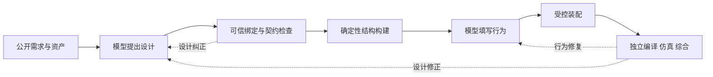

# SR2FPGA：契约驱动的 RTL 工程构建与反馈修复

**Contract-Driven RTL Project Construction and Feedback Repair: Mechanism Design and Development Validation**

中文研究初稿 v0.4 · 2026 年 10 月 26 日

本文按机制验证论文组织。第 4 节描述方法及原型，第 5 节给出尚待执行的机制对照设计，第 6 节报告已经完成的 DW→PW 开发验证。本文的研究对象涵盖结构、协议、控制与功能错误。

## 摘要

大语言模型能够根据硬件需求生成 RTL，但完整工程的正确性同时依赖接口连接、数据解释、控制推进和时序行为。将这些责任集中在自由文本生成与整工程修改中，使错误定位和修复后的回归检查面临较大负担。本文提出 SR2FPGA，一种由工程契约、确定性结构构建和反馈修复组成的 RTL 工程生成方法。方法将公开需求与模型提出的设计决策分离，通过配置级检查形成可构建的工程契约，由程序生成模块接口、实例、连接及数据布局，再由模型完成行为实现。行为包与具体构建版本绑定，结构修改和行为修改分别接受对应检查。围绕这一流程，本文建立结构、协议、控制和功能错误的机制分析框架，并设计受控错误、合法变体及同起点修复对照，以研究错误发现阶段、修复成本和新增回归。当前原型已完成一个固定 INT8 Depthwise→Pointwise 子系统的开发验证：三次外部候选调用经过一次契约格式纠错，生成包含三个 RTL 文件的工程；同一候选在两组不同输入上均通过编译、独立逐拍验证和完整通用综合，每组完成三次计算调用及复位取消检查。该案例确立了方法的可执行基础；受控行为修复与方法对照构成后续机制实验。

**关键词：** 大语言模型；RTL 工程生成；工程契约；确定性结构构建；反馈修复；机制验证

## 1 引言

RTL 工程生成要求模型同时处理多种性质不同的设计责任。端口、层次和连接决定工程能否正确展开，数据类型及布局决定数值如何被解释，状态与握手决定计算何时推进，而算法实现决定最终输出是否符合要求。一个工程即使能够编译，也可能因计数边界、复位恢复或输出有效时刻错误而产生错误结果。Ravindran 等的错误分析归纳了状态机推进、握手漂移和 RTL 赋值语义等问题，说明生成质量需要在具体硬件行为上评价。[R1](https://doi.org/10.1109/ACCESS.2026.3665894)

这些错误对生成流程提出了不同要求。接口或连接错误适合在构建前检查；停顿期间的数据变化需要协议观察；累加次数错误需要结合控制轨迹和数值参考。因而，可靠生成方法需要协调规格表达、工程构建和工具反馈，并让修改能够回到适当的设计层次。

本文研究一种明确的责任分配：模型提出设计契约并编写模块行为，程序检查可机械判定的关系并构建结构，独立工具执行行为验证。契约为各阶段提供共同的工程描述，骨架落实已经接受的结构决策，反馈修复处理剩余错误。模型仍负责卷积、矩阵乘加和控制逻辑；程序承担可由契约确定的重复结构工作。

本文采取机制验证的研究定位。核心问题是：在具有明确要求的硬件案例中，契约、结构构建和反馈修复各自作用于什么错误，组合后如何影响错误发现、纠正和回归。局部计算错误与跨模块错误均可进入研究；是否能够被静态检查直接发现，是分析维度之一。

本文提供三方面内容。首先，给出公开需求、设计契约、结构产物和行为实现之间的责任及版本关系，并实现相应检查与装配原型。其次，建立按错误类别和介入阶段组织的机制验证方案，分别检验检查能力、构建与编辑边界的联合作用，以及诊断信息的作用。最后，报告固定量化 DW→PW 工程的实际开发轨迹，提供候选文件、工具执行和独立验证的对应证据。当前结果用于回答流程是否能够执行；机制收益通过第 5 节的实验进一步检验。

## 2 相关工作与方法定位

### 2.1 可检查表示与结构构建

CPPL 通过 Python 前端声明接口和层次，让模型生成 JSON 电路表示，再检查并降低到 CIRCT。其固定版本代码还检查必需实例、位宽和执行样例，并支持反馈重试。本文采用直接 RTL 行为体，程序仅构建契约确定的结构。[R2：论文](https://arxiv.org/html/2605.17892v1)、[R2：源码](https://github.com/SawyDust1228/CPPL/blob/d7ebbb5f4036ac57a768bc362996ab05e8c39b9f/cppl/agents/worker.py#L285)

HINT 将状态、事务、控制推进和资源承诺表达为可执行硬件意图，在 RTL 前检查，再约束实现。本文的 PC 采用边界与有限关系描述，完整算法保留在 RTL 行为中，因此前置表示工作与后端验证负担的分配不同。[R3](https://arxiv.org/html/2608.07625v2)

### 2.2 规格细化与反馈修复

VeriRefine 以逐信号 ASTF 显式化规格解释，并将失败区分为理解错误和编码错误。本文同样允许返回设计层修改，但将工程结构、数据边界及构建版本作为修复的约束对象。[R4](https://arxiv.org/html/2607.18519v1)

Veri-Sure 结合设计契约、轨迹分析、依赖切片和局部补丁，代码中实际限制替换范围并进行重检与回滚。本文的编辑范围主要来自契约中的结构归属；故障切片定位可与这一范围结合。[R5：论文](https://arxiv.org/html/2601.19747v2)、[R5：源码](https://github.com/xyjoey/Veri-Sure/blob/aab5bed60f04157a4be8581b53f9e913287ba328/eda_agent/rtl_editor.py#L383)

层次 IR 工作利用架构草图、模块操作规格和多模块调试组织复杂硬件生成。本文关注同一份契约如何贯穿结构构建和后续修改，并将这种联系落实为可以干预和观察的工程过程。[R6](https://arxiv.org/html/2608.30659v1)

### 2.3 本文的研究切入点

本文把完整方法视为三个协同机制：将要求显式化，将确定结构交给程序，将修改绑定到可重新验证的工程版本。研究价值通过这些机制对具体错误的作用来评价。定向错误用于检查作用过程，合法变体用于识别过度约束，自然生成轨迹用于观察实际使用情况。近邻比较集中在表示粒度、结构责任和修复权限，外部方法的数值结果不直接作为本任务上的对照。

## 3 问题定义与错误分析框架

### 3.1 输入、输出与设计自由度

输入包括公开需求 R、目标配置 T、工具能力 K 和公开资产 A。R 包含外部接口、数学功能、数值规则、复位语义、事务协议和环境假设。权重及初始化数据属于公开资产，通过内容身份绑定。本文的开发输入由任务作者明确给出，需求歧义消解不属于当前原型。

模型输出设计 D，内容包括模块划分、内部签名、参数、显式连接及需求关联。控制程序将 D 与原始公开输入绑定为工程契约 C。最终输出 P 是多文件 RTL 工程及声明式源码清单。只要满足公开要求，内部模块可以采用不同的计算顺序、存储方案和控制实现；模型提出的设计决策可以修改，公开任务要求保持不变。

记生成、检查、构建和装配过程为：

\[
D = G_{\mathrm{design}}(R,T,K,A),\qquad C=\mathrm{Bind}(R,T,K,A,D),
\]

\[
\widehat C=\mathrm{Check}(C),\qquad B=\mathrm{Build}(\widehat C),\qquad
P=\mathrm{Compose}(B,H),
\]

其中 H 为模型生成的行为体集合。Check 的成功表示所列静态规则通过；工程行为是否满足 R，由独立验证 V(P,R) 判定。

### 3.2 错误类别与观察层次

表 1 将错误类别与适合的观察方式关联。分类根据实际违反的要求确定，可记录主类别和次类别。一次输出异常不直接等同于已确认的根因。

**表 1　机制研究中的错误分类。**

| 类别 | 代表问题 | 主要观察依据 | 方法的预期介入点 |
|---|---|---|---|
| 结构与表示 | 接口或连接错误、位序不符、参数和编码声明冲突 | 契约检查、真实解析和展开 | 前置拒绝与确定性构建 |
| 协议与时序 | 握手漂移、有效窗口错误、流水错位、事件／电平混淆 | 接受事件、逐拍稳定性和延迟约束 | 显式义务、协议反馈与行为修复 |
| 状态与控制 | 优先级、计数边界、状态阶段遗漏、复位或恢复错误 | 定向刺激、状态相关输出和完成条件 | 要求关联、控制修复与回归验证 |
| 功能与计算 | 布尔项遗漏、移位、累加、舍入或饱和错误 | 独立数值参考及边界输入 | 行为反馈与受限修改 |

分类依据需求语义而非代码外观。Moore 输出的定义是仅依赖当前状态，并不要求每个输出另设寄存器。[R7](https://docs.amd.com/r/en-US/ug958-vivado-sysgen-ref/Moore-State-Machine) 时序块中的阻塞赋值需要结合读写关系判断，不能仅凭出现赋值符号便认定功能错误。[R8](https://verilator.org/guide/latest/warnings.html#blkseq) 对 ready/valid 流，本文在握手时记录传输，在有效且停顿时要求保持数据；空闲拍数据值按任务规定处理。[R9](https://documentation-service.arm.com/static/68b03beb01ae952d9559f9eb)

### 3.3 研究问题

RQ1 关注要求表达：显式契约能够在构建前检查哪些指定错误，其诊断能否支持正确修改？RQ2 关注结构构建：相同设计决策下，程序构建与受限编辑是否减少结构错误及修复中的结构回归？RQ3 关注反馈修复：从同一失败工程出发，在相同编辑范围内关联契约义务的诊断是否提高修复完成率，或降低修复成本？这三个问题允许出现不同结果，例如结构错误减少而局部计算错误保持不变。

## 4 契约驱动的构建与修复方法

### 4.1 需求事实与设计决策分离

PC 2.1 将外部要求与模型设计分别保存。公开事实可以承担保证或环境假设的角色，例如“停顿时保持有效数据”属于实现义务，“接收方连续停顿不超过规定拍数”属于环境条件。模型将模块与相关事实关联，控制程序检查关联对象和所需覆盖。事实关联提供追踪入口，具体行为仍需由验证确认。

绑定保存公开源文件和资产的内容身份。重新加载、构建和评价时，系统检查原始输入及其解析投影是否一致。这样，设计修正可以改变内部实现选择，而不会通过改写任务描述消除原本要求。[E1]

### 4.2 配置级静态检查

检查器针对选定参数配置展开层次，检查模块引用、递归、参数取值、端口类型、驱动关系和时钟复位域。张量描述进一步包含形状、轴序、lane、尾部掩码和量化编码。两个同宽接口只有在要求的完整解释相容时才能直接连接；需要转换时，设计必须明确表达转换责任。[E2]

量化使用整数和有理数描述，避免将尺度关系依赖于浮点近似。per-axis 编码与相应轴长度关联；部分和描述记录分组和顺序语义。有限张量关系用于检查声明间的兼容性，具体转换、累加和状态推进仍在行为层实现。

这一阶段输出检查后的实例图和验证义务。实际算法、握手行为、复位恢复、完成性以及实现资源被保留为后续验证对象。静态检查的研究作用是及早识别可机械判定的矛盾，并提供具体位置与关系。

### 4.3 确定性结构构建

构建器读取检查后的设计，生成参数特化模块、端口声明、实例、显式连线和规范化源码清单。流接口的 payload 与 valid 沿数据方向连接，ready 沿反方向连接。张量 ABI 定义 lane 和掩码的位位置，使行为生成和评测使用相同的数据解释。[E3]

给定相同契约、能力配置和构建器版本，结构产物确定。程序负责这些结构关系，模型完成卷积、乘加、缓存控制和握手状态等行为。当前构建器不会自动插入未声明的缓冲、数值转换或算法实现。方法由此形成一个明确的生成边界：模型可以选择结构，但结构一旦通过检查，其机械展开由程序完成。

### 4.4 行为装配与构建身份

模型依据构建器输出的单元接口生成行为包，每个必需单元对应一个行为体。装配前检查包格式、单元覆盖以及构建身份，随后使用真实 Yosys 前端检查模块集合、签名、端口方向和宽度，拒绝额外架构实例、层次访问及对受保护输入的写入。全部单元装配后再执行整工程解析与展开。[E3]

构建身份绑定设计、公开边界、源文件身份、能力、ABI 及检查和构建代码。其作用可写为：

\[
b=\mathrm{Hash}(D,R_{\mathrm{boundary}},\mathrm{bindings},K,\mathrm{ABI},\mathrm{versions}),
\qquad H=(b,\{h_u\}).
\]

只有行为包与当前构建计划及单元集合匹配时，装配才继续。当前实现采用保守的整体身份失效：设计变化可能使所有行为单元需要重新绑定，而不是计算最小影响集合。身份绑定阻止旧包被无意复用；新包中的实际语义依然接受独立验证。

### 4.5 分层修复协议

方法区分设计修改和行为修改。设计修改用于处理声明矛盾、连接选择或不合适的模块安排，修改后重新检查和构建。行为修改针对已接受接口内的计算及控制实现，修改后重新装配和验证。两种修改都保留旧工程及其结果，使每次反馈能够对应到确切候选。

拟采用的修复流程首先读取公开诊断，确定需要改变的设计层次；随后在允许范围内产生修改，并依次完成检查、装配和独立验证。当新设计改变构建身份时，旧行为包被拒绝，模型需要提交当前构建对应的完整行为包。一个失败修改不会覆盖此前已保存的工程。

**图 1　方法流程及反馈位置。** 实线为当前原型已有的处理步骤，虚线为修复返回路径；自动诊断路由和循环调度尚待完成。

当前开发 API 已支持调用预留、设计和行为提交、重新构建、装配及公开评价，由外部操作者组织执行。完整的自动错误归因、设计／行为修复路由和预算终止循环是方法的下一实现部分。首个案例已经执行了一次 PC 格式纠正；行为失败后的修复效果由第 5 节验证。[E4]

### 4.6 独立验证与结果记录

验证依次检查工程能否编译、仿真轨迹是否符合任务、以及是否完成指定综合。数值参考与协议监测由评价侧维护，当前 DW→PW 监测器是针对任务独立编写的程序。它根据实际接受的输入计算期望输出，并检查完整事务、停顿稳定性、复位取消和完成界限。[E5]

调用在分派前预留，候选响应、构建产物和工具结果通过不可覆盖的内容记录关联。不同尝试使用独立目录。结构来源和模型行为来源分别标注，使结果能够追踪到具体文件及其构建版本。

## 5 机制验证实验设计

本节是新版研究拟采用的实验设计，尚未产生方法对照结果。实验以小规模、可解释的干预为主，先完成 DW→PW，再用 GEMM 检查不同控制结构下的适用性。

### 5.1 机制假设与观察对象

H1 假设，契约检查能够在 RTL 生成前识别指定声明错误，同时接受合法变体，并提供支持纠正的具体关系。H2 假设，确定性结构构建与受限编辑能够减少模型重复维护结构时产生的错误，并保护行为修复之外的结构。H3 假设，公开验证诊断与契约义务的关联能够帮助完成行为修复，减少同一修改引入的新错误。

每个假设同时接受正向和反向观察。错误提议应被适当发现，符合要求的替代实现应被接受；若一个机制增加前置失败或修复开销，却没有改善指定终点，则按实际结果解释其适用范围。

### 5.2 案例与受控错误

DW→PW 提供串联计算、量化、尾部通道和流控场景。GEMM 提供跨 K 组的清零、累加和结果提交场景。表 2 给出首批机制案例。错误实例从正确参考或已经通过独立验证的工程派生，修改位置及违反的公开要求在模型修复前确定。

**表 2　拟开展的机制案例。所有条目均为待执行实验。**

| 案例 | 干预内容 | 重点观察 | 合法控制 |
|---|---|---|---|
| DW→PW 声明解释 | 同位宽接口采用不相容的布局或量化声明 | 检查阶段、定位信息、设计纠正 | 相容声明及明确的合法转换设计 |
| DW→PW 握手 | 停顿时推进输出索引或提前撤销 valid | 首个违例、修复成功及重复／丢失 | 保持数据至接受的实现 |
| DW→PW 控制边界 | 少处理或多处理一个通道／输出位置 | 计数、完成和数值错误的关联 | 不同但合法的计数写法 |
| DW→PW 复位恢复 | 复位后保留待输出标记或旧帧状态 | 取消操作后是否出现旧数据 | 同步复位后重新接收完整输入 |
| 局部计算 | 移位、舍入或累加表达式错误 | 独立参考是否定位并支持修复 | 数学等价的合法行为实现 |
| GEMM 状态推进 | 每组重复清零、重复加 Bias 或提前提交 | 跨组状态及最终结果 | 正确的分组累加与单次提交 |
| 构建版本变更 | 合法修改内部设计后提交旧行为包 | 拒绝旧包、更新行为并重新通过 | 当前身份且满足新设计的行为包 |

受控错误用于确认机制能够处理指定问题，其出现次数不被解释为模型自然错误频率。真实生成中的失败按同一分类另行记录。若两个代码修改产生同一个可观察故障，应保留关联，避免将其视为独立机制。

### 5.3 对照条件

完整流程采用契约检查、确定性构建、受控装配与反馈修复。结构构建对照从同一份有效 PC 出发，让模型自由生成完整 RTL，以比较构建与编辑边界的联合作用。修复反馈对照从同一失败工程出发，在相同编辑范围内分别提供原始公开诊断和附加义务关联的诊断，以比较反馈组织的作用。少量 Direct＋Repair 工程作为系统参考，获得相同公开要求、工具和总体资源约束。

检查能力实验将已知错误提议与合法变体送入同一检查器，测量能否在构建前作出正确判定。诊断实验另外从同一被拒提议出发，保持拒绝结果、模型和纠正机会一致，分别提供简要失败信息与具体语义关系，以检验诊断对修改的帮助。这里两组的发现阶段相同，差异归于反馈信息。

如果进一步比较启用和关闭目标前置检查，则仅纳入两条路径都能合法展开、且目标检查不承担必要 ABI 计算的提议，并预先确定共同后端判据。结构无法进入后端的提议单列为拒绝机制案例。构建对照联合改变结构生成与编辑范围，其结果按联合效应解释；反馈对照固定编辑范围，只解释诊断组织的作用。

各对照在运行前固定模型、提示、检查机会和可计量的资源上限。共享规划与构建成本在独立运行视图中归入每个条件。方法对照使用统一的外部功能判据，额外的 PC 检查作为过程终点记录。不同条件的诊断丰富度和编辑权限在结果解释中保持可见。

### 5.4 指标与报告方式

主要过程指标包括错误发现阶段、定位到的公开义务、合法且非空的修改次数、修复后通过情况，以及此前通过性质的新违例。对于已知错误集合，报告检出数及总数；对于合法变体，报告接受数及总数。修复结果以预先纳入的失败工程为分母，同时保留未完成和工具异常。

成本包括模型调用、可测 token、工具执行次数和时间。协议或算术修复不能只以编译成功结束，需要通过相同的独立行为验证。小规模机制实验优先报告逐例轨迹和配对差异；重复刺激及同一候选重放用于增加行为观察，不作为独立生成样本。

### 5.5 任务扩展

GEMM 的作用是检验方法对累加状态和提交时机的处理。ArchXBench 的层次、流水和矩阵任务可作为后续公开来源，选定具体任务时核验其规格与判分；其仓库已记录 v1.5 对测试台、参考数据和评分脚本的修订。[R10](https://github.com/sureshpurini/ArchXBench/blob/main/README.md) 外部任务按实际触发的机制选择，保留原任务功能得分与新增机制观察的区别。

## 6 已完成的 DW→PW 开发验证

### 6.1 任务与工具设置

开发任务为固定 INT8 Depthwise→重量化／ReLU→Pointwise 子系统。输入形状为 N=1、H=4、W=5、Cin=3，输出通道数为 5。Depthwise 使用 3×3 SAME 互相关、步长 1、通道倍率 1；Pointwise 使用 1×1 运算。每拍包含两个 8 位 lane 和两个掩码位，共 18 位。每次完整计算接受 40 个输入拍并产生 60 个输出拍。[E6]

输入量化尺度为 1/4、零点为 −3；DW 权重尺度为 1/2，PW 权重尺度为 1/4，权重零点为 0。DW 累加后进行有符号最近偶数舍入、INT8 饱和及 ReLU，中间值零点为 2、尺度为 1/4。令 sat8 为区间 [−128,127] 的饱和，rne 为最近偶数舍入，则：

\[
a^{DW}_{h,w,c}=b^{DW}_c+\sum_{k_h,k_w}(x_{h+k_h-1,w+k_w-1,c}+3)w^{DW}_{c,k_h,k_w},
\]

\[
m_{h,w,c}=\max\{2,\operatorname{sat8}(\operatorname{rne}(a^{DW}_{h,w,c}/2)+2)\},
\]

\[
a^{PW}_{h,w,o}=b^{PW}_o+\sum_c(m_{h,w,c}-2)w^{PW}_{o,c},\qquad
y_{h,w,o}=\operatorname{sat8}(\operatorname{rne}(a^{PW}_{h,w,o}/d_o)+z_o).
\]

边界填充值采用原始整数 −3；输出除数 d 为 [4,8,2,4,8]，零点 z 为 [−5,7,−9,3,−2]，无末端激活。权重和 Bias 为公开、非退化的手工常数。硬件采用同步低有效复位，复位取消未完成工作。环境约定源端暂停和接收端对已提供有效数据的连续停顿均至多两拍，每次调用从首次输入提供至最后输出接受的界限为 2048 拍。

数学参考使用 Python 整数和有理数运算，可信 harness 根据接受事件重建输入。检查包括精确输出、尾部掩码、有效停顿保持、多个调用以及输入中途和输出停顿时的复位。工具记录为 Icarus Verilog／vvp `14.0 (devel), s20260301-220-g78750c51d-dirty`，Yosys `0.66+154`、git `23aadd92a`。本例执行完整 `synth -top` 通用综合。[E5–E8]

### 6.2 生成与纠正轨迹

实验使用外部 Codex 子 agent 作为候选生成入口，授权上限为六次候选调用，实际使用三次。需求、公开权重和接口描述进入提示，独立参考实现和评测刺激未放入提示。表 3 列出全部候选调用。[E7]

**表 3　候选生成轨迹。**

| 调用 | 输出 | 接受结果 | 对应错误或修改 |
|---|---|---|---|
| 1 | 初始 PC 设计 | 格式检查拒绝 | signature、endpoint 和 execution 表达不符合格式 |
| 2 | 纠正后的 PC | 格式与所列静态检查通过 | 根据格式诊断修正设计表达 |
| 3 | 全部行为单元 | parser 保护与工程装配通过 | 一次提交两个行为体 |

最终工程包含一个顶层结构文件和两个行为模块文件，另有规范化 manifest。结构由程序构建，行为由候选提供。该轨迹包含一次真实的 PC 格式纠正；行为首次提交后通过评价，没有执行行为失败后的修复。

### 6.3 独立执行结果

最终候选先接受公开开发套件评价，随后以相同工程字节接受另一组输入重放。两个套件采用相同调度结构和不同输入数值，结果见表 4。[E8、E9]

**表 4　同一候选在两个开发套件上的结果。**

| 指标 | 公开开发套件 | 不同输入的终止重放 |
|---|---:|---:|
| 编译 | 通过 | 通过 |
| 仿真执行 | 通过 | 通过 |
| 独立轨迹与数值核对 | 通过 | 通过 |
| 完整通用综合 | 通过 | 通过 |
| 完成计算调用 | 3 | 3 |
| 已接受输入拍 | 167 | 167 |
| 已接受输出拍 | 180 | 180 |
| 复位次数 | 3 | 3 |
| 取消的未完成调用 | 2 | 2 |
| 完整调度周期 | 5407 | 5407 |
| 单次调用 2048 拍界限 | 通过 | 通过 |

167 个输入拍包含随后被复位取消的 7+40 拍，其余 120 拍对应三次完成计算。5407 周期包含复位与取消操作，是完整调度长度。两列是同一候选的两次验证，生成样本仍为一个固定任务上的一个最终工程。

公开套件记录的编译、仿真和综合进程时间分别约为 0.198、0.184 和 6.164 秒；终止重放分别约为 0.163、0.179 和 6.207 秒。这些数值描述当前主机上的工具执行开销，不包含完整模型生成时间。Yosys 统计为 9149 个 generic cells；该数量不等同 FPGA LUT 或物理实现面积。[E8、E9]

### 6.4 原型回归与参考控制

联合开发回归记录 603 项测试通过。其后针对空闲 payload 判定的修订又完成 14 项数学／轨迹测试，该子集未包含 HDL 测试，两组存在覆盖重叠。它们用于确认软件和评价原语的行为，不构成模型生成样本。[E10]

独立手写参考通过相同 PC 构建与装配路径，完成编译、仿真和完整通用综合。参考版本曾因组合规模导致综合超时，随后将 DW 核计算改为串行 MAC，在原完成界限下通过。早期工具崩溃和超时记录保留在开发工件中，手写参考与候选结果分别记录。[E11]

### 6.5 观察与方法解释

本例展示了三项已发生的过程。首先，格式检查给出了可以用于纠正 PC 的反馈；其次，确定性构建能够把接受的契约转为真实多文件工程；最后，行为装配后的同一候选通过了包含数值、停顿和复位场景的独立验证。流程中的每一步均对应实际产物和执行记录。

开发中还发现评价器最初对 valid=0 时的 payload 施加了不必要检查。该问题在候选行为评价前修正，并将运行迁移到保留旧记录的新目录。这个案例说明，错误分类与监测器需要共同遵循公开协议；额外限制合法行为会影响生成方法的评价。

当前自然失败集中于 PC 表达格式。握手、控制和计算错误的受控修复结果尚待第 5 节实验，现有案例为这些实验提供了可运行的工程、独立参考及评价路径。

## 7 讨论

### 7.1 完整方法如何作用于不同错误

契约、结构构建和修复在不同层次发挥作用。契约可以显式表达接口、数值和事务要求，检查器处理其中可机械判断的关系。结构构建直接承担重复连线及特化工作。行为中的控制和计算错误则通过独立验证暴露，再由模型纠正。

因此，机制效果不需要表现为所有错误均由前置检查消除。结构错误减少、诊断提前、修改范围缩小和修复回归降低都是可观察结果。对于局部算术错误，研究可以检验结构责任转移后是否改善行为生成或纠正，也可以得到没有明显作用的结果。相应结论依赖对照中的实际差异。

### 7.2 表示负担与修复代价

契约为工程关系提供明确载体，也增加规划和格式处理成本。首个案例中，一次调用用于纠正 PC 格式，表明这部分开销需要计入完整方法。保守的整体行为失效易于实现和审计，但可能增加设计修改后的输出量。后续可在保持版本正确性的条件下研究更精确的依赖分析，并与当前策略比较成本。

完整自动修复控制器还需将错误来源、允许修改和剩余预算连接起来。其实施重点是让模型获得具体诊断，并确保每次接受的修改重新满足对应义务。研究评价应同时检查修复成功与修复后的新增错误。

### 7.3 当前证据范围

本稿的实测部分覆盖一个固定开发任务及一个候选，输入重放用于增加同工程的行为观察。候选调用数是外部子 agent 分派次数；provider 精确模型版本、内部轮次、token 和生成 seed 未被独立记录。首响应由主机保值转录并规范化空白，后两份候选文件保留原字节。

候选与开发侧共享主机工具，提示未包含独立参考和刺激，但 collaboration API 没有强制候选文件系统隔离。运行因此按开发诊断记录，不承担正式留出或等预算方法比较的证据角色。后续对照需要可核验的模型计量和候选访问隔离。此次 Yosys 结果验证通用综合，FPGA 映射、时序收敛和板级执行尚未评价。

### 7.4 机制验证的下一步

优先工作是在现有 DW→PW 路径中加入握手、控制边界和局部计算的受控失败，补齐分层修复执行，并进行同起点比较。随后引入 GEMM 的分组状态案例，观察相同机制是否适用于不同控制结构。论文以逐例作用链和工程结果为主线，规模扩展由机制观察所揭示的问题决定。

## 8 结论

本文提出以工程契约贯穿 RTL 结构构建、行为装配和反馈修复的方法，并将结构、协议、控制与功能错误纳入统一的机制研究框架。当前原型完成配置级检查、确定性结构生成、真实 parser 保护及独立行为验证，在固定 DW→PW 任务上形成了包含一次 PC 格式纠正的开发闭环。一个最终候选在两组不同输入下通过编译、逐拍功能检查和完整通用综合。该结果建立了继续开展受控错误和修复对照的工程基础；后续实验将检验各机制对错误发现、修复完成及成本的具体作用。

## 数据、代码与写作说明

本文结果对应本地仓库中的原始候选、工具记录和回归报告，入口列于附录 A。当前未声明已完成外部数据或代码发布。手写参考、受信构建代码及模型行为分开保存，历史运行保持原记录。

Codex 用于工程开发协助、文献核查和本稿撰写；实验中的候选角色及可观测调用范围见第 6、7 节。本稿写作使用 Scientific Agent Skills 的 scientific-writing 流程辅助组织证据与检查引用。[R11](https://doi.org/10.48550/arXiv.2609.00065) 作者署名、单位、贡献及资助声明由作者在后续定稿时填写。

## 参考文献

**R1.** Arun Ravindran, Aditya Patra, Vahid Babaey, and Suresh Purini. “A Critical Review and Evaluation of LLMs for RTL Generation.” *IEEE Access*, 14: 28522–28539, 2026. [DOI: 10.1109/ACCESS.2026.3665894](https://doi.org/10.1109/ACCESS.2026.3665894). 错误分析见 §IV.C；[作者预印本](https://www.preprints.org/manuscript/202509.1681) 的题名为 *Survey and Benchmarking of Large Language Models for RTL Code Generation: Techniques and Open Challenges*，相关内容见 §4.3–4.4。

**R2.** Shuo Yin et al. “CPPL: A Circuit Prompt Programming Language.” arXiv:2605.17892v1, 2026. [论文](https://arxiv.org/html/2605.17892v1). 实现核查使用 commit `d7ebbb5f4036ac57a768bc362996ab05e8c39b9f` 的 [worker.py](https://github.com/SawyDust1228/CPPL/blob/d7ebbb5f4036ac57a768bc362996ab05e8c39b9f/cppl/agents/worker.py)，重点为候选检查、实例装配和修复分支。

**R3.** Tairan Cheng et al. “HINT: Toward an Executable Hardware-Intent Representation Layer for LLM-Driven RTL Generation.” arXiv:2608.07625v2, 2026. [论文，§3–4](https://arxiv.org/html/2608.07625v2).

**R4.** Xiangfei Kong, Tasnim Tabassum, Marwan Abdelwahab, and Hao Zheng. “A Progressive Approach to Synthesizable RTL Design Generation Using LLMs.” arXiv:2607.18519v1, 2026. [论文，§3](https://arxiv.org/html/2607.18519v1).

**R5.** Jiale Liu, Taiyu Zhou, and Tianqi Jiang. “Veri-Sure: Multi-Agent RTL Code Generation with Temporal Tracing, Slicing and Formal Verification.” arXiv:2601.19747v2, 2026. [论文，§3](https://arxiv.org/html/2601.19747v2). 实现核查使用 commit `aab5bed60f04157a4be8581b53f9e913287ba328` 的 [contract_linter.py](https://github.com/xyjoey/Veri-Sure/blob/aab5bed60f04157a4be8581b53f9e913287ba328/eda_agent/contract_linter.py) 与 [rtl_editor.py](https://github.com/xyjoey/Veri-Sure/blob/aab5bed60f04157a4be8581b53f9e913287ba328/eda_agent/rtl_editor.py#L383)。

**R6.** Chenyang Yin et al. “LLM-based Hardware Development with Hierarchical IRs and End-to-End Multi-Agent Workflow.” arXiv:2608.30659v1, 2026. [论文，§2–3](https://arxiv.org/html/2608.30659v1).

**R7.** AMD. “Moore State Machine.” *Vivado Design Suite Reference Guide: Model-Based DSP Design Using System Generator*, UG958, 2020.2. [官方文档](https://docs.amd.com/r/en-US/ug958-vivado-sysgen-ref/Moore-State-Machine).

**R8.** Verilator contributors. “Errors and Warnings: BLKSEQ.” [官方文档](https://verilator.org/guide/latest/warnings.html#blkseq)，访问于 2026-10-26。

**R9.** Arm. *AMBA AXI Protocol Specification*, §A2.3, Valid-Ready Transport. [官方文档](https://documentation-service.arm.com/static/68b03beb01ae952d9559f9eb)，访问于 2026-10-26。用于引用握手原则；本开发接口未声明实现完整 AXI。

**R10.** ArchXBench authors. *ArchXBench*, repository README, v1.5 release notes. [作者仓库](https://github.com/sureshpurini/ArchXBench/blob/main/README.md)，访问于 2026-10-26。本稿仅引用任务来源及修订说明，尚未使用其任务产生结果。

**R11.** Timothy Kassis, Vinayak Agarwal, Yuhuan He, Darshil Patel, and Aubrey M. Brueckner. “Scientific Agent Skills: A Library of Procedural Knowledge for Research Agents.” arXiv:2609.00065, 2026. [DOI](https://doi.org/10.48550/arXiv.2609.00065). 用于写作工具说明。

## 附录 A　本稿证据索引

本附录供本地审阅使用。文献题名、版本、作者及所引用内容由 Codex 于 2026-10-26 对照原文或官方来源核查，尚未记录作者逐项复核签认。下列 E 编号复用现有源码、运行记录和测试报告，不建立新的实验分母。

| 证据编号 | 事实或方法 | 原始入口 |
|---|---|---|
| E1 | 公开源加载及绑定，正文 §4.1 | [context.py](../../../agent/src/sr2fpga_agent/pc/context.py#L37)、[inputs.py](../../../agent/src/sr2fpga_agent/pc/inputs.py) |
| E2 | 声明检查与保留行为义务，正文 §4.2 | [checker.py](../../../agent/src/sr2fpga_agent/pc/checker.py#L61)、[tensors.py](../../../agent/src/sr2fpga_agent/pc/tensors.py) |
| E3 | 确定性结构、ABI、身份绑定及 parser 保护，正文 §4.3–4.4 | [emitter.py](../../../agent/src/sr2fpga_agent/pc/emitter.py#L136)、[abi.py](../../../agent/src/sr2fpga_agent/pc/abi.py)、[相关测试](../../../agent/tests/test_sr2fpga_pc21_emitter.py#L115) |
| E4 | 开发会话与调用、评价原语，正文 §4.5–4.6 | [development.py](../../../agent/src/sr2fpga_agent/pc/development.py#L146) |
| E5 | 独立数值参考和逐拍监测 | [oracle.py](../../../agent/src/sr2fpga_agent/tasks/ai_dw_pw/oracle.py)、[harness.py](../../../agent/src/sr2fpga_agent/tasks/ai_dw_pw/harness.py) |
| E6 | 固定任务、量化及环境条件，正文 §6.1 | [task.py](../../../agent/src/sr2fpga_agent/tasks/ai_dw_pw/task.py#L72)、[运行时公开需求](../../../artifacts/paper1-ai/dw-pw-candidate-20261026-02/public/requirements.json) |
| E7 | 三次调用、一次格式纠正及响应身份，表 3 | [原始调用事件](../../../artifacts/paper1-ai/dw-pw-candidate-20261026-01/store/refs/events/dw-pw)、[接受 PC](../../../artifacts/paper1-ai/dw-pw-candidate-20261026-02/call-02-design.json)、[行为包](../../../artifacts/paper1-ai/dw-pw-candidate-20261026-02/call-03-behavior.json) |
| E8 | 公开评价状态、计数、工具和综合统计，表 4 | [原始结果](../../../artifacts/paper1-ai/dw-pw-candidate-20261026-02/attempts/call-03/public-evaluation/result.json)、[工具记录目录](../../../artifacts/paper1-ai/dw-pw-candidate-20261026-02/attempts/call-03/public-evaluation) |
| E9 | 同工程不同输入重放，表 4 | [原始结果](../../../artifacts/paper1-ai/dw-pw-candidate-20261026-02/attempts/call-03/terminal-evaluation/result.json)、[归档事件](../../../artifacts/paper1-ai/dw-pw-candidate-20261026-02/store/refs/events/dw-pw)、[工程清单](../../../artifacts/paper1-ai/dw-pw-candidate-20261026-02/attempts/call-03/project/manifest.json) |
| E10 | 603 项联合回归及后续 14 项专项检查，正文 §6.4 | [联合 XML](../../../artifacts/paper1-ai/validation-20261026/combined-final.xml)、[专项 XML](../../../artifacts/paper1-ai/validation-20261026/idle-payload-fix-01.xml) |
| E11 | 手写参考完整验证与开发历史 | [参考原始结果](../../../artifacts/paper1-ai/dw-pw-reference-20261026-04/attempts/reference/public-evaluation/result.json)、[任务开发记录](../../../agent/src/sr2fpga_agent/tasks/ai_dw_pw/README.md) |

候选源文件的归档身份以运行事件为准；本稿撰写时仓库分支为 `codex/paper1-ai`，HEAD 为 `e20dfd2ce46c5690767e30cb629fb5c58aff073a`，工作树含未提交实现，不能仅凭 HEAD 重建运行。原始源码快照保存在对应运行的 ArtifactStore 中。

## 附录 B　版本与后续补充位置

本稿沿用 v0.4 标记以便与既有 v0.3 初稿区分，主线调整为“契约＋骨架＋修复”的机制设计与验证。既有边界责任审计和路线 B 的测试台研究不作为本文结果。本文采用 2026-10-26 讨论确定的机制研究定位；第 5 节是对实验方案的拟议收敛，尚未替换仓库 paper1-v2.2 的正式执行配置，也不追溯改变既有结果身份。

后续正文主要补充三处：在 §4.5 更新修复控制器的实际实现；在 §6 增加表 2 对应的受控错误、合法控制和配对修复结果；在 §7 据结果讨论适用范围和成本。GEMM 完成后作为第二工程案例加入 §6。本文已有方法、开发案例和完整讨论，不预填尚未执行的成功率或改善幅度。
